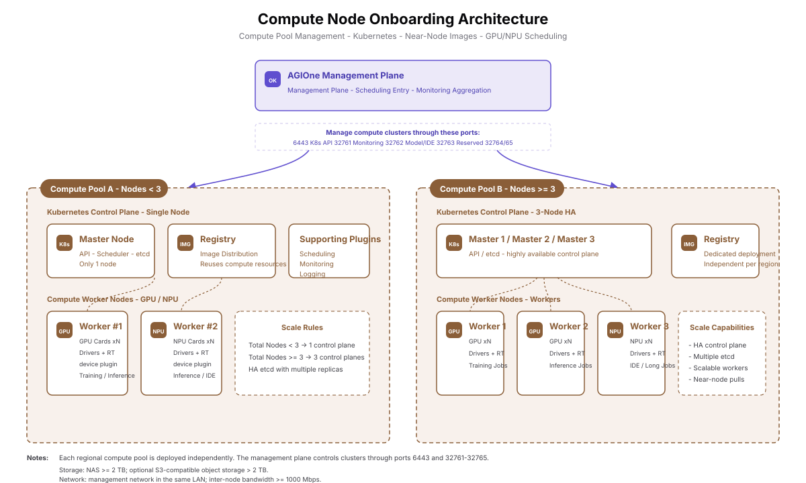

# Deployment Guide

## Introduction

Use this guide to request deployment resources and define acceptance criteria. **For new deployments, [install AGIOne using ClusterD](./clusterd-agione-best-practices).** The command-line guides remain available for existing deployments. Do not apply their node roles, disk requirements, or middleware settings to ClusterD.

## Reading Path

| Stage | Decision | What to prepare |
| --- | --- | --- |
| 1. Choose a topology | How many AGIOne nodes do you need? Must services remain available if a node fails? | Select single-node, primary/standby, or enterprise high availability |
| 2. Request resources | Will ClusterD share a host with AGIOne? What disks do the target nodes have? | Inventory the hosts, disks, and available capacity |
| 3. Plan access and package sources | How will installers, nodes, and users connect? Will installation be online or offline? | Record SSH settings, networks, endpoints, certificates, and release packages |
| 4. Install and verify | Are you installing the platform, onboarding compute nodes, or configuring an installed platform? | Open the corresponding guide below |

## Terminology Quick Reference

| Term | Meaning |
| --- | --- |
| ClusterD control host | Runs the deployment wizard and stores tasks and release assets; it can share a machine with an AGIOne target node |
| AGIOne target node | Runs platform services and their Kubernetes and middleware components; only these machines count toward the deployment topology |
| Compute node | Provides GPU or NPU capacity; compute onboarding is a separate process and does not count toward the AGIOne topology |
| Data root | Common location for persistent AGIOne data, `/var/lib/agione/local-path` by default; the directory name alone does not identify the underlying disk |
| Precheck | Evaluates the chosen release, nodes, topology, and services; meeting per-node minimums does not mean the topology is deployable |

## 1. Overview

Installing the AGIOne platform and onboarding compute nodes are separate tasks. Prepare and verify their resources separately.

| Task | When to use it | Guide |
| --- | --- | --- |
| Install AGIOne | You need a new platform or console | [Install AGIOne](./clusterd-agione-best-practices); if the control host is not ready, see [Install, Upgrade, and Uninstall ClusterD](./clusterd/) first |
| Onboard compute nodes | You need GPUs or NPUs for training, inference, or IDE workloads | [Prepare for Compute Onboarding](./deployment-requirements-for-managing-compute-nodes) → [Install Compute Nodes](./quick-install-with-agione-clusterd) |
| Configure after deployment | You have installed the platform and are preparing it for use | [Operation Edition](./post-deployment/operation-edition) or [Enterprise Internal Edition](./post-deployment/enterprise-internal-edition) |

## 2. Choose an AGIOne Topology

Public cloud, private cloud, and IDC describe **where your hosts run**. Single-node, primary/standby, and enterprise high availability describe **how ClusterD deploys AGIOne**. Running on public cloud does not require a managed database or automatically provide high availability.

| Wizard topology | AGIOne target nodes | Use and limitations |
| --- | --- | --- |
| All in One (single node) | 1 | PoC, demo, or functional testing. Platform services and middleware share one machine; a host failure affects the entire deployment. |
| Primary/standby | 2 | For deployments that need a standby database and can accept controlled manual failover. The control plane is still a single point of failure; this is not full-stack HA. |
| Enterprise high availability | At least 3 | For production deployments that need to limit the impact of a node failure. The current deployment plan uses three control-plane nodes for 3–4 targets and five for 5 or more; confirm in the wizard preview. |

Availability also depends on failure domains, remaining capacity, storage, ingress, and failover. Verify service availability after a node failure on the release being delivered rather than promising availability based on node count alone.

## 3. Plan Host Resources

| Check | ClusterD control host | AGIOne target nodes (each) |
| --- | --- | --- |
| OS and architecture | Ubuntu 22.04; select a published ClusterD package for the control host's x86_64 or ARM64 architecture | Ubuntu 22.04; use the same CPU architecture across the cluster and obtain matching deployment assets |
| CPU / memory | Allow headroom for the control service, extraction, and asset processing. Include the target-node workload when sharing a host. | For production delivery, request **16 vCPUs / 32 GiB** per target node; the selected services and replicas must still pass scheduling capacity checks. |
| System and release storage | Budget for the downloaded archive, extracted files, ClusterD data, and offline assets | Reserve space for the OS, system logs, and temporary deployment files separately from AGIOne data |
| AGIOne data storage | Not needed on a control-only host; required if it also serves as a target node | At least **160 GiB** per node for a standard fresh install: total capacity for an empty device, or free capacity for an existing filesystem |
| Access | Installing ClusterD requires root or sudo | Prepare each node's unique name, private IP, SSH port, account, and authentication method. The account must be able to elevate privileges as required for installation. |

**Production request baseline: 16 vCPUs / 32 GiB per target node.** Precheck also evaluates CPU, memory, and Pod scheduling capacity for the selected topology and service replicas. Allow room for data growth, request load, and failover. The [single-node offline installation example](./clusterd-agione-best-practices) uses this baseline together with a 100 GiB system disk and a 200 GiB dedicated empty disk; the actual delivery must still pass the release-specific precheck.

## 4. Plan Storage

### 4.1 AGIOne Node Storage

| Option | What to prepare | What to watch for |
| --- | --- | --- |
| Initialize a dedicated empty disk | An eligible whole disk on each node with at least **160 GiB total capacity** | Not a partition or the system disk. It must have no existing data, partitions, filesystem, or mount. Check each device before authorizing initialization. |
| Reuse an existing filesystem | An eligible mounted filesystem on each node with at least **160 GiB free**, and a dedicated directory for AGIOne | For example, reuse a data disk mounted at `/data`. Do not initialize it as an empty disk or assess it using only its advertised capacity. |
| Log storage | Plan either local archiving or NFS shared archiving separately | Selecting a data disk does not move logs automatically. For NFS, confirm the archive node can mount and write to the export. |

Prefer storage separate from the system disk. On a shared host, budget separately for ClusterD and AGIOne data. Verify the actual mount source after installation.

### 4.2 ClusterD Control Host Space

For a standard offline deployment, precheck evaluates the **filesystem containing the ClusterD data directory**. It requires at least **4 GiB free** for one or two target nodes, or **12 GiB free** for three or more. These are free-space floors, **not** a system disk sizing recommendation. Budget separately for downloads, extracted files, and assets already on disk. The default data directory is `/var/lib/agione-clusterd`; use the configured path if different.

## 5. Choose Release Assets and Middleware

- **Offline installation**: Obtain the offline assets and matching manifest for the target architecture and release. For a disconnected environment, transfer the package, trusted SHA-256 checksum, and system dependencies ahead of time. Use [Install AGIOne](./clusterd-agione-best-practices) to verify the outer archive and internal files, then confirm that offline assets are ready in the wizard.
- **Online installation**: First verify release-source connectivity and availability of assets for the target architecture in the wizard. Browser internet access does not prove that the control host or target nodes can fetch the assets.
- **Middleware**: The recommended ClusterD path deploys middleware supplied with the release according to the selected topology. It does not require Alibaba Cloud or Huawei Cloud managed services. The On-Cloud service group is not a managed middleware option. Do not treat a reachable external database or another replacement product as a supported configuration.

For legacy deployments, see the [command-line compatibility reference](#_5-1-2-databases-and-middleware). It does not apply to ClusterD.

## 6. Plan Networks and Access

| Direction | Protocol / port | What to prepare |
| --- | --- | --- |
| Installer → ClusterD | TCP `18093` (default HTTP) | Allow access only from trusted operations networks |
| ClusterD → AGIOne target nodes | SSH TCP `22` by default, or the configured port | Verify private connectivity from the control host, directly or through the configured bastion |
| AGIOne nodes ↔ AGIOne nodes | Internal cluster traffic for the selected release and topology | Plan private routing and firewall rules. Do not expose middleware or internal Kubernetes ports publicly. |
| Users → AGIOne | HTTPS TCP `18090` by default; HTTP TCP `18091` only when enabled | Allow the configured listener and use the URL on the deployment details page. If production uses a domain or external load balancer, verify DNS, TLS, and health checks separately. |
| AGIOne → compute cluster | Kubernetes API and configured compute service ports | Open only when onboarding compute nodes. See [Prepare for Compute Onboarding](./deployment-requirements-for-managing-compute-nodes). |

Keep Pod and Service CIDRs separate from node, VPC, VPN, and other existing networks. The NodePort range is a cluster setting, not an AGIOne user-facing access port. For online installation, verify the required outbound access. Offline installation does not require opening public access just because the nodes have no internet connection.

## 7. Compute Node Onboarding

### 7.1 Design Principles

- Each independent **regional compute pool** is deployed as a logical unit to avoid network jitter caused by cross-region scheduling.
- Each regional compute pool deploys an **image service** close to compute nodes and can reuse already-onboarded node resources.
- Deploy a Kubernetes cluster and supporting plugins for scheduling, monitoring, and related capabilities.

### 7.2 Kubernetes Control Plane Scale

Node requirements:

| Total Compute Pool Nodes | Kubernetes Control Plane Nodes | Description |
|---|---|---|
| < 3 nodes | **1 node** | Single control plane, suitable for small compute pools |
| >= 3 nodes | **3 nodes** | Highly available control plane with multiple etcd replicas |

Storage requirements:

- At least 2 TB NAS storage is required.
- Optional: S3-compatible object storage larger than 2 TB is supported.

Network requirements:

- The management network must be in the same LAN.
- Inter-node network bandwidth must be >= 1000 Mbps.
- Optional internet access: all nodes can access the internet.

### 7.3 Architecture Diagram

### 7.4 Externally Exposed Ports

Each compute cluster exposes the following ports to the management plane through NodePort:

| Port | Purpose |
|---|---|
| 6443 | Kubernetes API Server |
| 32761 | Monitoring interface |
| 32762 | Model and IDE invocation port |
| 32763 | Reserved extension port |
| 32764 | Reserved extension port |
| 32765 | Reserved extension port |

### 7.5 Deployment Notes

- Compute nodes should have GPU / NPU drivers, container runtime such as containerd, and the corresponding device plugin installed and validated in advance.
- The image service should be located in the same Layer 2 or low-latency network as the compute nodes to accelerate pulling large model images.
- For multi-region deployment, each region should maintain an independent near-node image service to avoid cross-region image pulls.

## 8. Pre-Deployment Checklist

- [ ] Choose the AGIOne topology and node count. Record each machine's architecture, OS, CPU, memory, and SSH settings.
- [ ] Budget separately for ClusterD downloads, extraction, data, and offline precheck space, and for AGIOne data on each target node.
- [ ] Decide whether each node uses an empty disk or an existing filesystem. Do not initialize a disk that holds data.
- [ ] Verify SSH from the control host, private connectivity between nodes, time synchronization, and non-overlapping Pod and Service networks.
- [ ] Confirm online or offline release assets for the target architecture. Obtain the trusted checksum for offline delivery.
- [ ] Plan the AGIOne entry point, DNS, TLS certificates, and log storage. If onboarding compute nodes, check their drivers, networking, and storage separately.
- [ ] Run precheck with the actual deployment settings. Resolve technical blockers and rerun precheck with those settings before installing.

When ready, continue to [Install AGIOne](./clusterd-agione-best-practices).

## Appendix: Command-Line Compatibility Reference (Being Phased Out)

This matrix applies only to existing deployments using `./agione install`. It does not define what ClusterD supports.

### Databases and Middleware {#_5-1-2-databases-and-middleware}

Generic managed middleware baseline requirements:

| Component | Purpose | CPU | Memory | Disk | Nodes | Network Requirement |
|---|---|---|---|---|---|---|
| **RDS (MySQL-family relational database)** | Stores primary AGIOne platform data | >= 4 vCPU | >= 16 GiB | >= 100 GiB | Follow the verified product shape | Same VPC as management nodes |
| **Nacos** | Service registration and discovery | Basic specification | - | - | 1 | Same VPC as management nodes |
| **Redis (cache)** | Caches data | Basic specification | - | - | 1 | Same VPC as management nodes |
| **Kafka (messaging)** | Core service message bus | Cluster node specification | - | >= 100 GiB | >= 3 | Same VPC as management nodes |
| **Object storage** | Stores images and other static resources | - | - | - | - | Network access via AK/SK |
| **Entry load balancing (project acceptance)** | AGIOne API load balancing | - | - | - | 1 | Private connectivity to management nodes; public access, >= 100 Mbps |

This matrix records the cloud middleware combinations tested with the command-line installer. Before purchasing resources, also confirm available specifications, availability zones, billing mode, and account permissions in the customer's target region.

> **Hard compatibility boundary**: The database layer supports only the MySQL protocol and SQL ecosystem, but that does not certify every MySQL-compatible database. Current validation covers only Alibaba Cloud RDS MariaDB `10.3` and Huawei Cloud RDS MariaDB `10.11` listed below. Other standard MySQL versions, other MariaDB versions, and Dameng (DM), Kingbase, GaussDB, openGauss, OceanBase (including MySQL-compatible mode), TiDB, PostgreSQL, Oracle, and SQL Server are unsupported. Any unlisted cloud provider, product, version, instance shape, or access protocol is **unsupported** until the same version completes end-to-end compatibility testing and this matrix is updated. Port reachability or a successful login alone is not compatibility evidence.

**Alibaba Cloud Managed Middleware List**

| AGIOne Component | Verified Alibaba Cloud Product | Verified Version / Shape | Required Delivery Constraints | Support Status |
|---|---|---|---|---|
| Database | ApsaraDB RDS for MariaDB | MariaDB `10.3`; High-availability edition; `cloud_essd`; tested class `mariadb.n2.small.2c` | Use a VPC internal endpoint; allow only App nodes in security groups / allowlists; the initialization account needs database, table, schema-change, and read/write permissions | Supported only for this baseline |
| Redis | Tair / ApsaraDB for Redis | Redis `5.0`; `Local` standard primary/replica; tested class `redis.master.small.default` | Use a VPC internal endpoint and add App nodes to the allowlist. Redis `4.0`, `6.0`, `7.0`, cluster editions, and other product shapes are outside the current support scope | Supported only for this baseline |
| Nacos | Microservices Engine (MSE) Nacos | Nacos `2.0` (`NACOS_2_0_0`); `mse_dev`; tested shape `MSE_SC_1_2_60_c`, one instance | Use the native Nacos API; the runtime account must be able to publish configuration and manage services in namespace `agione-prod`; other versions, Professional edition, or different instance counts require new testing | Supported only for this baseline |
| Kafka | ApsaraMQ for Kafka | Service version `2.2.0`; Normal edition; `alikafka.hw.2xlarge`; 3 brokers; VPC `PLAINTEXT` | Use the VPC advertised brokers returned by the service; enable broker-side automatic topic creation and create required consumer groups. SASL / SSL, other versions, and Serverless shapes are outside the current support scope | Supported only for this baseline |
| Object storage | Object Storage Service (OSS) | Cloud service with no separate engine version; Standard private bucket; internal S3-compatible endpoint | Use virtual-host-style access; prohibit public writes; grant runtime credentials only the required upload, download, list, and delete actions for the target bucket / prefix | Supported only for this access mode |

> **Alibaba Cloud permission focus**: When the optional cloud-resource helper creates resources, its account / RAM role must be able to create and query the selected products, manage allowlists, and authorize required service-linked roles. Keep this cloud-resource identity separate from the database, Redis, Nacos, Kafka, and OSS runtime credentials. The main installer consumes only final endpoints, ports, and least-privilege runtime credentials; do not store cloud-account AK/SK in the main installation YAML. Do not start formal installation while RAM policy propagation, a service-linked role, or an endpoint allowlist is incomplete.

**Huawei Cloud Managed Middleware List**

| AGIOne Component | Verified Huawei Cloud Product | Verified Version / Shape | Required Delivery Constraints | Support Status |
|---|---|---|---|---|
| Database | RDS for MariaDB | MariaDB `10.11`; tested as a single instance with `CLOUDSSD`, class `mariadb.n1.large.2` | Use a VPC internal endpoint; allow only App nodes through the security group; grant schema-initialization permissions. Primary/standby HA has not completed same-version end-to-end regression | Supported only for the tested single-instance baseline |
| Redis | Distributed Cache Service (DCS) for Redis | Redis `7.0`; single-node shape; tested class `redis.single.au1.large.1`, 1 GiB | Use a VPC internal endpoint with password and access policy. Primary/standby, Cluster, and other Redis versions have not completed end-to-end regression | Supported only for the tested single-node baseline |
| Nacos | Cloud Service Engine (CSE) Nacos | Nacos2 service version `2.1.0.24`; shape `cse.nacos2.c1.large.10`; RBAC | Use the native Nacos API; the runtime account must have namespace and config-publish permissions for `agione-prod`; other CSE versions / shapes are outside the support scope | Supported only for this baseline |
| Kafka | Distributed Message Service (DMS) for Kafka | Kafka `2.7`; 3 brokers; product `s6.2u4g.cluster.small`; 300 GiB general storage; `PLAINTEXT` | Use private bootstrap and advertised brokers. Other versions, SASL / SSL, or different product shapes require new compatibility testing | Supported only for this baseline |
| Object storage | Object Storage Service (OBS) | Cloud service with no separate engine version; private bucket | Use virtual-host-style access and least-privilege AK/SK or temporary authorization; avoid public read/write | Supported only for this access mode |

> **Entry-service boundary**: Alibaba Cloud ALB, MSE Cloud-native Gateway, and Huawei Cloud ELB are not part of the current end-to-end managed-middleware compatibility matrix. Before use, the project must accept HTTPS, health checks, sessions, upload size, and long-lived connections; treat these services as unsupported until that acceptance is complete. A generic TCP load balancer cannot replace Kafka advertised broker addresses.
