# Install AGIOne

## Introduction

This guide walks through a single-node offline installation using the ClusterD wizard on an Ubuntu 22.04 x86_64 host. Multi-node deployments use the same wizard, but require separate topology, storage, and scheduling capacity checks. Read the [Deployment Guide](./agione-deployment-requirements) before requesting hosts.

**Where should you start?**

| Your situation | Start here |
| --- | --- |
| You have not chosen hosts or disks | Read [2. Prerequisites](#_2-prerequisites) and [3. Network Configuration](#_3-network-configuration) |
| ClusterD is not installed | Start with [4.1 Obtain and Verify the Package](#_4-1-obtain-and-verify-the-package) |
| ClusterD is ready | Go to [4.3 Create an Account and Open the Wizard](#_4-3-create-an-account-and-open-the-wizard); sign in directly if you already have an account |
| A target node already has a mounted data disk | Choose [Reuse an Existing Filesystem](#reuse-existing-filesystem) when adding the node; do not authorize disk initialization |

To learn about ClusterD or maintain it later, see [What Is ClusterD?](./clusterd-overview) and [Install, Upgrade, and Uninstall](./clusterd/).

## Deployment Timeline

| Stage | Action | Continue when |
| --- | --- | --- |
| 1. Plan | Confirm architecture, node count, disks, SSH, and access addresses | Target inventory and network plan are agreed |
| 2. Install ClusterD | Download, verify twice, install, and check the web page | Service is `active` and the web page opens |
| 3. Initialize | Create a ClusterD account and open AGIOne Deployment → Deployment Wizard | The topology selection page appears |
| 4. Complete the wizard | Topology → Basic → Network → Nodes → Services | Required fields are complete and every node has a valid probe result |
| 5. Precheck and confirm | Fix blockers, acknowledge individual risks, and review destructive scope | Precheck passes for the current inputs and targets are correct |
| 6. Install and accept | Wait for the task; check nodes, services, access, and account | Installation and runtime verification pass; business login is checked separately |
| 7. Finish | Record the handover; clean up test resources only when needed | Cleanup scope matches actual resource state |

## Terminology Quick Reference

| Term | Plain-language explanation |
| --- | --- |
| ClusterD control host | Runs the installation web page and stores tasks and deployment resources; it is not the AGIOne business service itself |
| Target node | Runs Kubernetes, middleware, and AGIOne; it may be the same machine as the ClusterD control host |
| Topology | How services are distributed across machines and what failures the arrangement can tolerate |
| Bundle / Manifest | A Bundle contains deployment resources; its Manifest describes versions, files, and digests. Use a matching pair |
| CPU architecture | `x86_64` and `arm64` are different processor architectures. Programs and images must match the target architecture |
| CIDR | A network range such as `10.68.0.0/16`; Service and Pod ranges must not conflict with nodes or existing networks |
| NodePort | Kubernetes service ports reserved on nodes; not the ClusterD login port or the console HTTPS port |
| Dedicated empty disk | A whole disk without partitions, a filesystem, mounts, or existing data; initialization requires explicit authorization |
| Existing filesystem reuse | Uses a dedicated directory on an already mounted filesystem, such as `/data/agione`, without formatting the whole disk |
| PVC / PV | An application's persistent-storage claim and its backing storage resource; healthy Pods alone do not prove correct disk placement |
| NAS / NFS | Network-shared storage; log sharing here uses NFS, not SMB/CIFS |
| Runtime verified | Actual node and service state has been checked, beyond a successful installer exit |

## 1. About This Guide

| Item | Example scope |
| --- | --- |
| Installation method | ClusterD and AGIOne share one machine. The All in One deployment uses offline assets for the target architecture. |
| Verified installation | An x86_64 full package. See the relevant steps for the tested hardware, package checksum, and results. This does not validate every release or topology. |
| Multiple nodes and other scenarios | Select primary/standby or enterprise high availability in the wizard and enter each node individually. Validate ARM64, online installation, NAS, and existing-filesystem reuse against the release being delivered. |

::: warning Confirm the host and data disk first
The example initializes `/dev/vdb` only after installation confirmation. **Do not copy this device name.** Never treat a disk with an existing filesystem, mount, partition, or business data as an empty device. [Reuse its filesystem](#reuse-existing-filesystem) or prepare a separate empty disk.
:::

## 2. Prerequisites

Target nodes need Ubuntu 22.04, a common CPU architecture, working SSH, and privilege elevation. A standard fresh install requires at least **8 vCPUs, 12 GiB of memory, and 160 GiB of data storage per node**; for a mounted filesystem, check free space rather than advertised capacity. Budget for ClusterD control-host storage separately; see the [Deployment Guide](./agione-deployment-requirements). The selected topology must still pass scheduling capacity precheck.

### 2.1 Example Host and Access Plan

| Item | Example value or resource | What to confirm |
| --- | --- | --- |
| OS and architecture | Ubuntu 22.04.5 LTS, `x86_64` | A fresh host; architecture matches the package and resources |
| CPU / memory | 16 vCPU / 32 GiB | This is the tested size, not a universal capacity guarantee for every topology or workload |
| System disk | 100 GiB | Space for the OS, archive, extracted files, ClusterD resources, and temporary files; do not budget only for archive size |
| AGIOne data disk | 200 GiB whole disk `/dev/vdb` | Empty before installation; select the actual device returned by probing |
| Node name / private IP | `node-1` / `10.10.0.11` | All addresses here are examples. Replace them with real, unique, routable addresses |
| ClusterD web page | `http://<ClusterD-IP>:18093/` | Restrict access to trusted operations sources, not an unrestricted public network |
| AGIOne web page | HTTPS `18090` | Separate from the ClusterD port; client routing, firewall, security groups, and DNS must agree |
| SSH | `22`, password or public-key authentication | ClusterD can reach each target; targets have the required private-network connectivity |

The reference deployment was validated on a Huawei Cloud host. Physical hosts can use the same separation of responsibilities. Cloud provisioning, VPCs, security groups, and AK/SK management are outside the deployment wizard. Never enter cloud access keys as SSH passwords, ClusterD passwords, or AGIOne account credentials.

### 2.2 Separate Program Directories from the Data Disk

| Path | Location | Purpose |
| --- | --- | --- |
| `/opt/clusterd-packages` | ClusterD control host | Downloaded packages and extracted directories, not the runtime data root |
| `/opt/agione-clusterd` | ClusterD control host | ClusterD program and bundled execution engine |
| `/etc/agione-clusterd` | ClusterD control host | ClusterD configuration; private-key files are placed under the site's controlled policy |
| `/var/lib/agione-clusterd` | ClusterD control host | Accounts, task records, cache, and offline resources |
| `/var/lib/agione/local-path` | Each AGIOne target node | AGIOne persistent-storage root; the dedicated-disk mode mounts the selected disk here |
| `/var/lib/agione/local-path/runtime` | AGIOne target node | Application runtime root derived from the storage plan, not another ClusterD program directory |

**Same-host deployment still uses SSH to the host's actual node address.** Do not enter the installation operator's computer's `127.0.0.1` as the target. Installing ClusterD does not automatically place AGIOne on a data disk: select and verify storage separately in the wizard.

### 2.3 Single Node, Multiple Nodes, and Architectures

- This example uses one node. For multiple nodes, prepare SSH information and an independent storage probe for every node; install ClusterD on the control host only once.
- Select the ClusterD package for the **control host's architecture**. Select the wizard's CPU architecture for the **AGIOne targets**. Nodes in one AGIOne cluster should use the same architecture.
- Obtain a genuinely published ARM64 package and its matching digest for an ARM64 host. Do not merely replace `x86_64` in this URL or reuse its digest.
- A control-host/target cross-architecture combination needs complete target-architecture resources. It is not included in this example's live acceptance. See [Deployment Overview](./agione-deployment-requirements) for production sizing and availability planning.

## 3. Network Configuration

Confirm that installers can reach ClusterD (TCP `18093` by default), ClusterD can reach every target node over SSH, and nodes can reach each other privately. Plan non-overlapping Pod and Service networks and verify that users can reach AGIOne (HTTPS `18090` by default). Enter the values in [4.6 Plan Networking, Console Access, and Logs](#wizard-network).

## 4. Product Installation

### 4.1 Obtain and Verify the Package

The package and commands for this example follow. Installation, upgrade, and removal for other releases are in [Install, Upgrade, and Uninstall](./clusterd/).

**ClusterD release download page:**

[Open the AGIOne and ClusterD release download page]({{DOCS_RELEASE_PAGE_URL_EN}})

The page provides the current ClusterD light and full packages and the matching SHA-256 files. The live validation used the x86_64 full package `agione-clusterd-full-release-2026.11.14-dev19-r4-linux-x86_64.tar.gz`.

**SHA-256 of this archive:**

```text
51c07623488f10b2364474c6adcac64246b1e7735dacd3b184acf36c2a4956a2
```

This is the release used in the live example, not an assertion that it is the approved production release for every environment. Use the agreed release and acceptance scope for formal delivery. When changing packages, replace the URL, filename, and trusted digest together.

Run these commands on the **ClusterD control host**. For an air-gapped host, transfer the same archive using delivery media or `scp`, skip `curl`, and retain both verification steps.

```bash
sudo -i
bash
set -e
mkdir -p /opt/clusterd-packages
cd /opt/clusterd-packages

CLUSTERD_PACKAGE_NAME="<DOWNLOADED_PACKAGE_FILENAME.tar.gz>"
# Copy the package URL and matching SHA-256 value from the release download page.
CLUSTERD_PACKAGE_URL="<CLUSTERD_PACKAGE_URL_FROM_DOWNLOAD_PAGE>"
CLUSTERD_PACKAGE_SHA256="<TRUSTED_OUTER_ARCHIVE_SHA256>"

curl --fail --location --output "$CLUSTERD_PACKAGE_NAME" "$CLUSTERD_PACKAGE_URL"
printf '%s  %s\n' "$CLUSTERD_PACKAGE_SHA256" "$CLUSTERD_PACKAGE_NAME" | sha256sum -c -
tar -xzf "$CLUSTERD_PACKAGE_NAME"
cd "${CLUSTERD_PACKAGE_NAME%.tar.gz}"
bash verify.sh
```

**Continue when:** the archive reports `OK` and the entire `verify.sh` command exits successfully. SHA-256 is not MD5. A digest calculated from the newly downloaded file is not its trusted reference. Stop on any failure, check release and integrity, and never edit manifests to bypass verification.

### 4.2 Install and Open ClusterD

This step starts the installation web page; it does not deploy AGIOne yet. Initial verification still needs system `python3`; the full package's embedded Python cannot replace it. See [ClusterD Installation, Upgrade, and Uninstallation](./clusterd/) for prerequisites, architecture checks, and complete upgrade/removal instructions.

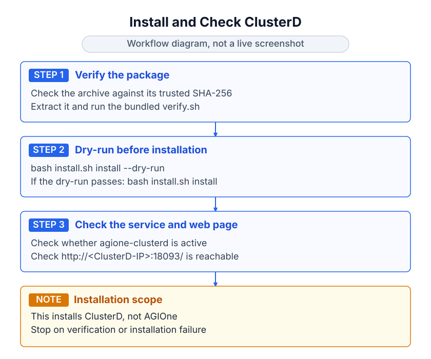

Continue in the extracted directory, in the same root Bash. Store the complete log outside that directory so package contents remain unchanged.

```bash
bash install.sh install --dry-run
CLUSTERD_INSTALL_LOG=/var/log/agione-clusterd-install.log
if bash install.sh install > "$CLUSTERD_INSTALL_LOG" 2>&1; then
  tail -n 20 "$CLUSTERD_INSTALL_LOG"
else
  tail -n 100 "$CLUSTERD_INSTALL_LOG"
  false
fi
systemctl is-active agione-clusterd
curl --fail --silent --show-error --output /dev/null \
  --write-out 'HTTP %{http_code}\n' http://127.0.0.1:18093/
```

**Success:** dry-run passes, installation reports `agione-clusterd-install-ok`, the service is `active`, and the web page returns `HTTP 200`. Open `http://<ClusterD-IP>:18093/`. **Failure:** inspect the log first. If local access works but remote access fails, check listening address, routing, and security groups instead of reinstalling. Processing a multi-GB full package can take time; wait for the current command to finish.

### 4.3 Create an Account and Open the Wizard

First access creates a **ClusterD login account**, not the target host's SSH account or the AGIOne account supplied after deployment.

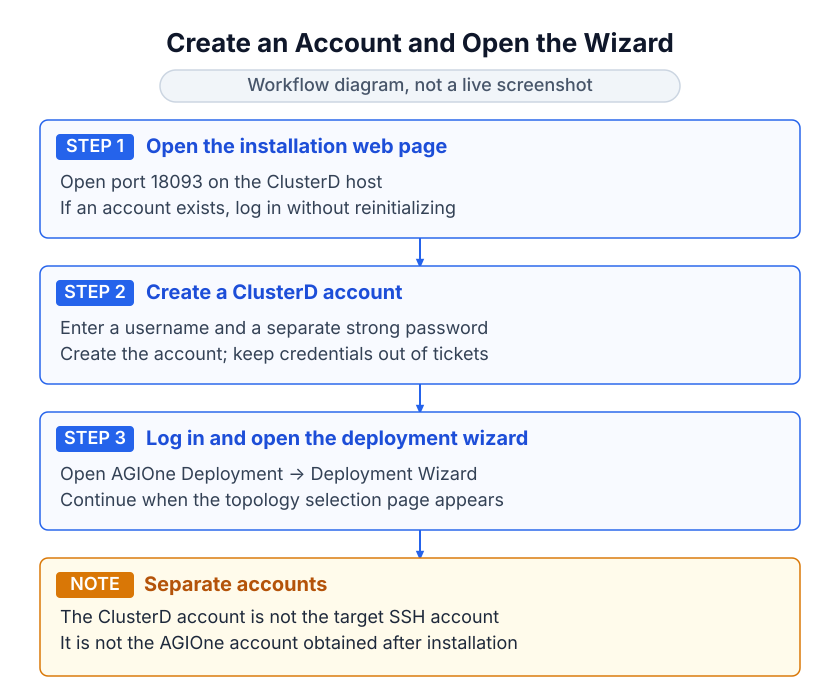

| Field or action | Example | Meaning and requirement |
| --- | --- | --- |
| Username | `deploy-user` | ClusterD login name; follow the site's account naming policy |
| Password | Enter a separate strong password in the page | Do not reuse SSH passwords or put it in documentation, command history, or tickets. Follow the current page's length validation |
| Create account | Click on first initialization | Creates the ClusterD login account, not an AGIOne cluster |
| Login | Click on subsequent visits | Use the same ClusterD username and password already created |

After login, open **AGIOne Deployment → Deployment Wizard**. The topology page should appear. If you remain on the login page, inspect the error and account inputs; do not reinitialize an existing instance.

### 4.4 Select a Topology

This step determines how many hosts form the cluster. **For this example, select `All in One` and configure one node.**

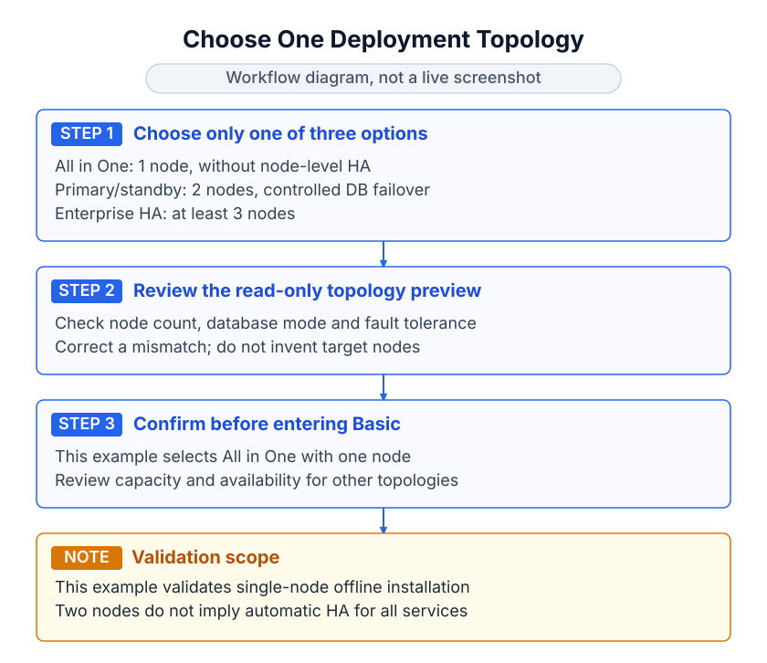

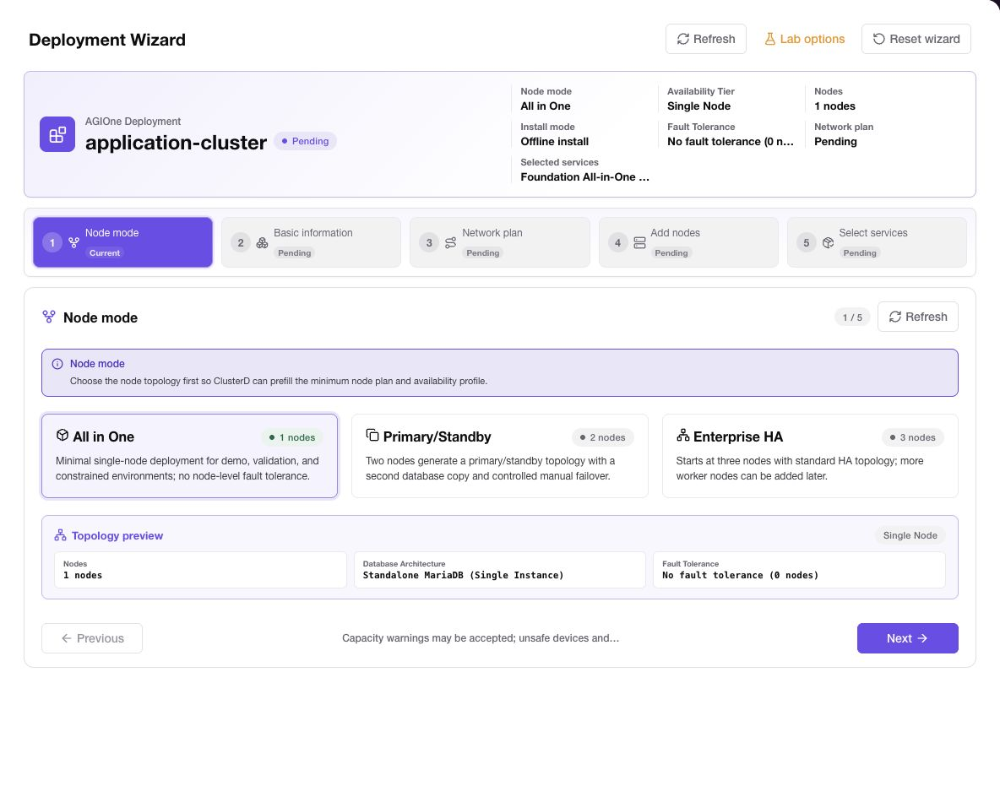

| Choice | Node count | Meaning and selection advice |
| --- | --- | --- |
| All in One | 1 | Foundation and business services on one host; a host failure affects the whole installation, without node-level high availability |
| Primary / standby | 2 | Generates a primary/standby database topology; failover is controlled, not automatic high availability for all services |
| Enterprise high availability | At least 3 | Uses the corresponding HA topology; failure domains, quorum, capacity, and network connectivity still need planning |

Node count, database architecture, availability, and fault tolerance are **read-only derived results**, not additional editable fields. Check the preview and click Next. If a one-node plan shows several core nodes, correct the topology instead of inventing extra hosts.

### 4.5 Enter Basic Information and Select Resources

Specify what will be deployed and which resources it uses. **This example selects Offline install and x86_64, retaining the derived runtime root.**

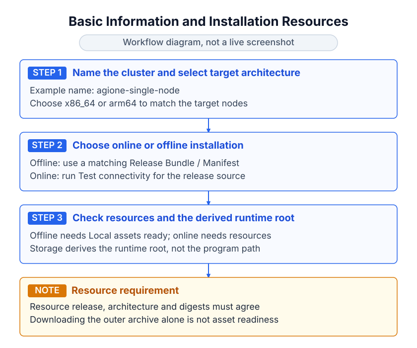

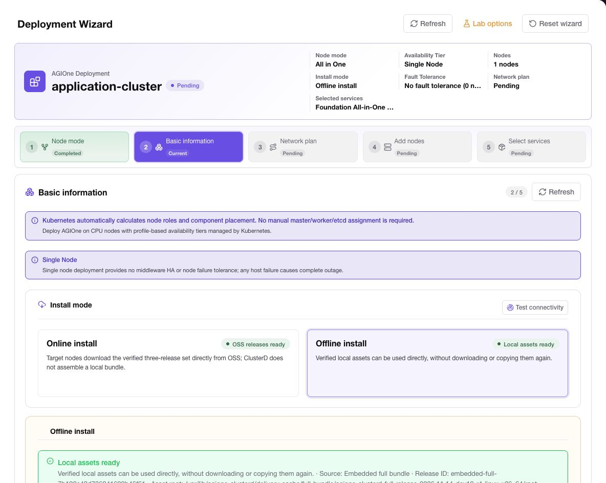

| Field or status | Example / common value | Meaning, condition, and action |
| --- | --- | --- |
| Install mode | `Offline install` | Offline uses verified local assets on the control host; online uses resources from the configured release source, not merely any internet connection |
| Test connectivity | Click before online installation | Checks source configuration and target-architecture Release availability. Do not force online mode while checking or when resources are unavailable |
| Offline resource status | Wait for `Local assets ready` | Read-only; check version, architecture, source, and integrity result. Stop and repair resources if not ready |
| Bundle / Manifest | Obtain the matching pair for one Release when resources are needed | Bundle contains assets and Manifest describes files and digests. One missing file, mixed versions, or renamed files do not form a valid release |
| Offline resource directory | Default `/var/lib/agione-clusterd/offline-bundles` | Follow the displayed directory and import instructions; copying an arbitrary extracted directory is not proof of import |
| Cluster name | `application-cluster` | Identifies this deployment; change it under the site's naming policy if needed. Use it for later confirmation and cleanup |
| Description | `Single-node offline deployment` | Optional purpose/environment information, never passwords or cloud keys |
| Architecture | `x86_64`; choose `arm64` for ARM targets | Must match every target node and its resources, not the computer running the browser |
| Application runtime root | `/var/lib/agione/local-path/runtime` | Read-only, derived from storage selection. Do not enter the ClusterD installation path |

**Online branch:** after connectivity testing passes, ensure both the control host and target execution nodes can reach the required resource addresses. Fix unconfigured sources, missing Releases, or signature/digest failures first. Online installation does not require opening every inbound port.

**Offline branch:** a full package normally contains resources matching its own architecture; prepare system dependencies for air-gapped hosts too. Continue only when the resource card reports readiness. Downloading the outer archive alone is not proof of ready installation assets. Complete the fields and click Next.

### 4.6 Plan Networking, Console Access, and Logs {#wizard-network}

#### Kubernetes Networks

Avoid network conflicts first, then choose how users connect. These ranges illustrate a plan, not values every site should copy unchanged.

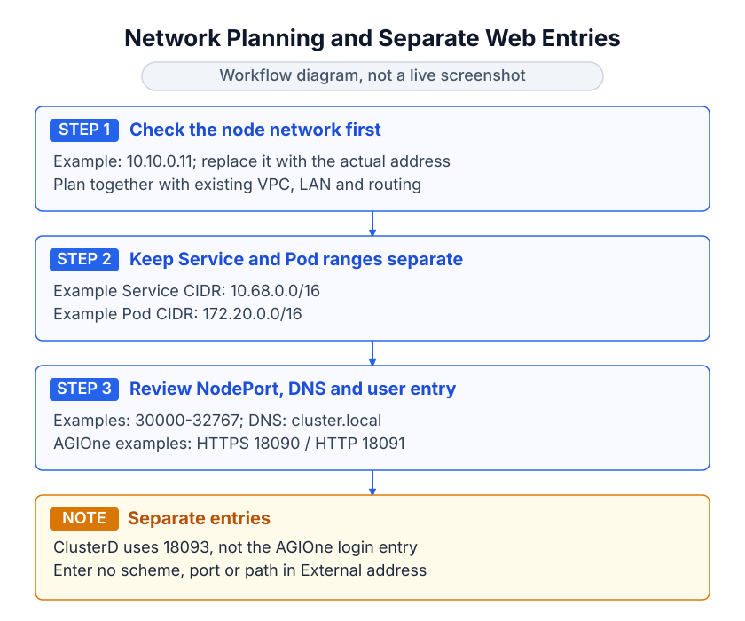

| Field | Example | Meaning and requirement |
| --- | --- | --- |
| Service CIDR | `10.68.0.0/16` | Virtual service addresses; valid IPv4 CIDR, without overlap with Pods, node networks, VPCs, or enterprise networks |
| Cluster / Pod CIDR | `172.20.0.0/16` | Pod addresses; plan separately from Service and existing networks |
| NodePort range | `30000-32767` | Use `start-end`; current validation requires `30080`, `30443`, `30500`, and `30889`, with at least 128 ports in the range |
| Max pods | `110` | Maximum schedulable Pods per node; current page range is 16–250. Raising it does not add CPU or memory |
| DNS domain | `cluster.local` | Internal service-discovery domain; usually retain the default unless site DNS planning requires another valid value |
| External address | Leave empty for internal use, or `agione.example.com` | User-reachable node/entry IP or DNS hostname, without `https://`, port, or path. Configure DNS resolution separately |

#### Console Protocol, Ports, and Certificate

| Field | Example selection / value | Meaning and condition |
| --- | --- | --- |
| Console protocol | `HTTPS` | HTTPS, HTTP, or HTTP + HTTPS; prefer HTTPS for formal delivery |
| HTTP port | `18091` | Only for HTTP or dual-protocol mode. Use an available port in 1–65535, outside reserved SSH/Kubernetes ports and the NodePort range |
| HTTPS port | `18090` | Only for HTTPS or dual-protocol mode. Keep separate from HTTP and ClusterD ports; align security groups and the access address |
| Insecure HTTP acknowledgment | Appears when HTTP is enabled | HTTP can expose passwords and tokens in transit; understand and explicitly acknowledge the risk. Dual protocol does not imply automatic HTTP-to-HTTPS redirection |
| HTTPS certificate file | Site certificate `.pem` / `.crt` / `.cer` | Upload with its matching private key; the certificate must cover the actual hostname/IP |
| HTTPS private-key file | Matching `.pem` / `.key` | Must match the certificate. Never place it in Git, chat, or public object storage |
| Certificate name | Derived from filename | Identifies the certificate; it is not an input for pasting private-key contents |

This example uses an installer-generated self-signed certificate rather than an uploaded production certificate. If the browser does not trust it, configure a trusted certificate or have site operations confirm the trust policy. Bypassing a certificate warning is not production acceptance. Correct invalid port or certificate errors before continuing.

#### Logging Policy

Logging is a separate area in the Network step. **This example enables logging with local persistence.** Check its actual location independently; selecting an application data disk does not place every possible log path on it.

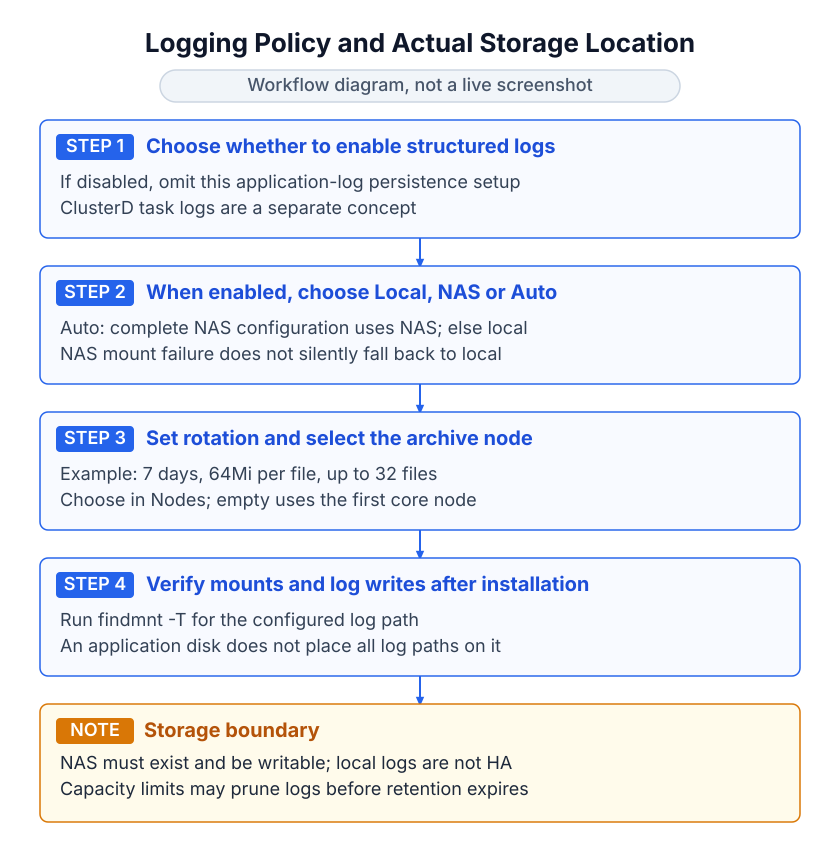

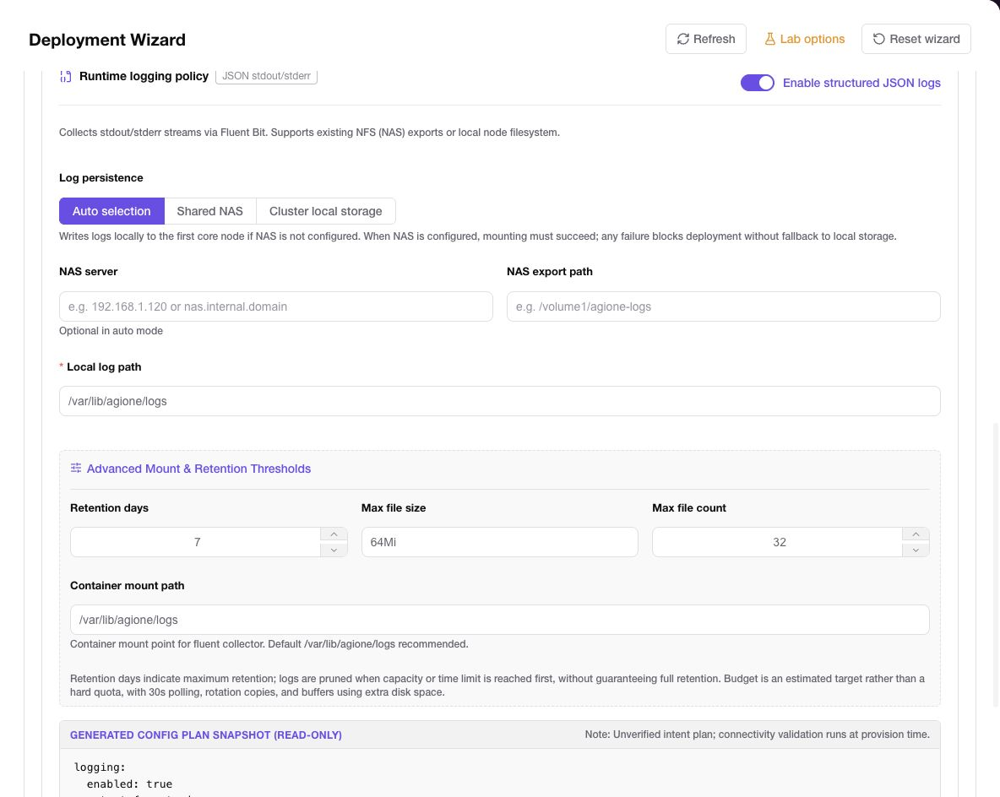

| Field | Example | Meaning and condition |
| --- | --- | --- |
| Enable structured JSON logs | Enabled | Collects container stdout/stderr with Kubernetes metadata. Disabling it omits this application-log persistence configuration; ClusterD task logs are a separate concept |
| Persistence mode | Auto / NAS / Cluster local storage | Auto uses local archiving without NAS configuration and NAS with a complete NAS configuration. A failed NAS mount does not silently fall back to local |
| NAS server | `10.10.0.120` or `nas.example.com` | Required for NAS mode. Enter hostname/IP without `nfs://` or `http://` |
| NAS export directory | `/volume1/agione-logs` | Required for NAS mode; an existing exported absolute path writable by the archive node. In Auto, fill both NAS fields or leave both empty |
| Local log directory | `/var/lib/agione/logs`, or a planned `/var/lib/agione/local-path/logs` | A safe absolute path for local archiving. To use the data disk, select a dedicated path on it and verify the mount; do not use `/` or sensitive system directories |
| Local archive node | Leave empty or select `node-1` in the Nodes step | Empty uses the first core node. In multi-node deployments, confirm which node actually stores logs; it does not create a copy on every node |
| Retention days | `7` | 1–365 days; capacity limits may cause earlier removal, so the full period is not guaranteed |
| Maximum file size | `64Mi` | Rotation file size, using `Ki`, `Mi`, or `Gi`; do not enter unitless `64` |
| Maximum file count | `32` | 1–100 rotation files, combined with time retention; not a whole-cluster disk quota |
| Container mount path | `/var/lib/agione/logs` | Advanced Auto/NAS setting inside the log collector, not a host mountpoint. Hidden in local mode |

Provision NAS beforehand. The archive node needs an NFS client, network access, and write permission to the export; ClusterD does not create NAS. Local logs are not cross-node HA storage. The preview is **planned configuration**, not evidence that NAS is writable or logs are persisted. Review it and click Next.

### 4.7 Add Nodes and Select Storage

#### SSH Connection Fields

Tell ClusterD how to reach the actual target host. **The example uses one `node-1`, the host's actual private IP, and no bastion. Enter authentication material locally, not in this document.**

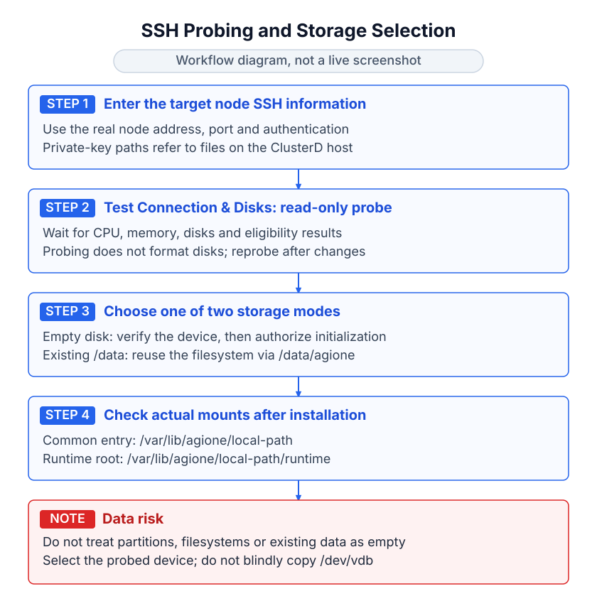

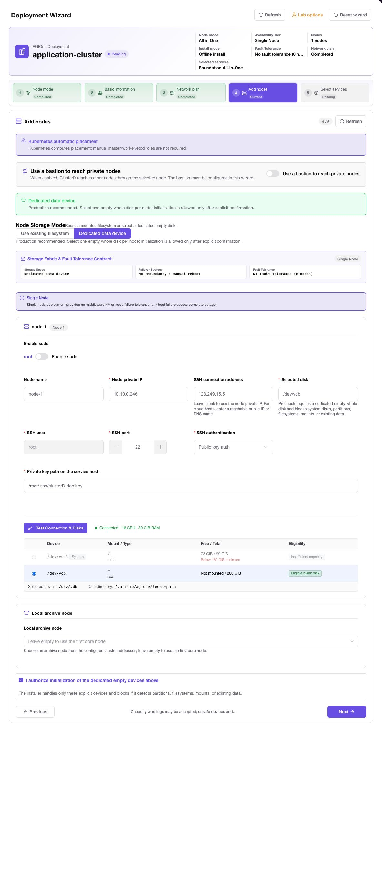

| Field | Example / selection | Meaning and requirement |
| --- | --- | --- |
| Access private nodes through a bastion | Disabled here | Disabled means direct SSH; enabled routes other private nodes through the selected node on this page |
| Bastion node | Select a configured node when enabled | Not an arbitrary text address; the current bastion path requires matching SSH user, port, and authentication material for routed nodes |
| Node name | `node-1` | Stable, unique wizard identifier; not an IP or a replacement for the actual hostname |
| Node private IP | `10.10.0.11` | Unique, routable address for Kubernetes topology and inter-node communication, not the browser computer's loopback address |
| SSH connection address | Empty or a reachable target IP/DNS | Actual SSH destination from the control host; empty uses private IP. It may differ if private routing is unavailable |
| Enable sudo | Follow site policy | Disabled uses root SSH; enabled uses a non-root SSH user with sudo privileges |
| SSH user | `root`, or the actual sudo user | Do not keep root when sudo mode is enabled; the target must permit the required escalation |
| SSH port | `22` | Target SSH listener, 1–65535; security groups, routing, and bastion path must allow it |
| SSH authentication | Password or public key | Select what the host actually supports; cloud AK/SK are not SSH credentials |
| SSH password | Enter in the page; no example value here | Only for password authentication. Do not reveal it while taking screenshots |
| SSH private-key path | `/etc/agione-clusterd/keys/deploy-key` | Required for public-key authentication. The file is on the **ClusterD control host**, not the browser computer or target node. Restrict file permissions, for example `0600` |
| sudo password | Enter if needed, or leave empty | Only in sudo mode. Empty falls back to the SSH password for password auth; with public-key auth, the target must permit passwordless sudo |

#### Example: Initialize a Dedicated Empty Disk

1. Select **Dedicated data device**.
2. Complete node connection information and click **Test Connection & Disks**. This probe is read-only; it does not format disks.
3. Wait for CPU, memory, and the disk table. Select the actual eligible whole disk, such as `/dev/vdb`, not partition `/dev/vdb1`.
4. Check the displayed data directory `/var/lib/agione/local-path` and runtime root `/var/lib/agione/local-path/runtime`.
5. Only after confirming the device is correct and has no data, acknowledge **initialization of the dedicated empty devices**. The checkbox authorizes initialization; actual initialization occurs during installation.

| Storage field or table column | How to read or fill it |
| --- | --- |
| Storage mode | Choose empty-disk initialization or existing-filesystem reuse; these have different safety requirements |
| Selected disk | `/dev/vdb` in this example; choose separately per node, not a directory or URL |
| Device | Actual block device; system disks and partitions are not dedicated empty disks |
| Mount / Type | An empty disk must be unmounted with no filesystem or child partitions. `raw` is one display form; use the eligibility result |
| Free / Total | Mounted filesystems show free/total; unmounted disks show “Not mounted / total,” not zero free space |
| Eligibility | Must be eligible for the current mode or show a blocking reason. The current regular capacity requirement is 160 GiB; total size is not the same as free capacity |
| Data directory | Read-only selection result; reuse mode may display the source path. This does not replace actual mount verification |
| Initialization acknowledgment | Dedicated-disk mode only; authorizes the explicitly listed devices, not every disk on the machine |

Fix SSH, permissions, or disk state if probing fails. Reprobe after changing addresses, credentials, mode, or device; do not reuse stale results. Partitions, existing filesystems, mounts, signatures, or other non-empty conditions block empty-disk installation. Do not erase disks, run `mkfs`, or alter probe results to pass the check.

#### Reuse an Existing Filesystem {#reuse-existing-filesystem}

If the disk is already mounted at `/data`, select **Existing filesystem**, run the probe, and choose the eligible mounted filesystem. The page normally derives a dedicated source directory `/data/agione`, later bind-mounted to the common `/var/lib/agione/local-path` entry. It does not format the entire `/data` disk.

- Do not put an existing ext4/xfs `/dev/vdb` into empty-disk mode.
- Check writability, free capacity, filesystem UUID, and directory ownership. Do not assume an existing non-empty directory will be migrated or overwritten automatically.
- Without choosing another mounted filesystem, the default location may still use the system disk. A shared system-storage failure domain requires explicit risk acknowledgment; selecting reuse alone does not guarantee data-disk placement.
- Probe and select independently on every node. Current probe and precheck results determine whether reuse is allowed.

#### Multiple Nodes and the Archive Node

Fill every node required by the topology with a distinct address. Changing topology may change core nodes, database mode, and capacity requirements, so review every node and precheck again. When logging is enabled, select the archive node in this step or leave it empty to use the first core node. Continue to Services only after connectivity and storage information are correct.

### 4.8 Review Services and Run Precheck

Confirm the delivered service combination. This step is **not an editor for arbitrary middleware versions or passwords**.

| Service card / preview | Current meaning |
| --- | --- |
| Foundation All-in-One | Required foundation group for this example, including MariaDB, ProxySQL, Redis, Nacos, Kafka, RustFS, and components delivered by the current catalog |
| On-Prem | Required local-site business service group |
| On-Cloud | Required cloud-side business service group; does not automatically provision cloud hosts or managed middleware |
| ISync | Not delivered in the current installer; shows a technical-block/unavailable explanation and cannot be forced on |
| CPU, memory, Pod capacity | Planning or probe summary; “not collected” is neither zero capacity nor a passed capacity check |
| Ingress, database, Redis / Kafka | Read-only topology-derived service/port previews, not authorization for public middleware access |
| Logging intent | The policy entered earlier, not evidence of actual log writes |

Use component identities from this release's catalog. Do not infer that untested databases or managed middleware are interchangeable. Review the cards and click **Run precheck**.

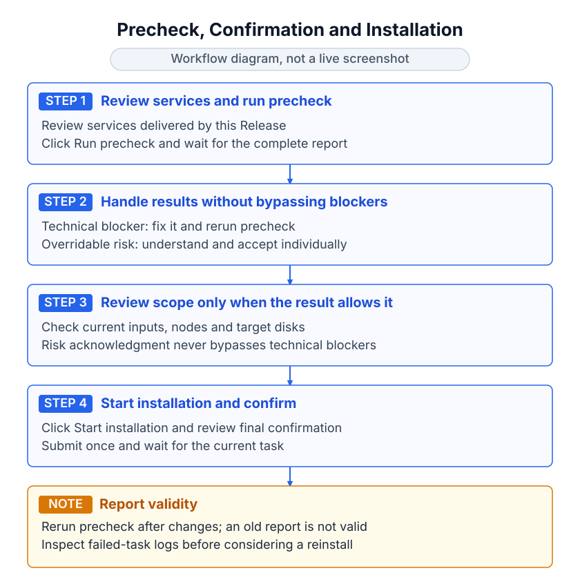

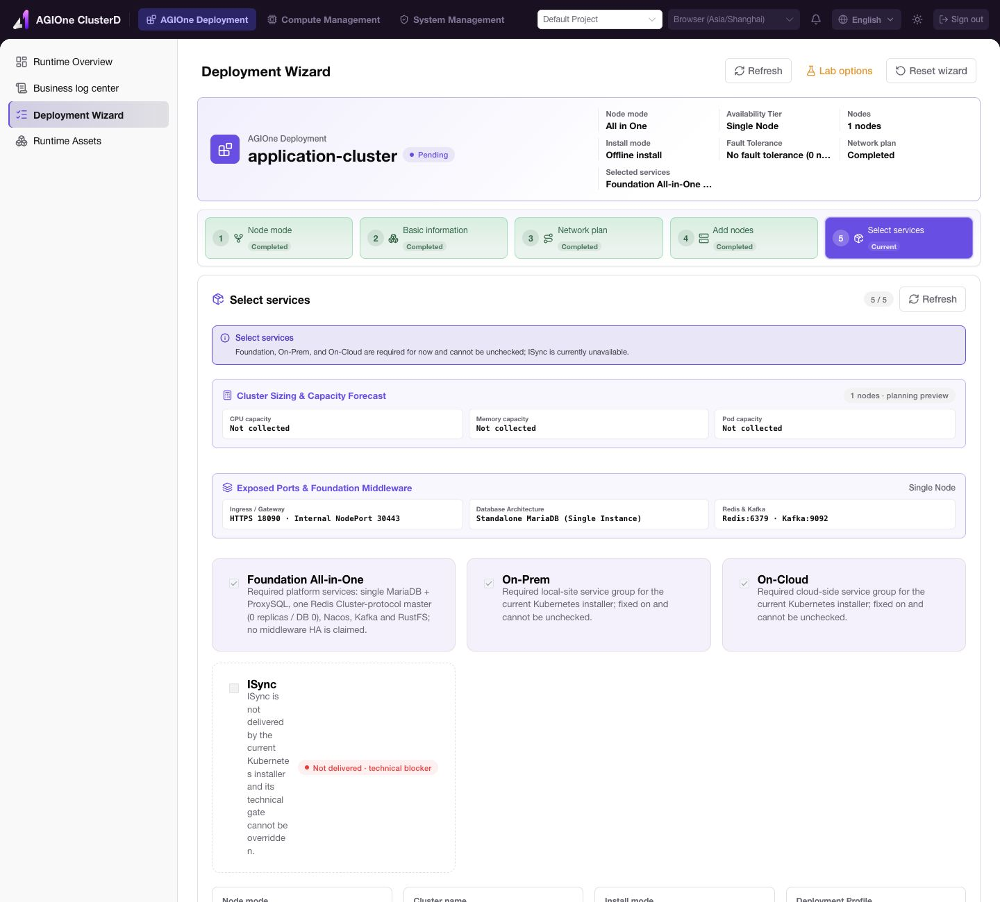

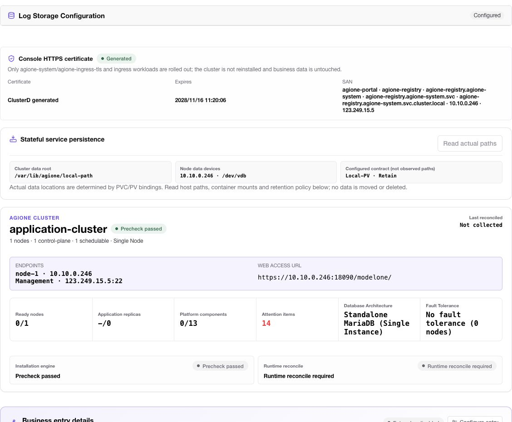

| Result | Can installation continue? | Action |
| --- | --- | --- |
| Technical blocker | No | Fix OS, architecture, SSH, disk, ports, or asset integrity, then rerun precheck |
| Overridable risk | Explicit individual acceptance required | Read the impact and accept only risks the site can bear. Acceptance never bypasses a technical blocker |
| Warning | Follow the report | Record and evaluate it; neither classify every warning as failure nor ignore it |
| Passed | Proceed to confirmation | Still check precheck time, target devices, and installation scope |

Precheck validates node resources, time synchronization, storage, ports, Kubernetes/AGIOne configuration, and offline asset completeness. Read the **final report and blocker count**, not one log line's color. Rerun after changing inputs; an old report cannot authorize a new configuration.

### 4.9 Confirm and Install

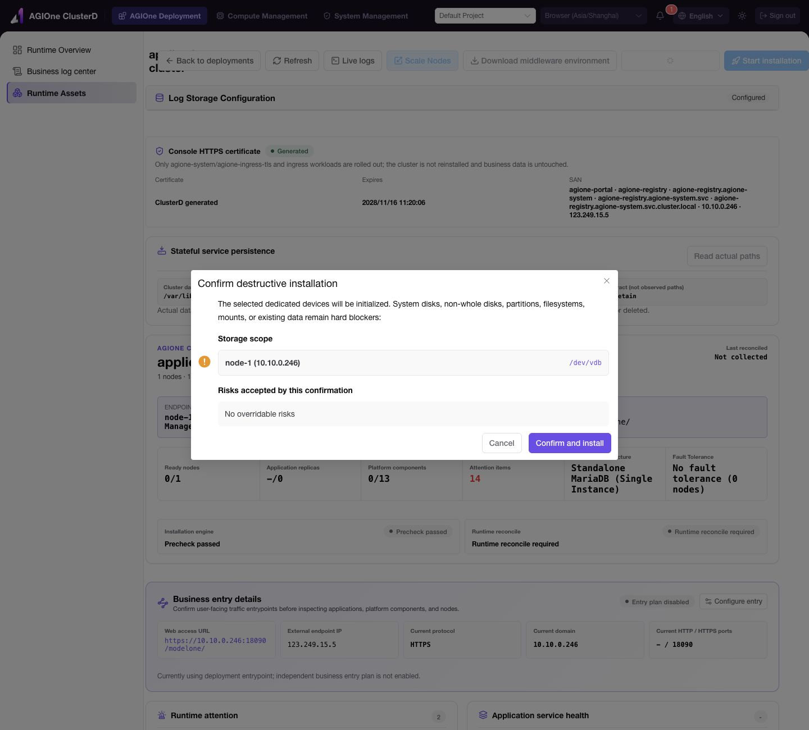

The confirmation page/dialog is the final review of targets and destructive scope. Check:

- Cluster name, topology, node count, and CPU architecture.
- Online/offline mode, matching Release, and resource readiness.
- Private/SSH addresses, Service/Pod CIDRs, console protocol, and ports.
- Storage mode and device on every node; this example authorizes only the confirmed dedicated empty disk.
- Log directory/NAS/archive node, service combination, and valid precheck for the current inputs.

Click **Start installation**, review the final confirmation, and confirm installation only when correct. Do not repeatedly submit, run a second installer concurrently, or create another deployment because one stage takes time.

**Success:** the task becomes `Succeeded`, and details show installation completed with runtime verification starting or complete. In this example, task `#2` completed successfully and task `#3` (`Reconcile now`) subsequently completed successfully. **Failure:** open the corresponding task log/report and identify the failing stage; fix the cause instead of immediately deleting data and reinstalling. A successful installer exit and Runtime verified are separate evidence layers.

## 5. Verify the Result

### 5.1 Verify Runtime Status and the Data Disk

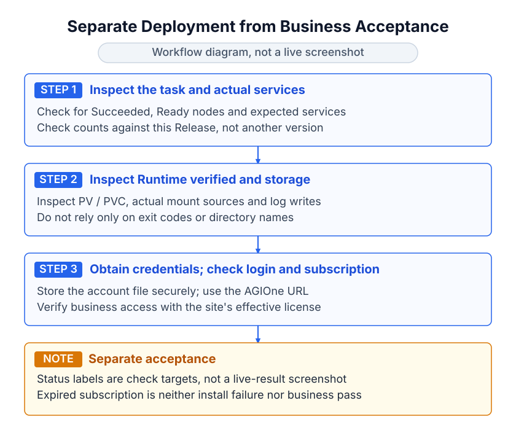

These are the **acceptance checks for this example**, not values to enter into the page or fixed service counts for every release. The live detail page was checked after task `#2` and reconciliation task `#3` reached terminal success; the counts below are evidence for this single-node test and must not be copied as fixed values for another Release.

| Acceptance item | Recorded result | Your check |
| --- | --- | --- |
| Installation task | `#2` `Succeeded`; no failed stage shown | Open this task and confirm the same result for your deployment |
| Reconciliation task | `#3` `Succeeded` | Run Reconcile only after installation and inspect its terminal result |
| Nodes | `1/1 Ready` (`node-1`, 16 CPU, 31 GiB) | Count matches topology; an available ClusterD page is insufficient |
| Platform components | `13/13` ready | Verify against this Release's actual component inventory |
| AGIOne services | `15/15`; each displayed `1/1 · UP` | Verify against the current service inventory |
| Runtime verification | `Runtime verified`; attention items `0` | Requires actual runtime evidence, not just an installer exit code |
| Data disk | `200 GiB`, `/dev/vdb` → `/var/lib/agione/local-path` | Actual source is the data disk, not merely a directory with the right name |
| Application runtime root | `/var/lib/agione/local-path/runtime` | Derived runtime path; verify the actual PV/PVC host paths separately |
| Console entry | HTTPS `18090`; page showed generated certificate | Confirm DNS/SAN and trust requirements before production use |
| Account credentials | Detail page showed credentials as ready to view | Deliver the file securely; validate actual login and subscription separately |

Run these read-only checks on the **AGIOne target node**:

```bash
lsblk -f
findmnt -T /var/lib/agione/local-path
findmnt -T /var/lib/agione/local-path/runtime
df -h / /var/lib/agione/local-path
sudo k3s kubectl get nodes -o wide
sudo k3s kubectl get pods -A
sudo k3s kubectl get pv,pvc -A
```

Nodes should be `Ready`, long-running services `Running`, one-time initialization Jobs may be `Completed`, and PVCs should be `Bound`. Check actual PV paths and retention policy. For `/data` reuse, check the source directory and bind mount too. If logging is enabled, run `findmnt -T <log-directory>` for the configured location and verify writes; application-disk selection alone does not prove log placement.

### 5.2 Obtain the Account and Open the Console

1. Use the **Web access URL** provided in deployment details. Do not use ClusterD's `18093` to log in to AGIOne.
2. Use the account credential view/download entry in details. Read any confirmation; do not reveal passwords in screenshots or copy the downloaded file into public locations.
3. Save the file in a controlled local location and hand it over under the site's password-management policy. Never put it in Git, chat, tickets, or public object storage.
4. Open AGIOne and use the corresponding account from the file to verify the actual business page.

The example HTTPS entry has this form:

```text
https://<node-or-external-address>:18090/modelone/
```

Use passwords through the product login page. Do not embed them in URLs, terminal commands, or improvised authentication requests. A failed handcrafted request does not prove the account file is wrong.

### 5.3 Verify the Subscription and Business Access

If business access returns `platform_license_expired`, check the effective subscription and authorization state. **Technical deployment and licensed business availability are separate acceptance items.** A subscription result alone does not indicate a disk, Kubernetes, or account-synchronization failure.

Complete the applicable [Purchase and Activation](../license/activation-code-activation) process, then verify login and business access again. Record licensing results separately from the technical runtime acceptance.

## 6. Troubleshooting and Next Steps

| Symptom | Check first | Do not |
| --- | --- | --- |
| ClusterD works locally but not from another computer | Listening address, routing, firewall, and security groups for `18093` | Reinstall AGIOne |
| Online mode unavailable | Connectivity test, release-source configuration, target-architecture Release, signatures, and digests | Force it merely because the browser has internet access |
| Offline assets not ready | Matching Bundle/Manifest, architecture, completed import, and verification | Mix Releases or rename files to imitate compatibility |
| A “new cloud disk” is blocked | Actual partitions, filesystem, signatures, and mounts; run a fresh read-only probe | Erase the disk or skip the capacity check |
| `/data` already has ext4/xfs | Reuse mode with an eligible mount and dedicated directory | Initialize an existing filesystem as a raw disk |
| System disk runs out of space | Separate ClusterD download/extraction/cache usage from AGIOne storage and inspect actual mounts | Assume choosing an application disk moved ClusterD caches |
| NAS mount or writes fail | NFS client, routing, export, and write permissions on the archive node | Assume Auto falls back to local |
| Task succeeded but runtime is pending | Reverification, node/Pod/component state, and detailed report | Treat the task exit code as complete acceptance |
| Account cannot log in | Entry URL, account file, time, product auth logs; distinguish credentials from subscription expiry | Paste passwords into tickets or invent plaintext auth requests |
| `platform_license_expired` | Effective subscription and authorization state | Delete the cluster or reinstall its database |

The installation wizard covers topology, resources, networking, nodes, services, and precheck. **Resource sync**, **Delivery rollout**, and **middleware external access** are later maintenance operations. Do not run synchronization/redeployment or expose middleware ports simply to solve login, licensing, or entry issues. Upgrading ClusterD does not upgrade AGIOne business services; see [ClusterD Upgrade](./clusterd/#_6-upgrade-clusterd).

## 7. Clean Up a Test Environment

Use this section only when the environment is no longer needed. It is not a mandatory post-installation step. **Reading this page does not clean any host automatically.**

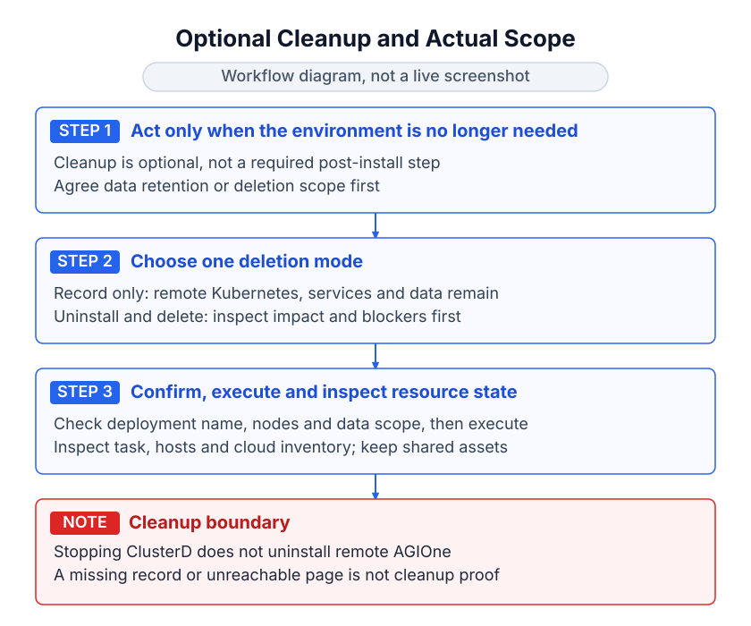

| Goal | Correct scope and action |
| --- | --- |
| Temporarily stop using ClusterD | Stopping ClusterD does not uninstall remote AGIOne; act on the intended service |
| Uninstall AGIOne | In that deployment's delete/uninstall entry, select “Uninstall environment & delete record.” Review impact first, including nodes, data deletion, blockers, and deployment name, before explicit execution |
| Delete the ClusterD record only | Removes local tracking, not remote Kubernetes, services, or data; not a substitute for environment removal |
| Remove the ClusterD program | Complete and verify any required remote cleanup first, then follow [ClusterD Uninstallation](./clusterd/#_7-uninstall-clusterd) |
| Release test cloud resources | Check ownership of ECS, data disks, EIPs, and other resources in the cloud console. Remove only dedicated test resources, not shared VPCs/subnets or unrelated workloads |

Environment removal is destructive; the data owner must decide retention/deletion beforehand. Resolve blocked previews instead of running `rm -rf` on the runtime root, deleting PVCs, or formatting disks. After cleanup, inspect the task, target hosts, and cloud inventory. An unavailable web page, missing record, or successful command exit alone is not proof of remote cleanup.

## 8. Delivery Checklist

- [ ] Record package version, architecture, and trusted SHA-256; both outer-archive and internal verification pass.
- [ ] ClusterD login works; targets, networking, and storage agree with the wizard.
- [ ] Every node has valid SSH/disk probes; initialization versus reuse is explicit.
- [ ] No technical blockers remain; accepted risks were reviewed individually.
- [ ] Installation succeeds, nodes/components/services match this Release, and runtime verification is complete.
- [ ] Check actual mounts for runtime root, persistent volumes, and logs, not only directory names.
- [ ] Verify AGIOne URL, TLS, account file, and login; no sensitive file enters the documentation repository.
- [ ] Record subscription and business availability separately; unverified items are not marked passed.
- [ ] When releasing a test environment, record actual cleanup scope and final resource state.

**Validated scope:** page-level wizard operation, field explanations, dedicated-empty-disk selection, precheck, destructive-install confirmation, task `#2` success, reconciliation task `#3` success, `1/1` Ready node, `13/13` platform components, `15/15` AGIOne services, generated HTTPS entry, and `/dev/vdb`/200 GiB storage selection. Credentials were not placed in screenshots or this repository. **Not covered by this example:** live ARM64 installation, multi-node failover, cross-architecture operation, online release sources, bastion/sudo, NAS, existing `/data` reuse, production TLS/public access, and licensed business acceptance. Their fields are documented from the current implementation; validate each relevant combination before delivery instead of treating this example as full-matrix acceptance.
