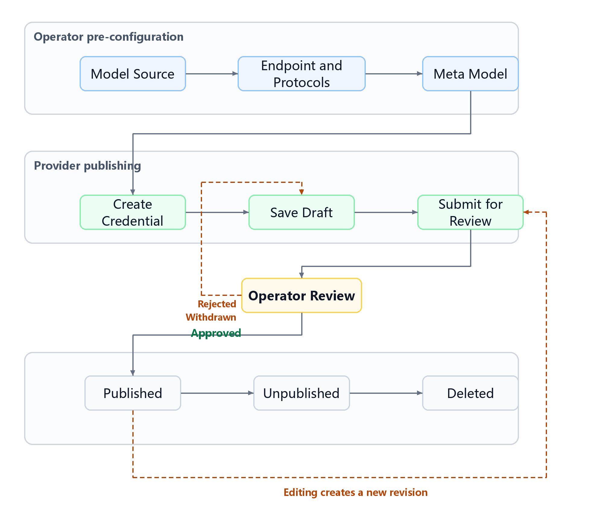

# Model Business Upgrade: Operator and Provider Changes and Publishing Flow

::: info Document Information
Applies to: 2026-11-02 model business upgrade
Updated: 2026-11-02
:::

This upgrade changes how models are onboarded, from "any model can be configured" to "connect through mature, widely adopted protocols". The platform now only provides a channel and does not define any request or response format. When publishing a model, a Provider no longer configures how the model itself is called and only needs to manage pricing. The legacy entry points are retained temporarily, for existing models only.

## 1. Key Changes

| Dimension | Before | After |
| --- | --- | --- |
| Onboarding | Each model configures its own request headers, output parsing, and so on — "any model can be configured" | Passthrough over standard protocols (OpenAI, Anthropic, Volcengine Ark, Alibaba Cloud Model Studio) |
| Platform role | Defines and converts formats | Only provides a channel; produces no format or standard |
| Model version | A single version (ModelsVersion) carries all information | Split into Basic and Pricing, reviewed and activated together under one revision |
| Supplier catalog | Provider / Region | Model Source / Endpoint |
| AK | Entered inside each model version | Managed centrally as an independent Credential: encrypted at rest, masked in the UI, rotatable, and reusable across models |
| What a Provider fills in | Call address, protocol, request headers, output parsing, capability parameters, pricing | Select source, endpoint, and credential; enter the upstream model ID and pricing |

### Supported Protocols

| Protocol ID | Modality | Upstream path | Invocation |
| --- | --- | --- | --- |
| `openai/chat_completions` | Text | `/v1/chat/completions` | Synchronous |
| `openai/responses` | Text | `/v1/responses` | Synchronous |
| `anthropic/messages` | Text | `/v1/messages` | Synchronous |
| `openai/images` | Image | `/v1/images/generations` | Synchronous |
| `volcengine/ark_image_generation` | Image | `/api/v3/images/generations` | Synchronous |
| `dashscope/image_generation` | Image | `/api/v1/services/aigc/image-generation/generation` | Asynchronous by default; synchronous also supported |
| `openai/video` | Video | `/v1/videos/generations` | Asynchronous |
| `volcengine/ark_video_generation` | Video | `/api/v3/contents/generations/tasks` | Asynchronous |
| `dashscope/video_generation` | Video | `/api/v1/services/aigc/video-generation/video-synthesis` | Asynchronous |
| `openai/audio` | Speech | `/v1/audio/speech` | Synchronous |
| `openai/embeddings` | Embedding | `/v1/embeddings` | Synchronous |
| `openai/rerank` | Rerank | `/v1/rerank` | Synchronous |

Authentication headers are configured per protocol, and `{ak}` is replaced at call time by the AK stored in the credential. The common template is `Authorization: Bearer {ak}`; for the Anthropic protocol it is `x-api-key: {ak}`.

## 2. Changes Required for Operators

1. **Maintain model sources** (permission `admin_save_model_source`)
   - The source code is globally unique and cannot be changed after creation. Names support Chinese, English, and Spanish.
   - Source status is maintained automatically based on the number of endpoints: a source is usable only when it has at least one endpoint.
2. **Maintain endpoints** (permission `admin_save_model_source_endpoint`)
   - Fill in the name, region tag, Base URL, console address, and documentation address.
   - The Base URL may contain a `{workspace}` placeholder; in that case a Provider must fill in the workspace when binding a credential.
   - Select the protocols supported by this endpoint from the protocol catalog, then configure the upstream path, authentication header, synchronous/asynchronous mode, and callback path for each one.
   - Before deleting an endpoint, confirm that no credential is bound to it and no model is using it (the system does not block this today).
3. **Maintain meta models** (permission `admin_save_meta_model`)
   - A meta model carries model capabilities: type, Function/thinking/web-search capability, context window, maximum input and output length, input and output modalities, and protocol.
   - When a Provider publishes, this information is populated from the meta model and is no longer entered by the Provider.
   - The meta model identifier (metaModelUid) cannot be changed after creation. The system automatically creates one default aggregate model for each meta model.
4. **Review model revisions** (permission `admin_model_audit`)
   - Basic and Pricing are reviewed as one revision: both are approved or both are rejected.
   - Auto-review can be enabled. An administrator can force-unpublish a published model.
5. **Run the existing-data migration**: see section 6, Compatibility and Transition.

## 3. Changes Required for Providers

1. **Create a credential first; no longer enter an AK in the model**
   - Select a model source, enter the AK, and select the endpoints to bind. If an endpoint requires a workspace, fill it in as well.
   - Repeating the creation with the same AK under the same tenant, the same source, and the same set of endpoints reuses the existing credential instead of creating a duplicate.
   - The AK is encrypted at rest and only a masked value is shown in the UI. You can rotate the AK, enable or disable the credential, and add or remove bindings.
   - A credential that a callable model is using cannot be disabled; a binding that an active model is using cannot be removed.
   - For SuanMoFang and SuanShu deployment publishing, the publishing page creates the corresponding credential automatically; no manual creation is needed.
2. **When publishing a model, only pricing needs attention**
   - Select the meta model, model source, endpoint, and credential; enter the upstream model ID; choose public or private.
   - Capabilities, modalities, context, protocol, and call address are all populated from the meta model and the endpoint and need no further configuration.
   - Enter the pricing: free or charged, billing unit (TOKEN / IMAGE / CHARACTER / DURATION), and billing rules.
3. **What you no longer need to do**
   - No longer enter an AK, custom request headers, output parsing, or protocol conversion settings inside the model.
4. **Edit and delete rules**
   - Editing a published model creates a new revision; the online version is unaffected and is replaced only after the new revision is approved.
   - After the first activation, the meta model, model type, billing unit, and visibility are fixed; pricing and the free/charged setting can still be changed.
   - A model that is unpublished or was never published can be deleted; unsubmitted or rejected revisions are discarded with it. A revision under review must be withdrawn first.

## 4. New Model Publishing Flow

The following figure shows the full lifecycle of a model, from Operator pre-configuration to being published or deleted. Dashed lines are the rollback paths: a rejected review or a Provider-initiated withdrawal both return the model to draft, and editing a published model creates a new revision that re-enters review.

The figure shows the model publishing flow in four stages — Operator pre-configuration, Provider publishing, Operator review, and state transitions. Blue boxes are Operator configuration items, green boxes are Provider actions, the yellow box is the review gate, and dashed lines are rollback paths.

1. The Operator configures the model source, endpoints (including protocols), and meta models.
2. The Provider creates a credential in credential management and binds the endpoints to use.
3. On the publish page, the Provider selects the meta model, source, endpoint, and credential, enters the upstream model ID and pricing, and saves a draft.
4. The Provider submits for review. The submission can be withdrawn during review, returning the model to draft.
5. The Operator reviews: approval publishes the model; after a rejection the Provider edits and resubmits.
6. Editing a published model again creates a new revision and repeats steps 4 and 5. An unpublished model can be deleted.

## 5. Data to Pre-Configure Before Publishing

| Data | Configured by | Key fields | Notes |
| --- | --- | --- | --- |
| Model source | Operator | code, multilingual name | The code is globally unique and cannot be changed |
| Endpoint | Operator | Base URL, protocol configuration, authentication header | A source is usable only when it has at least one endpoint |
| Meta model | Operator | Type, capabilities, context, modalities, protocol | Populated automatically at publish time |
| Credential | Provider | AK, bound endpoints, workspace | Created automatically by the publishing page for SuanMoFang and SuanShu |
| Pricing | Provider | Free or charged, billing unit, billing rules | The billing unit cannot be changed after first activation |
| Rate limits and authorized tenants (optional) | Provider | RPM, TPM, tenant rate limits, authorized tenants | Take effect on save, without review |

## 6. Compatibility and Transition

- **Legacy entry points retained**: the legacy invocation entry points and legacy management interfaces are retained temporarily, for existing models only. New models always follow the new flow.
- **The Operator runs the existing-data migration once.** The three interfaces must be called in order, then retired:

| Order | Interface | What it does |
| --- | --- | --- |
| 1 | `POST /model-source/migration/providers` | Migrates legacy Provider/Region into model source/endpoint. Endpoints enable all protocols by default, with `Bearer {ak}` as the authentication header (`x-api-key` for Anthropic) |
| 2 | `POST /model-source/migration/credentials` | Migrates the AK of existing models into credentials and creates bindings. The same AK under the same tenant and the same source reuses one credential |
| 3 | `POST /model-source/migration/models` | Splits legacy versions into Basic + Pricing. Approved versions take effect directly; unapproved ones become pending review or draft. Legacy OpenAI protocols for images and video become `openai/images-compatible` and `openai/video-compatible` |

- **Models skipped by the migration** (no model source or no credential binding) cannot be called after the switch and must be republished by the Provider following the new flow. The interfaces currently return only the number of skipped models; identify the specific models from the logs.
- Existing scheduled publish and unpublish tasks are out of scope for the migration.
