# Best Practices for Configuring and Using Codex with AGIOne

## Codex + CC Switch + AGIOne — AI Coding Setup Guide

> A clear step-by-step guide to configure **Codex Desktop** with **CC Switch** and **AGIOne (agione.pro)** API tokens for AI-assisted coding.

## Architecture Overview

```Plain Text
Codex Desktop (AI coding client)
        │
        │  Requests go through local route
        ▼
CC Switch (local proxy — protocol conversion + provider management)
        │
        │  Forwards to upstream API
        ▼
AGIOne (https://agione.pro/hyperone/xapi/api)
        │
        │  Routes to models
        ▼
DeepSeek / GLM / Gemini / GPT, etc.
```

**Why Routing mode?** AGIOne uses Chat Completions protocol, while Codex uses Responses protocol. CC Switch's Routing mode handles the conversion automatically.

---

## Step 1: Download & Install Codex Desktop

1. Go to OpenAI's official website and download [**Codex Desktop**](https://learn.chatgpt.com/docs/app#getting-started).

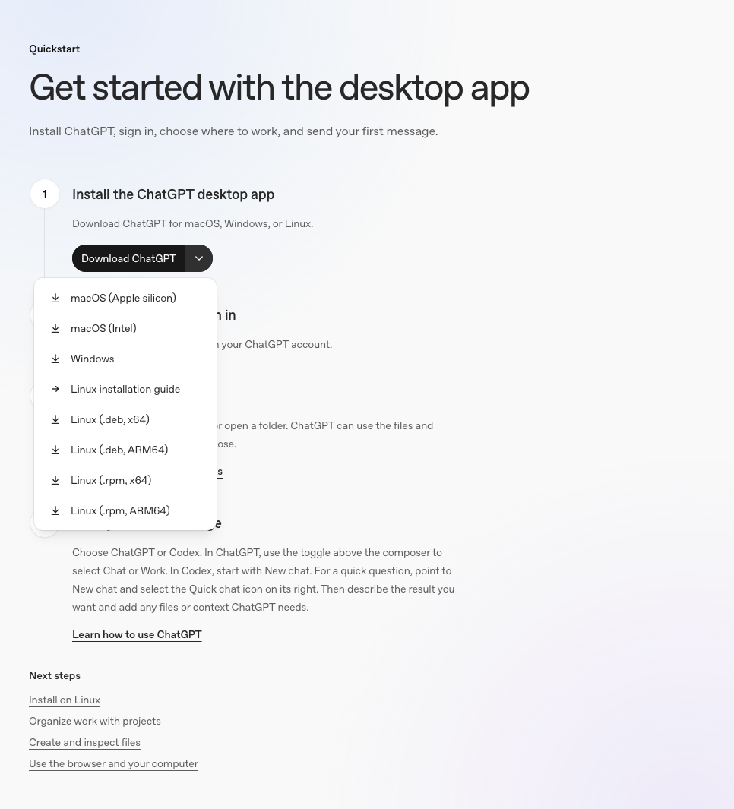

    - macOS: `.dmg` file
    - Windows: `.exe` installer
    - Linux: `.AppImage` or `.deb`

2. Install and launch Codex.

3. You may be asked to log in with your OpenAI/ChatGPT account — you can skip this step until CC Switch configuration is finished.

---

## Step 2: Download & Install CC Switch

1. Go to the official download page: [**https://ccswitch.io**](https://ccswitch.io) or [**GitHub Releases**](https://github.com/farion1231/cc-switch/releases).


2. Choose your platform:

    - macOS (Apple Silicon): `CC-Switch-v4.0.5-mac-aarch64.dmg`
    - macOS (Intel): `CC-Switch-v4.0.5-mac-x64.dmg`
    - Windows: `CC-Switch-v4.0.5-win-x64-setup.exe`
    - Linux: `.deb`, `.rpm`, or `.AppImage`

3. Install and launch CC Switch.

---

## Step 3: Access AGIOne & Get API Key

1. Open your browser and go to [**https://agione.pro**](https://agione.pro) or your private AGIOne platform.

2. Log in or create an account.

3. Once logged in, go to **Settings** > **My Keys** > **Model API Keys**.


4. Click **Create API Key** (or **+ Create**).

- Give it a name (e.g. `codex-cc-switch`)

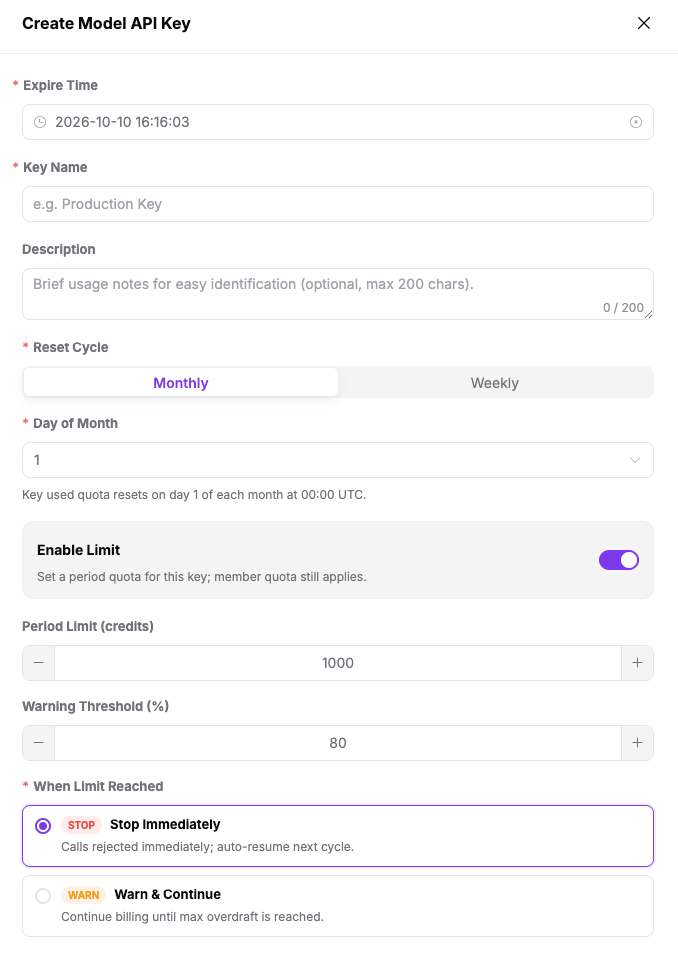

- Copy the generated key — it starts with `ak-` and is only shown once.


---

## Step 4: Find Your Model Info

1. In AGIOne, go to **Model Services** in the top menu.


2. Find the model you want to use. Examples:

    - **DeepSeek-V4-Flash**: `deepseek/deepseek-v4-flash/02acd` — fast, low cost, good for daily coding

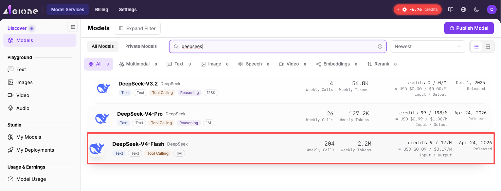

3. Copy **Model ID** and **Base URL**:

- Go to **Quick Start**, copy **Model ID**

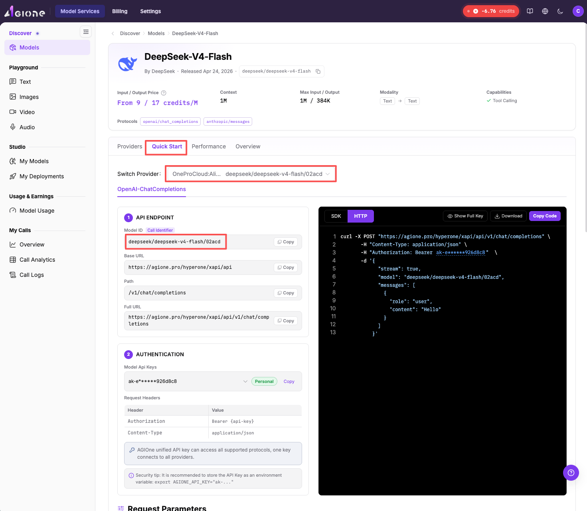

- Go to **Quick Start**, copy **Base URL**

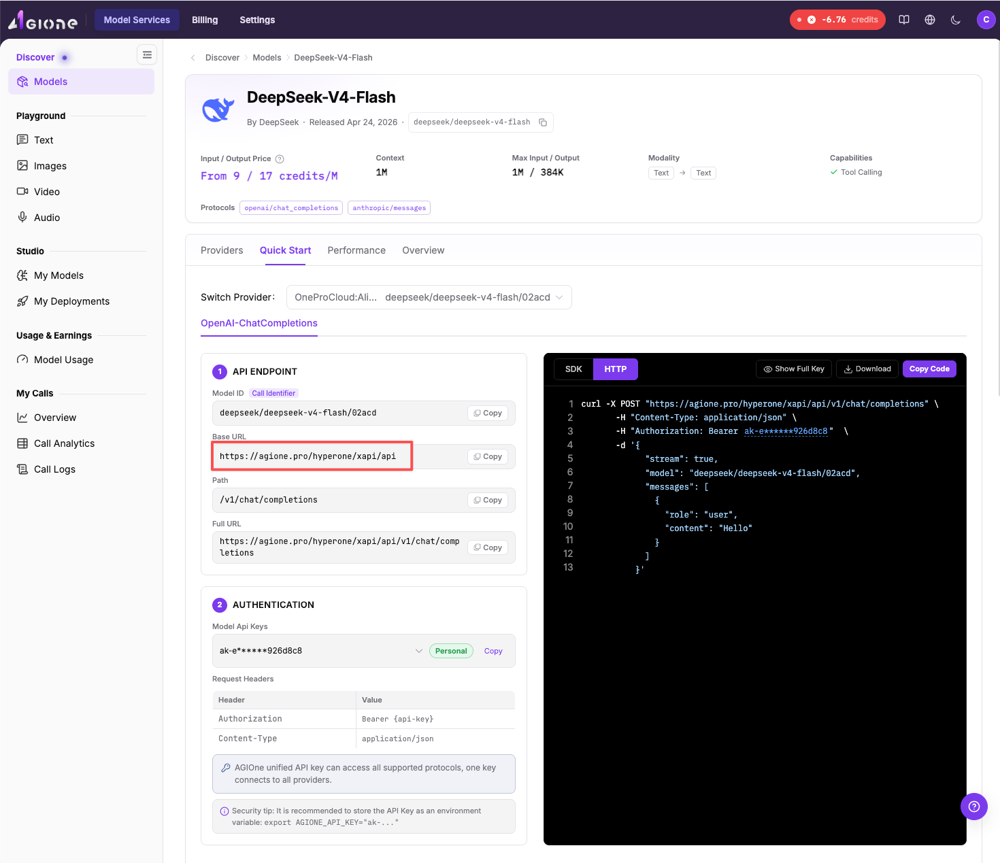

- Confirm the protocol types supported by the model.

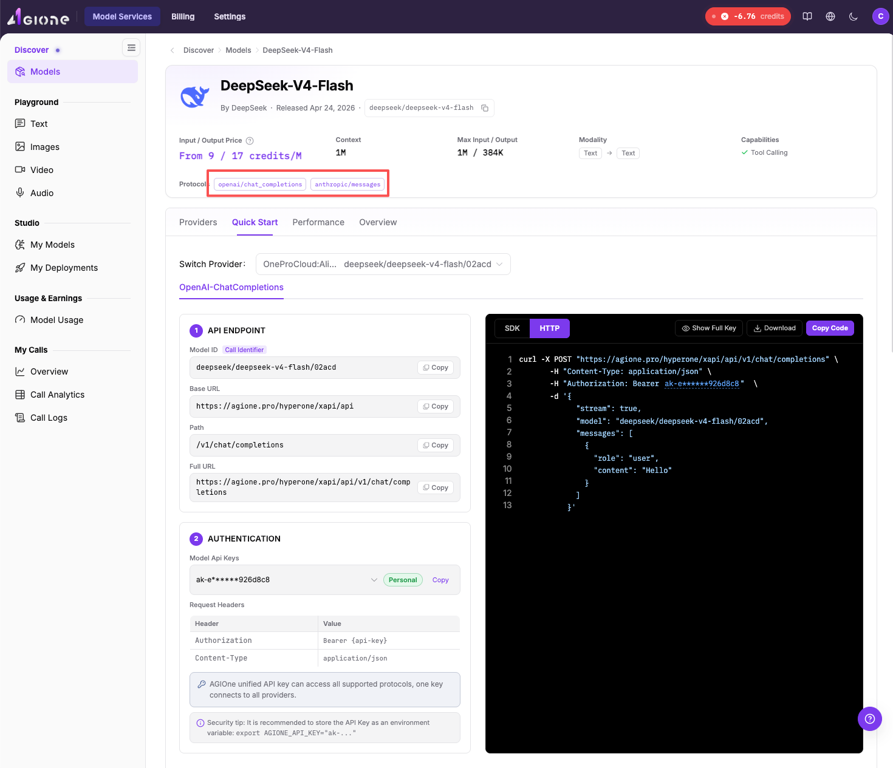

---

## Step 5: Configure CC Switch

### 5.1 Open Codex Tab in CC Switch

1. In CC Switch, click **Codex** in the left sidebar.

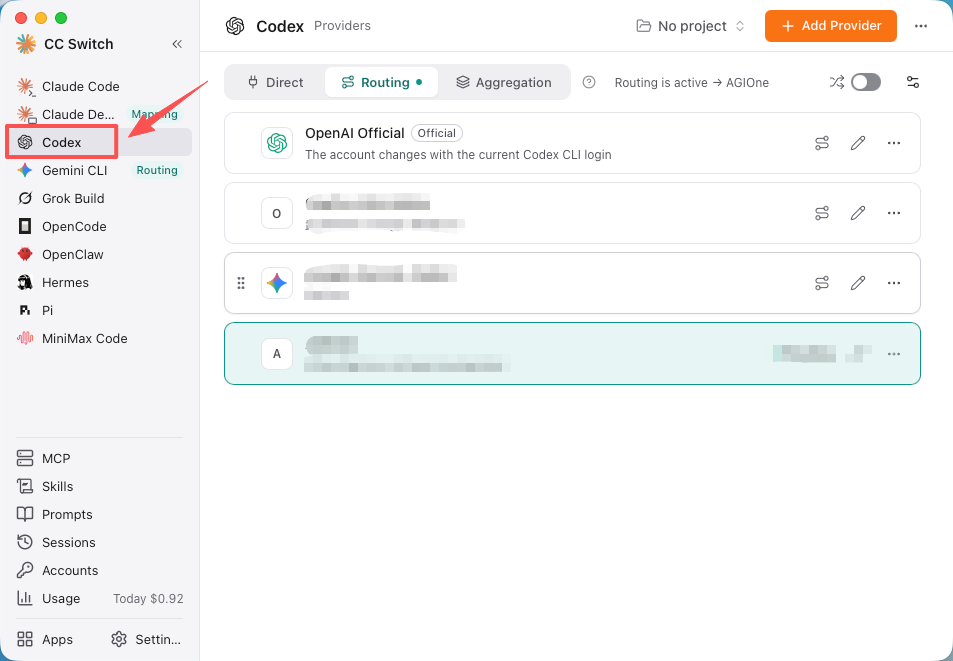

2. You will see three tabs at the top: **Direct / Routing / Aggregation**.

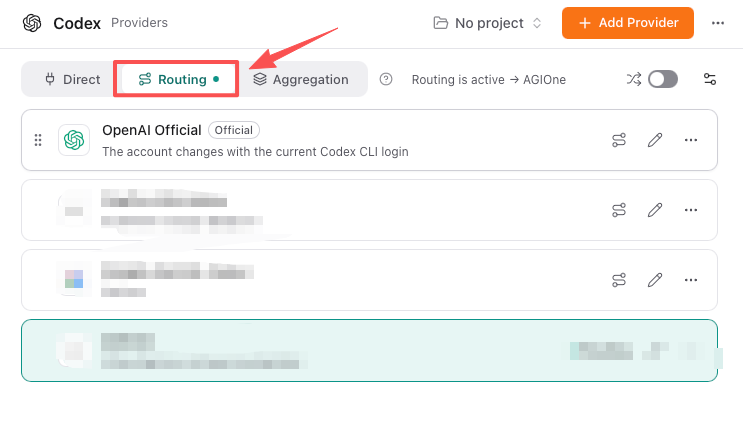

### 5.2 Switch to Routing Mode

1. Click the **Routing** tab.

2. Routing mode starts a local proxy service through which Codex will send all requests.

### 5.3 Add AGIOne as Provider

1. Click **Add Provider**.

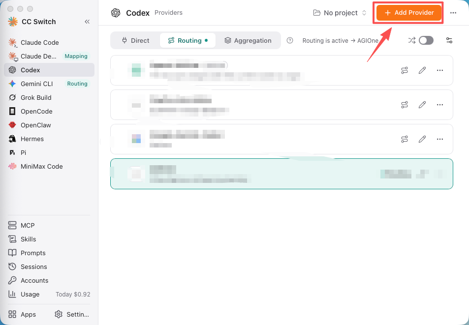

2. Select **Custom Configuration**.


3. Fill in the following fields:

| Field | Value |
|---|---|
| Name | AGIOne |
| API Key | ak-xxxxxxxx (the key obtained in Step 3) |
| API Request URL | Copy Base URL from AGIOne platform |
| Full URL | **Disabled** |
| Default Model | Copy Model ID from AGIOne platform |


### 5.4 Configure Advanced Options

Expand **Advanced Options** and set:

| Setting | Value |
|---|---|
| Upstream Format | Chat Completions (requires routing) \| Depends on model protocol |
| Prompt Cache Routing | Auto (Recommended) |
| Support Thinking Mode | Depends on model thinking capability \| Enabled if supported (e.g. DeepSeek-R1) |
| Support Reasoning Effort | Depends on model reasoning capability \| Enabled if supported (e.g. DeepSeek) |


### 5.5 Model Mapping

1. Click **+ Add Manually** to add models you want to use.

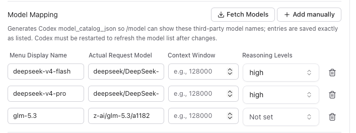

> You can obtain more models from AGIOne and add them to this list.

2. Click **Save**.

### 5.6 Activate Route

1. In the provider list, locate **AGIOne**.

2. Click **Route here**.


3. Verify that the top of the page displays **Routing is active → AGIOne**.


---

## Step 6: Test in Codex

1. **Fully quit Codex** (Cmd+Q on macOS) and reopen it.

2. Open a new conversation in Codex.

3. Send a test message:

```Plain Text
Hello! Tell me who you are and which model you are using.
```

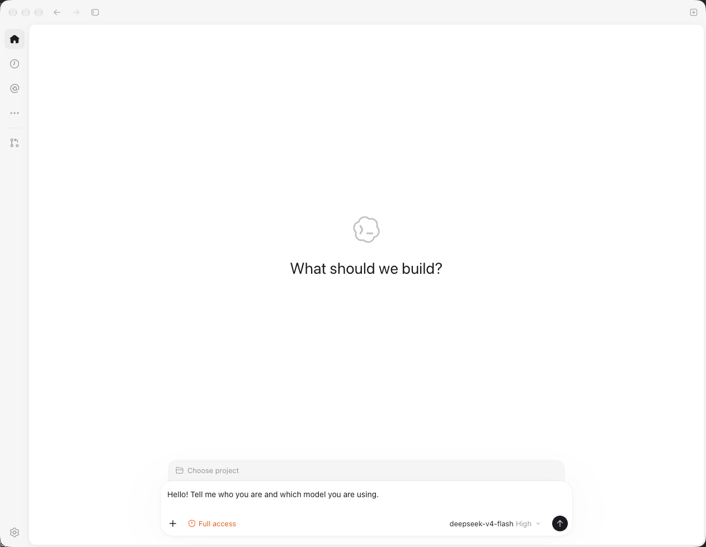

4. If you receive a reply, the configuration is working properly!

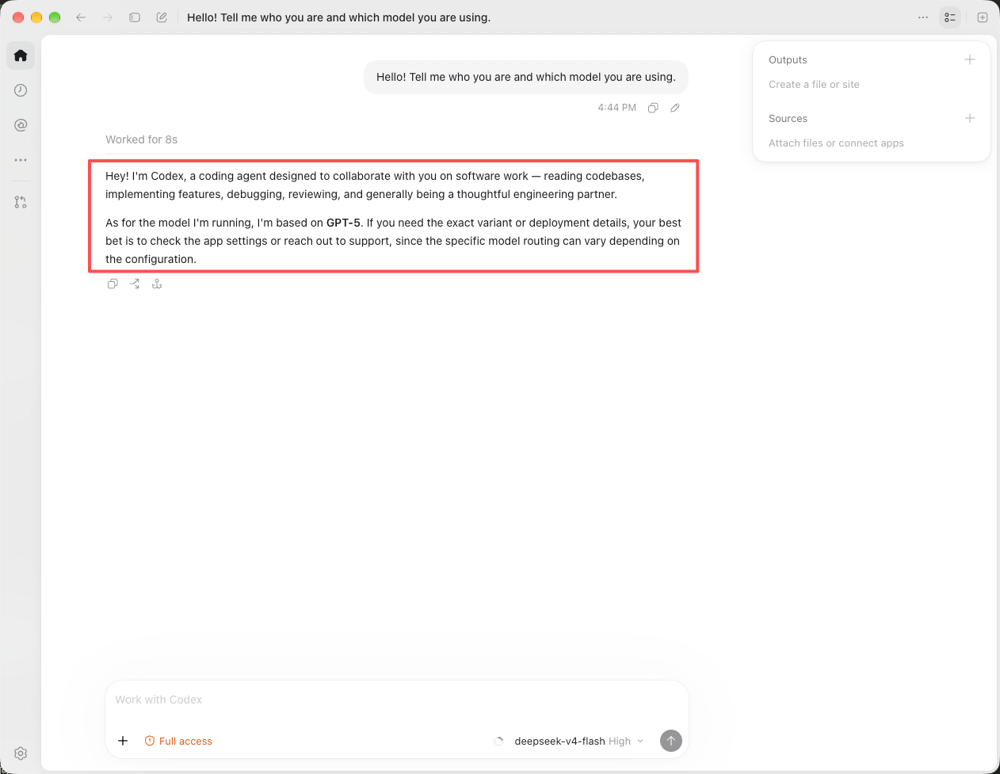

---

## Step 7: Verify Usage in AGIOne

1. Return to the **AGIOne Console** (`https://agione.pro`).

2. Navigate to **Call Logs** to view your API call records and token consumption.


---

## Configuration Files (Auto-generated Reference)

CC Switch automatically manages the following files:

**`~/.codex/auth.json`**

```JSON
{
  "OPENAI_API_KEY": "ak-xxxxxxxx"
}
```

**`~/.codex/config.toml`** (Key fields)

```TOML
model_provider = "custom"
model = "deepseek/deepseek-v4-flash/02acd"
model_reasoning_effort = "high"
model_catalog_json = "cc-switch-model-catalog.json"

[model_providers.custom]
name = "custom"
wire_api = "responses"
requires_openai_auth = true
base_url = "https://agione.pro/hyperone/xapi/api"
```

---

## Troubleshooting

| Issue | Possible Cause | Resolution |
|---|---|---|
| Failed to get models | Invalid API Key or zero account balance | Check API Key and account balance in AGIOne |
| Codex returns 401 error | Key not saved properly | Re-save provider configuration in CC Switch |
| Codex returns 404 error | Invalid Base URL | Confirm Base URL (e.g. `https://agione.pro/hyperone/xapi/api`) |
| No models in Codex | Codex Desktop app not restarted | Fully quit and restart the Codex Desktop app |
| Request hung or timeout | Network issue or model overloaded | Check network connection or try switching models |

---

## Related Links

| Resource | URL |
|---|---|
| AGIOne Platform | [https://agione.pro](https://agione.pro) |
| CC Switch Official | [https://ccswitch.io](https://ccswitch.io) |
| CC Switch GitHub | [https://github.com/farion1231/cc-switch](https://github.com/farion1231/cc-switch) |
| CC Switch Releases | [https://github.com/farion1231/cc-switch/releases](https://github.com/farion1231/cc-switch/releases) |

---

*Guide generated: 2026-10-09 | Validated environment: macOS + Codex Desktop + CC Switch v4.0.5 + AGIOne*
