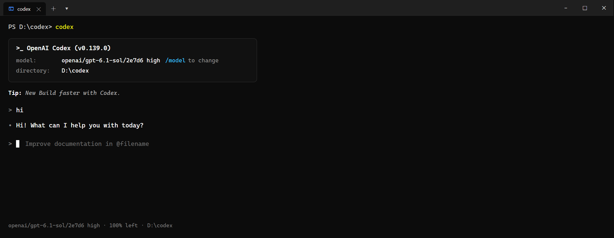

# Install Codex and Use AGIOne as the Model Provider

> This guide explains how to connect **Codex (CLI coding agent)** or the **ChatGPT desktop app** to **AGIOne** model services.
> Two configuration methods are provided:
> - **Basic Edition (3-Minute Setup)**: Get started immediately by modifying just a few configuration lines.
> - **Advanced Edition (All Features Unlocked)**: Define full model parameters to enable 1-million-token context memory, deep reasoning mode, and image recognition.

---

## Table of Contents
1. [Basic Edition: 3-Minute Quick Setup](#1-basic-edition-3-minute-quick-setup)
2. [Advanced Edition: Enable All Features (Long Context & Deep Reasoning)](#2-advanced-edition-enable-all-features-long-context-deep-reasoning)
3. [Troubleshooting & FAQ](#3-troubleshooting-faq)
4. [Appendix: Adding Other Models](#4-appendix-adding-other-models)

---

## 1. Basic Edition: 3-Minute Quick Setup

> Recommended for users who want a quick trial. This method only requires editing one configuration file without creating custom model catalog specifications.

### 1. Install Codex (Skip if Already Installed)
Ensure Node.js (version 20 or higher) is installed on your computer. Run the following command in your terminal / command prompt:

```bash
npm install -g @openai/codex@latest
```

Verify that the installation was successful:
```bash
codex --version
```


### 2. Edit config.toml
Locate the primary Codex configuration file:
- **Windows**: `%USERPROFILE%\.codex\config.toml` (e.g., `C:\Users\<username>\.codex\config.toml`)
- **macOS / Linux**: `~/.codex/config.toml`

*(If the `.codex` folder or `config.toml` does not exist, create the directory and text file manually)*

Paste the following configuration and save:

```toml
model = "openai/gpt-6.1-sol/2e7d6"
model_provider = "agione"
model_reasoning_effort = "high"

[model_providers.agione]
name = "agione"
base_url = "https://agione.pro/hyperone/xapi/api/v1"
wire_api = "responses"
env_key = "AGIONE_API_KEY"
```

### 3. Set the API Key
Visit [AGIOne International Version](https://agione.pro/) and obtain your real API key (typically a string prefixed with `ak-`) from the model marketplace or API key management page.

Replace `YOUR_ACTUAL_KEY` with your actual secret key:

- **Windows (Run once in CMD or PowerShell):**
  ```powershell
  setx AGIONE_API_KEY "YOUR_ACTUAL_KEY"
  ```
  *(Note: After running this command, **completely close and reopen your command prompt window** for the change to take effect)*

- **macOS / Linux (Run in terminal):**
  ```bash
  echo 'export AGIONE_API_KEY="YOUR_ACTUAL_KEY"' >> ~/.zshrc
  source ~/.zshrc
  ```
  *(If using Bash, change `~/.zshrc` to `~/.bashrc`)*

### 4. Verify the Connection
Open a terminal in any directory and run:
```bash
codex
```
Enter a test message (e.g., type `hi` and press Enter). If the model responds normally, Codex has successfully connected to AGIOne:



---

## 2. Advanced Edition: Enable All Features (Long Context & Deep Reasoning)

### Why Configure `models.json`?
Without this configuration, Codex treats all third-party models as small default models (allocating only a standard short context window and aggressively pruning earlier conversation history during multi-turn chats).

Configuring `models.json` unlocks the following core capabilities:
- **1-Million-Token Context Window**: Retain the complete conversation context when reviewing and editing large codebases without losing background information;
- **Deep Reasoning Mode (Thinking Effort)**: Allocate extended reasoning effort for complex debugging or architecture design before code generation;
- **Intelligent Localized Patching (Freeform Patch)**: Modify only target lines instead of regenerating thousands of lines of unmodified files;
- **Multimodal Visual Debugging**: Drag UI screenshots or error dialog images directly into the chat for instant inspection.

---

### Step 1: Create the `models.json` File
In the **exact same directory** as `config.toml` (`~/.codex/` or `%USERPROFILE%\.codex\`), create a new text file named `models.json` with the following content:

```json
{
  "models": [
    {
      "slug": "openai/gpt-6.1-sol/2e7d6",
      "display_name": "GPT-6.1-Sol (AGIOne Enhanced)",
      "description": "AGIOne GPT-6.1 Sol coding model with 1M context memory and deep reasoning",
      "base_instructions": "You are a coding agent. Follow the user's instructions and use tools when needed.",
      "default_reasoning_level": "medium",
      "supported_reasoning_levels": [
        { "effort": "low", "description": "Fast responses with light reasoning" },
        { "effort": "medium", "description": "Balanced mode for daily coding tasks" },
        { "effort": "high", "description": "Deep reasoning for complex debugging and architecture" },
        { "effort": "xhigh", "description": "Maximum reasoning effort for difficult problems" }
      ],
      "supports_reasoning_summaries": true,
      "default_reasoning_summary": "auto",
      "shell_type": "shell_command",
      "visibility": "list",
      "supported_in_api": true,
      "priority": 0,
      "additional_speed_tiers": [],
      "service_tiers": [],
      "support_verbosity": false,
      "default_verbosity": "medium",
      "apply_patch_tool_type": "freeform",
      "supports_parallel_tool_calls": true,
      "supports_image_detail_original": false,
      "context_window": 1048576,
      "max_context_window": 1048576,
      "auto_compact_token_limit": 996147,
      "effective_context_window_percent": 95,
      "truncation_policy": {
        "limit": 10000,
        "mode": "tokens"
      },
      "input_modalities": [
        "text",
        "image"
      ],
      "output_modalities": [
        "text"
      ],
      "capabilities": {
        "streaming": true,
        "tools": true,
        "function_calling": true,
        "structured_output": true
      },
      "supports_search_tool": false,
      "use_responses_lite": false,
      "experimental_supported_tools": []
    }
  ]
}
```

### Step 2: Reference `models.json` in `config.toml`
Add the line `model_catalog_json = "models.json"` to your `config.toml` (specify only the filename):

```toml
model = "openai/gpt-6.1-sol/2e7d6"
model_provider = "agione"
model_reasoning_effort = "high"

# Reference the model catalog file in the same directory
model_catalog_json = "models.json"

[model_providers.agione]
name = "agione"
base_url = "https://agione.pro/hyperone/xapi/api/v1"
wire_api = "responses"
env_key = "AGIONE_API_KEY"
```

Save the file and reopen the terminal to run `codex`. Your agent will now operate with the full 1-million-token memory and deep reasoning capabilities.

---

## 3. Troubleshooting & FAQ

### Q1: The ChatGPT desktop app shows "Model provider 'modelrouter' not found"?
- **Cause**: When resuming legacy sessions, the desktop client searches for the previously recorded provider identifier `modelrouter`.
- **Solution**: Keep both identifiers configured in `config.toml`, pointing to AGIOne:
  ```toml
  model_provider = "modelrouter"

  [model_providers.modelrouter]
  name = "AGIONE"
  base_url = "https://agione.pro/hyperone/xapi/api/v1"
  wire_api = "responses"
  env_key = "AGIONE_API_KEY"

  [model_providers.agione]
  name = "AGIONE"
  base_url = "https://agione.pro/hyperone/xapi/api/v1"
  wire_api = "responses"
  env_key = "AGIONE_API_KEY"
  ```

### Q2: Error "500 The requested model ... is unavailable"?
- **Cause**: An abbreviated model slug was entered (e.g., only `gpt-6.1-sol`).
- **Solution**: AGIOne requires the full model identifier (Slug), such as `openai/gpt-6.1-sol/2e7d6`.

### Q3: Configured the environment variable, but the terminal still reports missing API Key?
- **Cause**: Existing terminal sessions do not automatically reload newly created system or user environment variables.
- **Solution**: Completely close all active terminal and IDE windows (e.g., VS Code integrated terminals) and start a new session.

---

## 4. Appendix: Adding Other Models

The `models.json` file above serves as a standard template. When onboarding additional models available on AGIOne (e.g., Gemini, Claude, or DeepSeek), copy the model object and adjust the following four fields:

1. **`slug` (Required Model Identifier)**:
   Copy the full model slug from the AGIOne model catalog or API endpoint interface (e.g., `gemini/gemini-3.8-flash/5aa94`).
2. **`context_window` (Memory Capacity)**:
   - **1M Token Models** (e.g., GPT-6.1, Gemini 3.8): Set `context_window` to `1000000` and `auto_compact_token_limit` to `950000`.
   - **200K Token Models** (e.g., Claude series): Set `context_window` to `200000` and `auto_compact_token_limit` to `190000`.
   - **128K Token Models** (e.g., DeepSeek series): Set `context_window` to `128000` and `auto_compact_token_limit` to `120000`.
3. **`supported_reasoning_levels` (Reasoning Effort)**:
   - Models with native chain-of-thought reasoning (e.g., GPT-6.1, DeepSeek Reasoner): Keep all 4 levels (low, medium, high, xhigh).
   - Standard non-reasoning models: Keep only `medium` or leave empty to prevent sending extraneous parameters that may trigger API errors.
4. **`input_modalities` (Image Recognition)**:
   - Vision-capable models: Set to `["text", "image"]`.
   - Text-only models: Set to `["text"]`.
