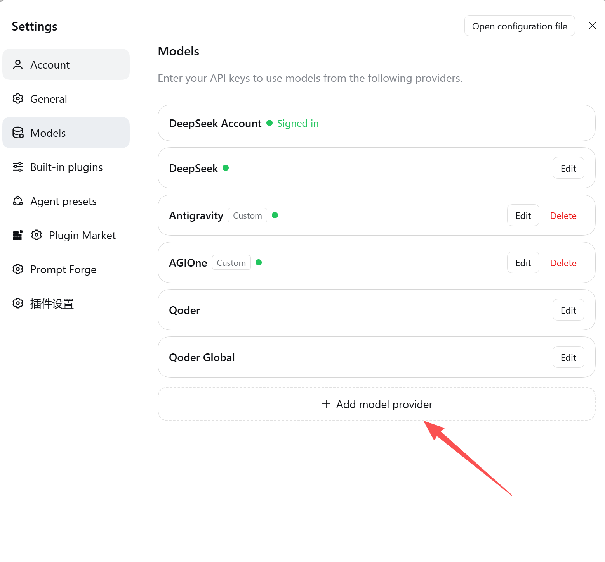
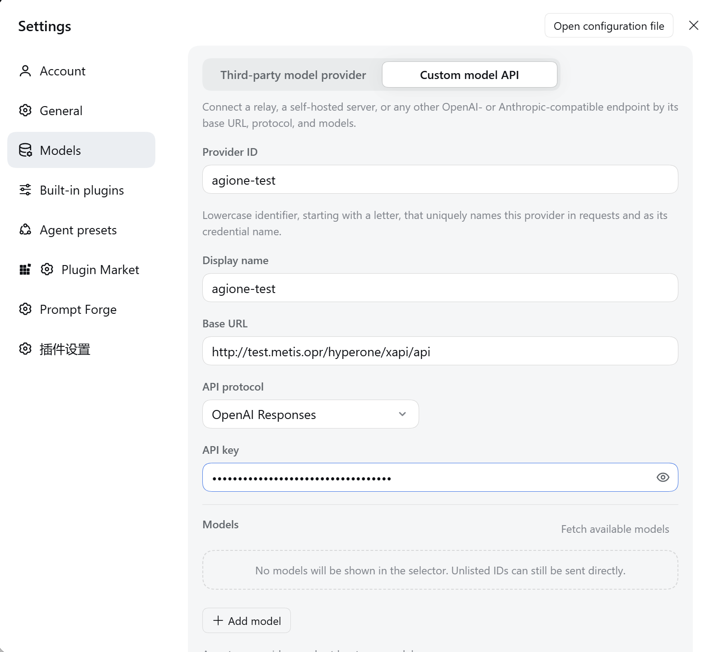
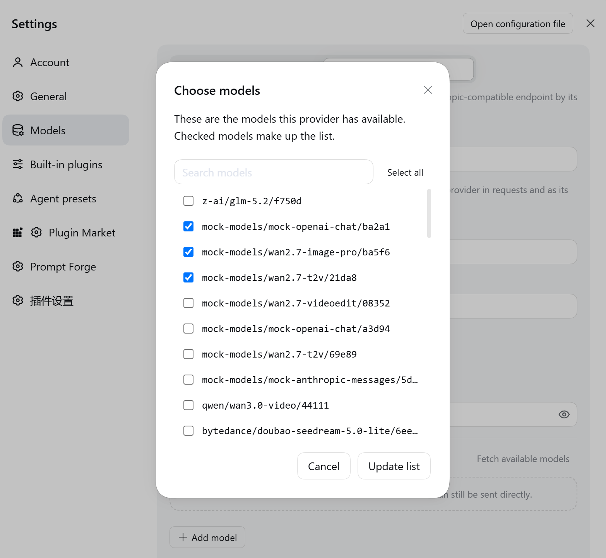
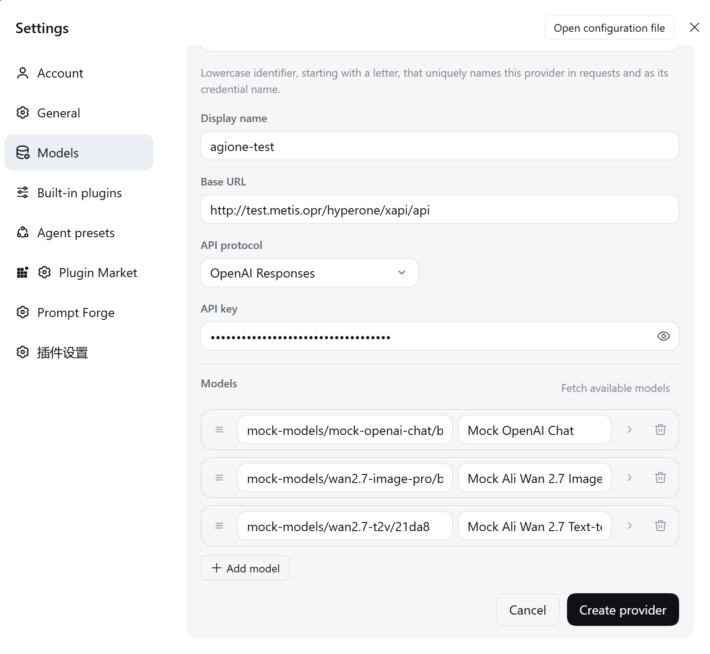

# Add AGIOne as a Model Provider in DeepSeek Harness

This guide explains how to configure AGIOne through **Custom model API**, fetch its model list, and select a model for a response test in DeepSeek Harness.

## Before You Start

1. Install and open DeepSeek Harness. Visit [DeepSeek Harness](https://harness.deepseek.com/) and follow the official release instructions for downloads. This guide starts with an installed client.
2. Visit [AGIOne](https://agione.pro/), then register and sign in.
3. Select a model in the model marketplace. Open its API or quick-start page to obtain the **Base URL**, **API Key**, and complete **Model ID**. Check which API protocols the model supports.

> The screenshots supplied for this guide show a test environment. Provider names, endpoint addresses, and model entries are examples, not production configuration. Use the connection details from your own AGIOne platform, not the test endpoint or Mock models shown there.

## Configure the Model Provider

### 1. Add a Custom Model API

Open **Settings**, select **Models** in the left sidebar, and click **+ Add model provider** at the bottom of the provider list.

Select **Custom model API** in the add-provider area.

### 2. Enter the AGIOne Connection Details

| Field | What to enter |
| --- | --- |
| Provider ID | A unique identifier, such as `agione`. Start with a lowercase letter, followed by lowercase letters, digits, or dashes. Do not reuse an existing provider ID |
| Display name | A name of your choice, such as `AGIOne` |
| Base URL | Copy the base endpoint for the selected protocol from the AGIOne API page. Use the actual value shown for either the public platform or a dedicated deployment, not the test address in the supplied screenshot |
| API protocol | The supplied example selects `OpenAI Responses`. Before using it, confirm that both the model and endpoint support Responses. For other models, select the protocol specified on their API page |
| API key | Enter the AGIOne API Key. If the page labels it `Authentication TOKEN`, obtain it there |

The protocol menu also supports `OpenAI Chat Completions` and `Anthropic Messages`. Match the protocol to the model's AGIOne API instructions; do not choose it based only on the model name.

### 3. Fetch and Select Models

1. Enter the Base URL and API key, then click **Fetch available models** beside the model catalog.
2. In **Choose models**, search for and check the models you need.
3. Click **Update list** to add the checked models to the catalog.

For coding, select a model on your platform that supports text conversations and the tool calls you need. Do not copy the image, video, or Mock model choices from the test example.

If the endpoint returns no models, click **+ Add model**. Enter the complete Model ID copied from AGIOne and set a display name. A custom model API requires at least one model.

### 4. Create the Provider

1. Review the Model IDs and display names in the catalog.
2. Check the Base URL, API protocol, and API key.
3. Click **Create provider** in the lower-right corner.
4. Return to the provider list and confirm that the new **AGIOne** entry appears.

> Creating a provider or fetching its model list does not verify a model conversation. Continue with the response test below.

## Test a Response

1. Return to the conversation view. In the model selector, select a model added under AGIOne.
2. Enter a simple task, such as: `Write a Python function that adds two numbers, and include comments.`
3. Send the message and check for a complete model response.
4. Open the call logs in AGIOne and check for a matching invocation of the selected model.

A normal model response and a matching AGIOne call record confirm connectivity for that invocation. This test does not verify all tool calls, image inputs, or other advanced capabilities.

## Configuration Checks

- **Provider ID already in use**: Choose an unused identifier. To change an existing AGIOne provider, return to the list and click **Edit** on that entry.
- **Empty model catalog**: Fetch the available models or add a complete Model ID manually. Keep at least one model.
- **Model listed but conversation not working**: Compare the Base URL, API protocol, API key, and Model ID with the AGIOne API page, then inspect the matching call logs.

> Screenshot status: This page uses the user-supplied English UI originals. The plugin settings entry retains its Chinese label in these captures. The supplied originals have not been recaptured to standardize the window size or remove the model-picker backdrop.

*Evidence: User-supplied English UI screenshots; field labels and protocol options were also checked against the local DeepSeek Harness 0.2.2-rc.1 UI implementation. No live API integration result is recorded here; the response-test steps guide readers through validating their own configuration.*
