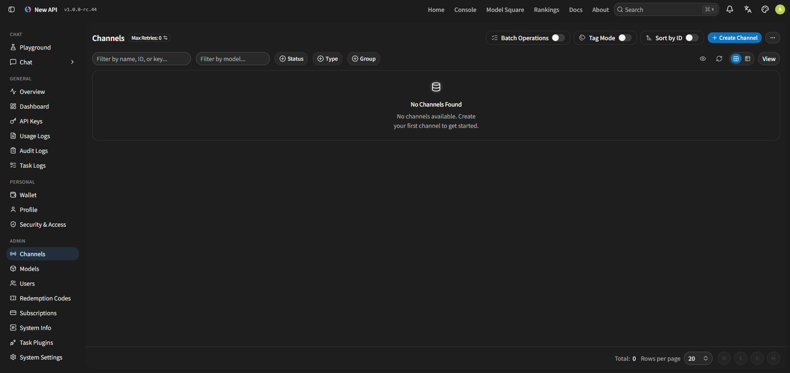
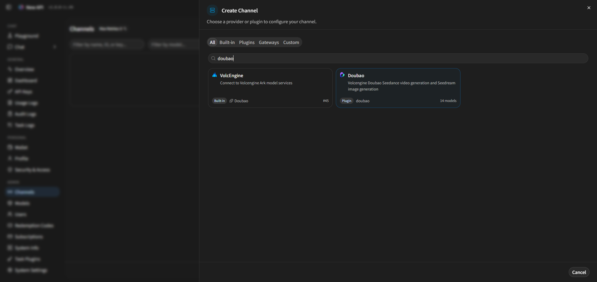
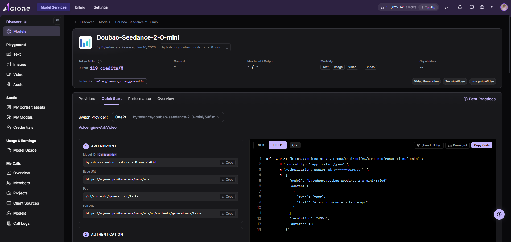
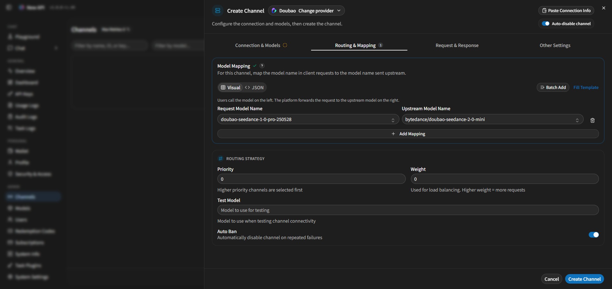
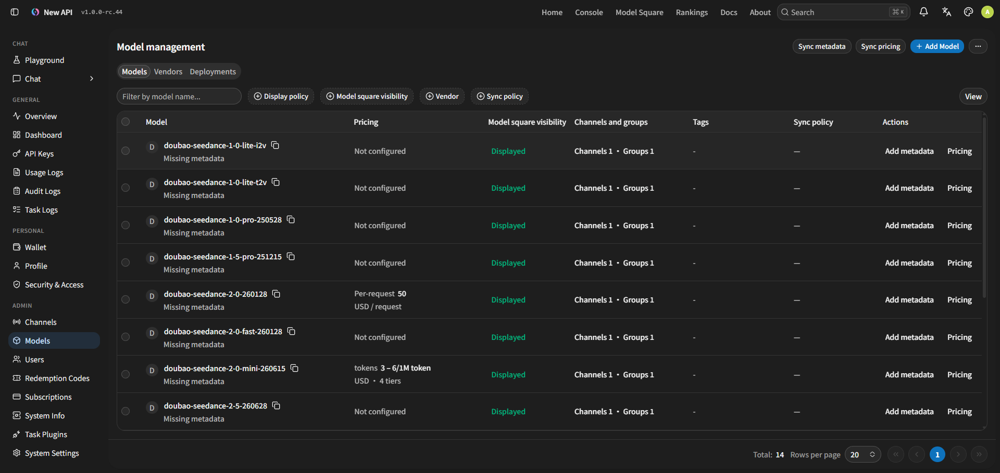
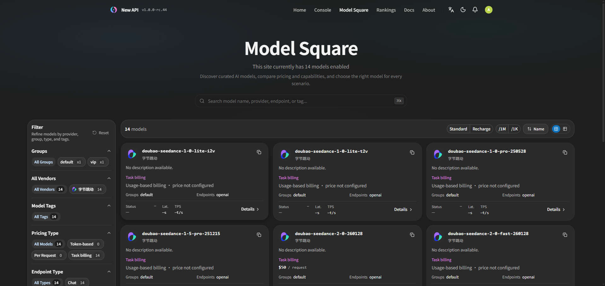

# Integrating AGIOne Doubao Video Generation Models into New API

This article explains how to create a channel in **New API** (an API aggregation and management platform) to integrate the Doubao Seedance / Seedream series of video and image generation models from the AGIOne platform into New API, so that downstream users can call them through a unified API key.

## Before You Start

1. Deploy and log in to the New API admin console (this article uses `v1.0.0-rc.44`).
2. Visit [AGIOne](https://agione.pro/), register and log in, and make sure your account has sufficient balance.
3. In AGIOne's **Model Market**, find the Doubao model you want to integrate, open its model detail page, and obtain the following information:
   - **Base URL**
   - **Model ID**
   - **API Key**

> This article uses the Doubao Seedance video generation model as an example. The screenshots are configuration examples; refer to the actual information on your own AGIOne platform for real operations.

## Step 1: Open Channel Management in New API

Log in to the New API admin console. In the left navigation bar, under the **Admin** group, click **Channels** to open the channel management page.

Initially the channel list is empty and displays "No channels found". Click the **+ Create Channel** button in the upper-right corner to start adding an AGIOne channel.



## Step 2: Select the Doubao Channel Type

In the **Create Channel** dialog that appears, you need to select a provider or plugin to configure the channel.

Type `doubao` in the search box, and the system will show two related options:

| Option | Type | Description |
| --- | --- | --- |
| **Volcano Ark** | Built-in | Connects to Volcano Ark model services, with built-in Doubao support and 45 models in total |
| **Doubao** | Plugin | Volcano Engine Doubao Seedance video generation and Seedream image generation, with 14 models in total |

Select the appropriate option based on your needs. This article selects **Doubao (Plugin)**, which is specifically adapted for Seedance video generation and Seedream image generation models.



## Step 3: Obtain Model Call Information from AGIOne

After selecting the Doubao plugin, you need to fill in the upstream model connection information. Switch to the AGIOne platform to obtain this information.

### Obtain the API Endpoint and Key

1. Log in to [AGIOne](https://agione.pro/) and open **Model Market** in the left navigation bar.
2. Find and click the target model, for example **Doubao-Seedance-2-0-mini**, to open its model detail page.
3. Click the **Quick Start** tab to view the API call information.

On the Quick Start page you can see the following key fields:

| Field | Example Value | Description |
| --- | --- | --- |
| Model ID | `bytedance/doubao-seedance-2-0-mini/54f0d` | The full identifier of the model, including the vendor prefix and instance ID |
| Base URL | `https://agione.pro/hyperone/xapi/api` | The base URL for API requests |
| Path | `/v3/contents/generations/tasks` | The API path for video generation tasks |
| Full URL | `https://agione.pro/hyperone/xapi/api/v3/contents/generations/tasks` | The complete request URL |
| API Key | Obtained from the **Authentication** section | Personal Key used for request authentication |

The right side of the page also provides code examples in three forms — SDK, HTTP, and Curl — which can be used to verify API connectivity.



> **Tip:** Click the **Copy** button to the right of each field to quickly copy its value. The API Key is in the **Authentication** section; select an existing Personal Key or create a new one.

## Step 4: Configure the Connection and Model Mapping

Return to the Create Channel dialog in New API and complete the following configuration.

### Connection & Models

On the **Connection & Models** tab, fill in the Base URL, API Key, and other connection information obtained from AGIOne.

### Routing & Mapping

Switch to the **Routing & Mapping** tab to configure the model mapping.

**Model Mapping** determines how the model name in a user request maps to the real upstream (AGIOne) model name. The platform replaces the model name in the client request with the corresponding upstream model name for this channel.

Configuration details:

| Field | Example Value | Description |
| --- | --- | --- |
| Request model name | `doubao-seedance-2-0-mini-260615` | The model name used by downstream users in API requests |
| Upstream model name | `bytedance/doubao-seedance-2-0-mini/54f0d` | The full Model ID on the AGIOne platform |

You can click **+ Add Mapping** to configure mappings for more models, or use **Batch Add** or **Fill Template** to configure quickly.

**Routing Strategy** controls the channel's call priority and load distribution:

| Field | Description |
| --- | --- |
| Priority | Channels with higher priority are selected first (a higher number means higher priority) |
| Weight | Used for load balancing; a higher weight means more requests |

> Mapping configuration supports two editing modes, **Visual** and **JSON**, which you can switch between as needed.



### Other Settings

On the **Request & Response** and **Other Settings** tabs, you can configure advanced options such as request timeout and auto-disable as needed. The default configuration is usually sufficient.

Once configuration is complete, click the **Create Channel** button in the lower-right corner to save.

## Step 5: Confirm the Models Were Added

After the channel is created successfully, click **Models** in the left navigation bar to open the **Model Management** page and confirm that the Doubao models were added correctly.

The figure below shows the 14 models successfully integrated through the Doubao channel, covering both the Seedance video generation and Seedream image generation series:



Key information on the model management page:

| Column | Description |
| --- | --- |
| Model | The model name, i.e. the identifier used by downstream users in API requests |
| Pricing | The model's billing method and price (per request, per token volume, etc.) |
| Model Square Visibility | Whether the model is visible to end users in the model square |
| Channels & Groups | The channel ID and user group associated with the model |

## Step 6: Verify in the Model Square

Finally, click **Model Square** in the top navigation bar to confirm that the models are displayed correctly from the end user's perspective.

The model square shows all enabled models, and users can browse information such as model name, vendor, billing method, and endpoint type.



Confirm the following:

- The model cards show the correct model name and vendor (ByteDance)
- The billing method is labeled correctly (per-task billing)
- The endpoint type shows `openai`
- You can filter by group (default / vip) and vendor

> A normal display in the model square does not mean the model call has been verified. Continue with the call test below to ensure end-to-end connectivity.

## Testing the Call

Once the channel and model configuration is complete, it is recommended to verify connectivity with an API request.

Using Doubao-Seedance-2-0-mini video generation as an example, send a test request with Curl:

```bash
curl -X POST "https://<your-new-api-domain>/v3/contents/generations/tasks" \
  -H "Content-Type: application/json" \
  -H "Authorization: Bearer <your-new-api-key>" \
  -d '{
    "model": "doubao-seedance-2-0-mini-260615",
    "content": [
      {
        "type": "text",
        "text": "A scenic mountain landscape"
      }
    ],
    "resolution": "480p",
    "duration": 2
  }'
```

Replace `<your-new-api-domain>` with the actual domain of your New API instance, and `<your-new-api-key>` with the API key assigned to the user by New API.

If a successful task-creation response is returned, the full chain New API → AGIOne → Doubao model is connected.

## Warning

**Core technical pitfall warning:** When you click the **Test Connection** / **Test Channel Connection** button on a channel card, both the console and the UI will report an error: `Task Plugin channel test is not supported`. The reason is that New API's channel test sends a standard text chat (Chat/Completions) probe by default, while the task plugin is designed for asynchronous/task-based image and video generation and has no chat completion implementation at its core. This error is a mechanism limitation of New API; it does not indicate that the channel is broken or the plugin is malfunctioning. Testing and verification must use real text-to-image or text-to-video API requests.

## FAQ

- **Cannot find the Doubao option when creating a channel**: Make sure the Doubao plugin is installed in New API. In the Create Channel dialog, switch to the **Plugins** tab to view the list of installed plugins.
- **The channel is created successfully but calls fail with an error**: Check that the AGIOne Base URL and API Key are entered correctly; confirm that the API Key has permission to call the corresponding model; check the call logs on the AGIOne platform to locate the cause of the error.
- **Model mapping is incorrect**: Make sure the request model name (downstream name) and the upstream model name (full AGIOne Model ID) are configured correctly. You can edit or re-add the mapping on the **Routing & Mapping** page.
- **The model does not appear in the model square**: On the model management page, check whether the model's **Model Square Visibility** is set to "Displayed".

*Source: Based on the New API v1.0.0-rc.44 admin console and AGIOne platform screenshots provided by the user. This article does not record real API integration test results; the call test section is intended to guide readers in verifying their own configuration.*
