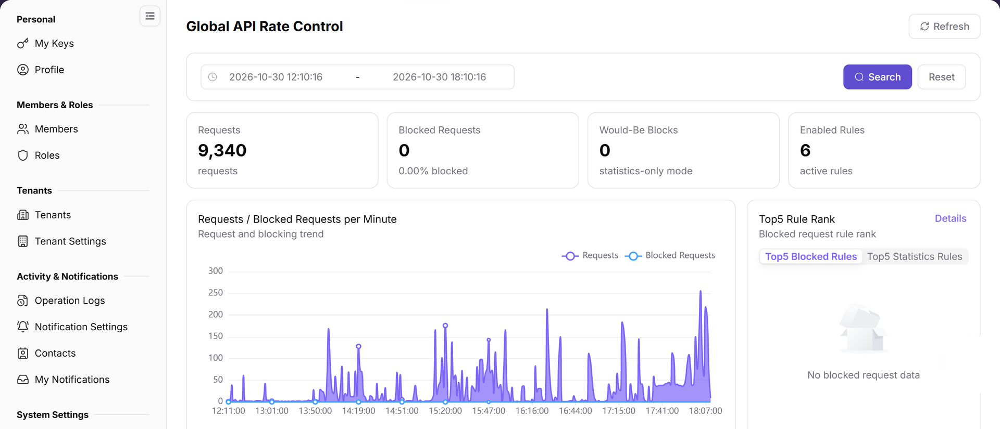
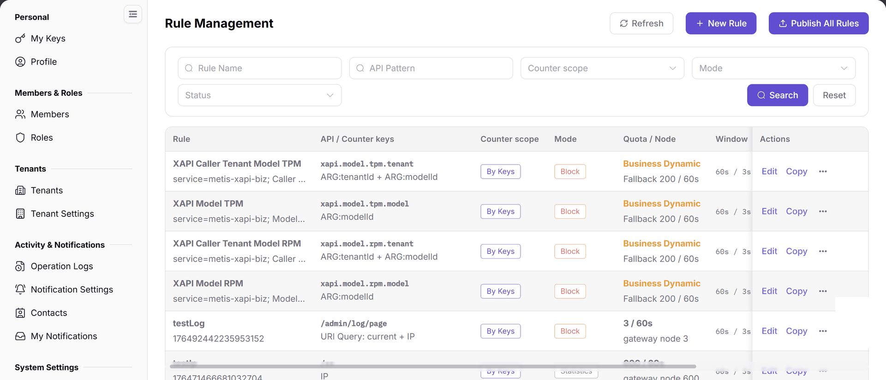
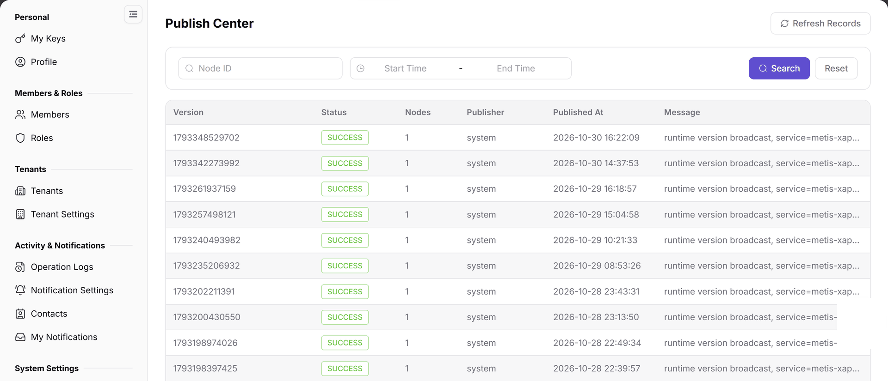
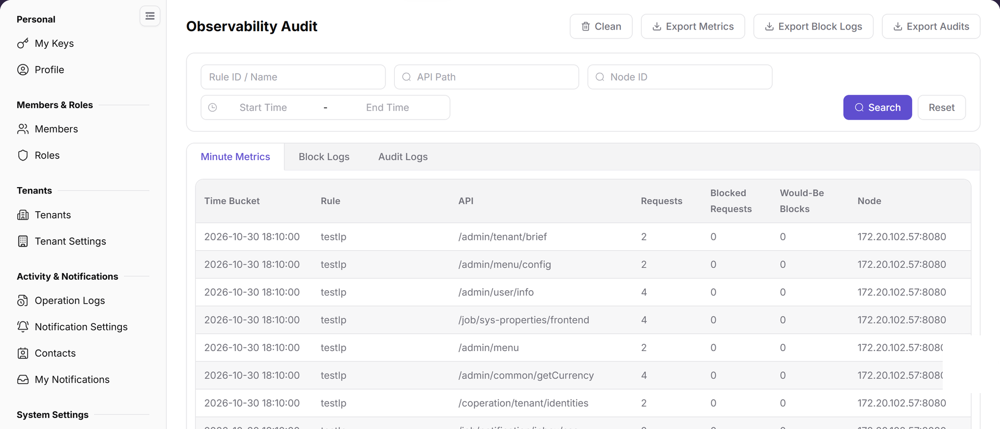

# Release and Audit API Rate-Control Rules

Use this task to release an API rate-control rule version safely and validate node state and business impact. API means application programming interface; API Pattern is the interface-path matching pattern.

## Applicable Roles

- Platform Operators, API gateway administrators, and security or audit staff

## Before You Start

1. Record the target API, tenant or model scope, and current normal request baseline.
2. Define statistics or blocking mode, threshold, observation window, and rollback conditions.
3. Confirm release permission, approval requirements, and target-node scope.

**Role handoff:** The business owner supplies the target interfaces, normal-traffic baseline, and observation requirements. Staff with rule-management/publishing permission and business authorization perform the change and hand the target version and node scope to authorized reviewers. Reviewers return hits, blocks, and business impact before the scope is expanded.

## Procedure

### 1. Record the Traffic Baseline

Open [API Rate Control Overview](../../../usermanual/settings/operator/api-rate-control/overview/), select a time range that covers normal and peak traffic, and record requests, blocked requests, over-limit statistics, and top rules. Do not judge a rule from total requests alone.

### 2. Create or Review the Rule

Open [Rule Management](../../../usermanual/settings/operator/api-rate-control/rule-management/) and review API Pattern, counting scope, mode, quota, window, and priority. Validate a new rule in statistics mode or a limited scope first, then expand only after confirming that it does not match unrelated APIs.

### 3. Release and Check Node Versions

In **Rule Management**, verify the rules and version, confirm business authorization and the impact of a full release, then use **Publish All Rules** (the rule-version publication action) and review its confirmation prompt. Saving or copying a rule is not a release. After the authorized release, open [Release Center](../../../usermanual/settings/operator/api-rate-control/publish-center/) and check version, state, node count, publisher, and message. Then open [Node Cache](../../../usermanual/settings/operator/api-rate-control/node-cache/) and confirm that target nodes loaded the same version. Investigate failed nodes before repeating a full release.

### 4. Observe Hits and Audit Details

Return to Overview to review request and blocking trends. Then open [Observability and Audit](../../../usermanual/settings/operator/api-rate-control/observability-audit/) and compare minute statistics, block logs, and audit logs for the same API, nodes, and time range. Adjust or roll back according to the plan when false positives or abnormal growth appear.

## Completion Checklist

Do not expand the rule scope until node behavior and the checks below match expectations.

| Check | Pass Criteria |
| --- | --- |
| Rule configuration | API matching, counting scope, threshold, mode, and priority are correct. |
| Release record | Target version, node count, state, and release message match expectations. |
| Node cache | All target nodes load the same valid version. |
| Hit audit | Overview metrics correspond to audit records and false positives are acceptable. |
| Rollback readiness | Rollback condition, owner, and validation method are clear. |

## Troubleshooting

| Symptom | Check First |
| --- | --- |
| Rule does not work after a successful release | Enabled state, API Pattern, rule priority, and node-cache version |
| Only some nodes apply the rule | Release target, failure message, node availability, and cache update time |
| Blocking count rises unexpectedly | Business peak, caller retries, matching scope, and threshold |
| Overview shows blocks but audit has no records | Time range, tab, API Path, node, and reporting delay |
