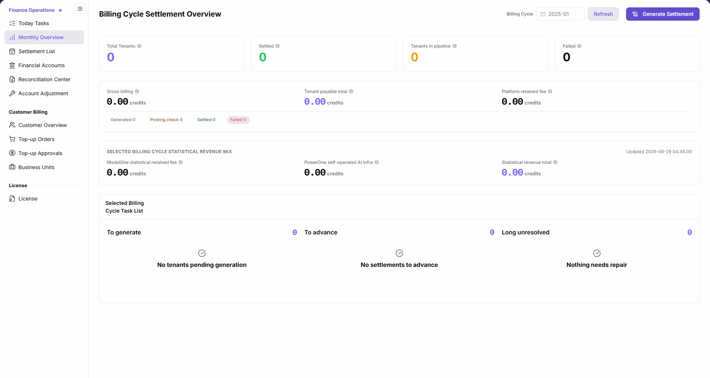
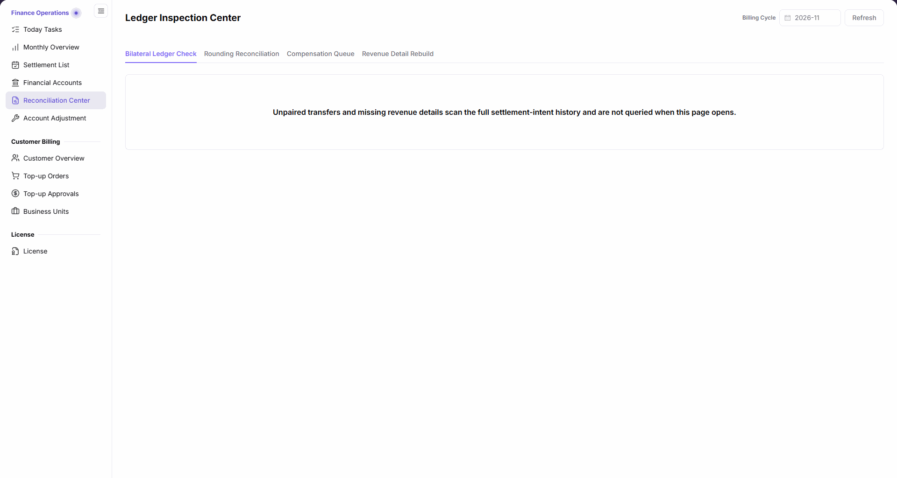
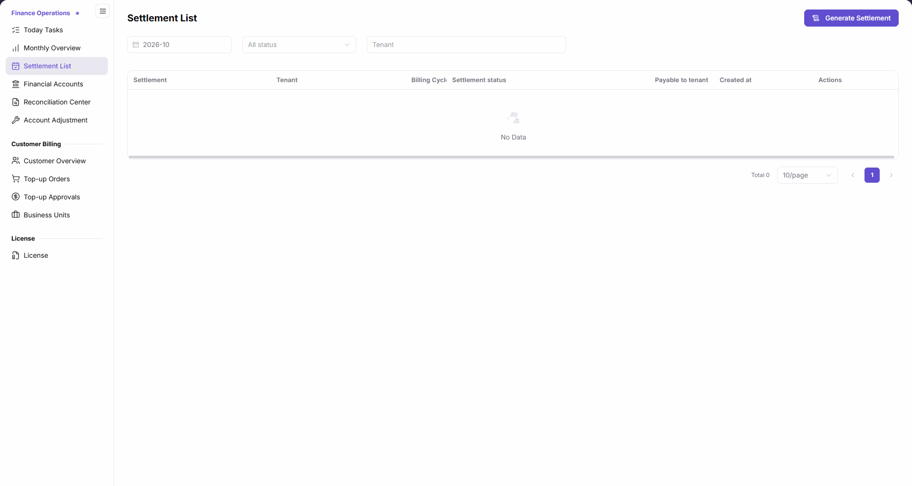

# Billing-Cycle Reconciliation and Settlement

Use this task to complete an operator-side billing-cycle review, exception resolution, and settlement confirmation. The billing cycle is the settlement month under review, not the scope of a live account balance.

Billing reviewers assemble the cycle, tenant, transaction references, and differences. A person with the relevant permission and business authorization performs any required generation or rebuild. When a provider needs to reconcile the result, hand over the statement identifier, cycle, and discrepancy notes for review in that provider's own revenue pages; opening an action page is not proof of posting.

## Applicable Roles

- Platform Operators, billing operators, and financial reconciliation staff

## Before You Start

1. Confirm the target billing cycle, tenant, customer, and business line.
2. Confirm that your account can view financial accounts, reconciliation, and settlement statements.
3. Assess the impact before generating statements, running compensation, rebuilding data, or adjusting accounts.

## Procedure

### 1. Confirm Monthly Status and Pending Tasks

Open `Billing > Finance Operations > Monthly Overview`, select the target cycle, and click **Refresh** before reading tenant settlement statistics, customer consumption, tenant entitlement, retained fees, and the task list. Changing the month alone does not load its statistics. Use [Today's Tasks](../../../usermanual/billing/operator/finance-operations/today-tasks/) for the daily summary; see [Monthly Overview](../../../usermanual/billing/operator/finance-operations/monthly-overview/) for field definitions.

### 2. Reconcile Financial Accounts

Open [Financial Accounts](../../../usermanual/billing/operator/finance-operations/financial-accounts/) and switch between the platform clearing and revenue accounts, choose the same cycle, and refresh. Check transaction direction, source system, and reference information. Read real-time balances separately from cycle statistics. There is no tenant filter here; do not subtract these different measures to infer a discrepancy.

### 3. Resolve Reconciliation Exceptions

Open the [Reconciliation Center](../../../usermanual/billing/operator/finance-operations/reconciliation-center/), review Bilateral Ledger Check, Rounding Reconciliation, Compensation Queue, and Revenue Detail Rebuild separately. Bilateral checks cover all settlement intents and do not query automatically on entry; an initial view without results is not proof of no exceptions. For rounding, check the source-cycle range, check time, and all five categories. Do not execute a rebuild during read-only review; confirm authorization and scan scope before any write operation.

### 4. Review or Generate the Settlement Statement

Open [Settlement Statements](../../../usermanual/billing/operator/finance-operations/settlement-list/) and search by billing cycle, status, and tenant. For generation, follow the manual through cycle and tenant selection, generation checks, settlement preview, and operation remarks. The cycle must precede the current month and the tenant must have ungenerated revenue details. Use the final confirmation only with business authorization, then return to the list and verify progress, amounts, details, and posting information. Opening the generation page is not proof of generation or posting.

### 5. Record Unresolved Differences and the Feature Boundary

[Account Adjustment](../../../usermanual/billing/operator/finance-operations/account-adjustment/) currently shows an under-development notice, not an adjustment form. Record the cycle, tenant, transaction references, and findings for the responsible staff. Navigating to that page or returning home is not a completed adjustment.

## Completion Checklist

Reconcile the cycle with traceable results; investigate failed checks before continuing.

| Check | Pass Criteria |
| --- | --- |
| Scope | Cycle and tenant references agree; platform accounts, real-time balances, cycle statistics, and full-history bilateral checks retain their own scopes. |
| Account transactions | Summary amounts can be traced to financial accounts and transactions. |
| Reconciliation exceptions | Blocking exceptions are resolved and all remaining items have a conclusion. |
| Settlement result | Statement amount, status, and posting information are correct. |
| Unresolved differences | References, findings, and the follow-up owner are recorded; no adjustment is claimed on an under-development page. |

## Troubleshooting

| Symptom | Check First |
| --- | --- |
| Monthly totals do not match account amounts | Billing cycle, tenant, transaction type, and data update time |
| Reconciliation exceptions remain unresolved | Compensation queue, missing revenue details, and assigned owner |
| Settlement statement cannot be generated | A cycle before the current month, a tenant with ungenerated revenue details, generation checks, and authorization |
| No adjustment form is available | Account Adjustment is under development; use Financial Accounts and Settlement Statements to inspect existing information |
