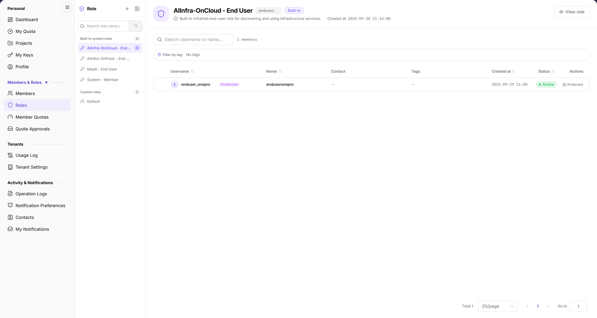

# Identity Authorization

This scenario guides platform administrators through setting organizational boundaries with tenants, packaging permissions in roles, assigning roles to users, and verifying menu, button, and resource access.

## Target Outcome

- The user belongs to the correct tenant and has a role appropriate to the job.
- The user sees only authorized subsystems, menus, and buttons.
- Platform governance permissions remain separate from regular tenant permissions.
- Changes can be verified by a new session and traced through records.

## Applicable Roles

- `operator`: confirms operational access requirements and maintains the permission scope using least privilege.
- `provider` and `enduser`: validation accounts for the resulting access model.

## Before You Start

1. Confirm the user's organization, tenant, and responsibilities.
2. Prefer built-in roles and create a custom role only when responsibilities are not covered.
3. List required and explicitly prohibited menus, actions, and resource scopes.
4. Prepare a validation account that does not carry production workloads.

## Procedure

| Step | Action | Reference | Completion Signal |
| --- | --- | --- | --- |
| 1 | Understand tenant, user, role, and menu relationships | [Identity and Access Model](../../../product/identity-access-model) | Boundaries and role choice are clear |
| 2 | Select a role from the default capability matrix | [Role Comparison](../../../product/role-comparison) | Role matches responsibilities |
| 3 | Confirm member ownership in Tenant Settings and Members | [Tenant Settings](../../../usermanual/settings/user/organizations/org-settings/), [Members](../../../usermanual/settings/user/members-roles/team-members/) | The member is active in the correct tenant |
| 4 | Select a built-in role or create a least-privilege role | [Roles](../../../usermanual/settings/user/members-roles/roles/) | The role contains only necessary permissions |
| 5 | Sign in with the validation account and inspect menus, actions, and resource scope | [Roles](../../../usermanual/settings/operator/members-roles/roles/) | Allowed items work and prohibited items do not |
| 6 | Review the permission change and validation in Operation Logs | [Operation Logs](../../../usermanual/settings/user/activity-notifications/operation-logs/) | Time, operator, and target are traceable |

Choose the execution scope first. Tenant-side member and role work in steps 3–4 requires an account with management permission in that tenant. For platform operations roles, follow the [operator Roles manual](../../../usermanual/settings/operator/members-roles/roles/). The menu path may be the same, but the forms and authorization targets differ. In step 5, use the actual target account to validate its access; an ordinary member does not need to enter operator role management.

Review the role record and permission scope on the appropriate **Roles** page before signing in with the validation account. The administrator hands the target tenant, assigned role, and allowed/denied checklist to the validator. The validator uses the target account and returns visible menus, available actions, and failed checks for the administrator to review; validation is not permission to expand access.

The figure shows built-in/custom roles on the left and the selected role information, member count, and member table on the right. Confirm that records or a completed empty state are visible before reviewing the permission scope.

## Completion Checklist

Check the results below; resolve failed items using the troubleshooting section before continuing.

| Check | Pass Criteria |
| --- | --- |
| 1 | The user belongs to the correct tenant and is active. |
| 2 | The role matches responsibilities without unnecessary platform permissions. |
| 3 | Required menus and actions are available. |
| 4 | Prohibited menus, actions, and resources are unavailable. |
| 5 | A fresh session reflects the change and records are traceable. |

## Troubleshooting

| Symptom | Check First |
| --- | --- |
| Target menu is missing | Tenant assignment, role assignment, menu permission, and a fresh session |
| Menu is visible but actions fail | Action permission code, API permission, and role-menu mapping |
| User sees another tenant's resources | Tenant boundary, resource authorization, and business filters |
| Changes do not take effect | Session cache, re-login, role state, and whether changes were saved |
| Custom role is too broad | Compare it with built-in roles and remove unrelated menus and APIs |

## User Manual

[Open the user-manual entry and choose the subsystem whose access you are configuring](/usermanual/)
