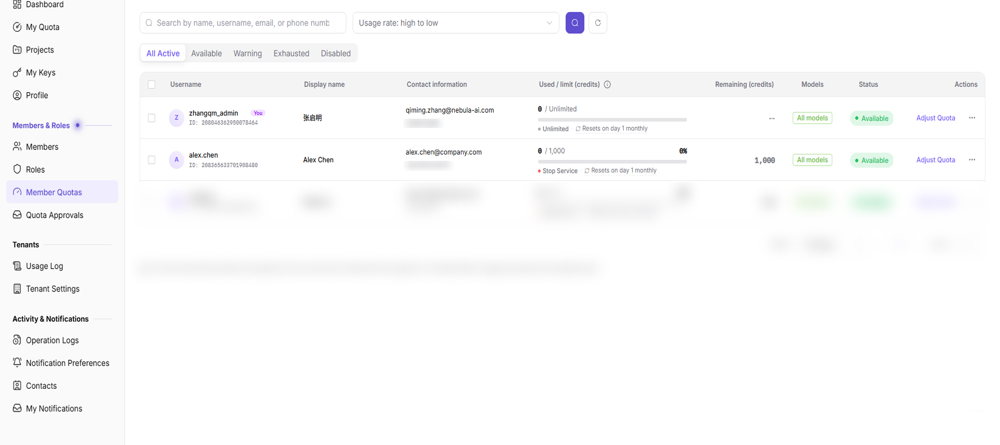
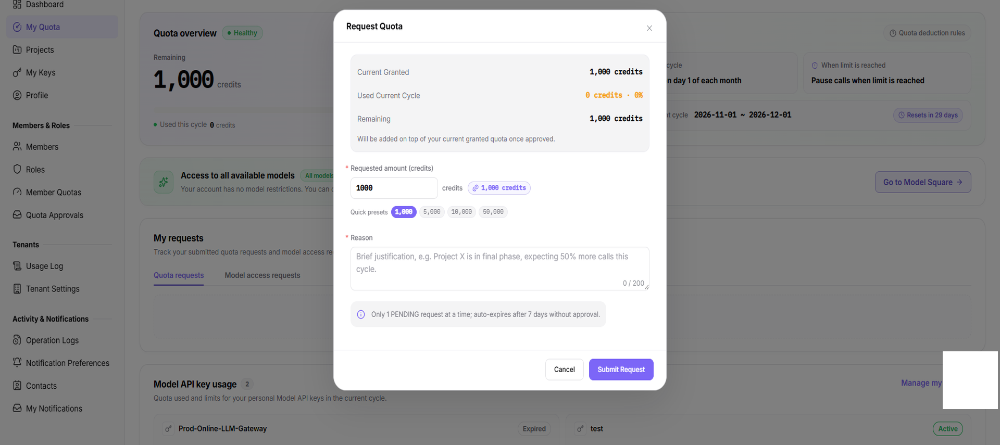
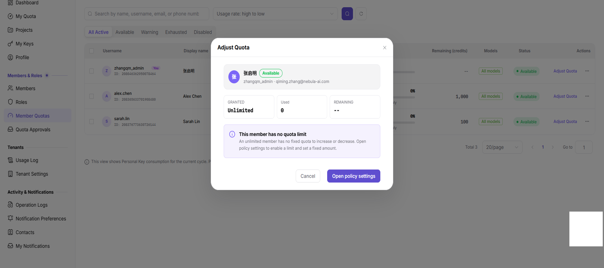

# Request and Allocate Member Quota

Use this task to request quota for a member, adjust the allocation, and set calling limits. Member quota is the member’s spending ceiling in credits; a key is a calling credential, so these are separate restriction layers.

The applicant supplies the target member, requested amount, and business reason. A person with approval permission returns the request state and decision; the member then verifies quota and adjustment records. An administrator changes quota only when a separate change is still needed and authorized, not simply because a request was approved.

## Applicable Roles

- Provider administrators, Model Providers, and end users who request quota

## Before You Start

- Identify the target member, required quota, and business reason.
- Confirm that no duplicate request is pending.
- Identify the project budget, key limit, model scope, and intended reset policy.

## Procedure

### 1. Review the Member's Current Quota

Open [Member Quotas](../../../usermanual/settings/user/members-roles/member-quotas/), locate the member, and review authorized quota, used quota, remaining quota, model scope, and status.

### 2. Submit a Quota Request

Open [Quota Approvals](../../../usermanual/settings/user/members-roles/quota-requests/) under `Settings > Members & Roles`, select the request-record tab, and confirm that no duplicate request is pending. Click **Request Quota**, enter the amount and business reason, and verify the request target and amount before submitting. Close the dialog without submitting for read-only inspection.

### 3. Track the Request and Approval Result

Filter request records by status and confirm whether the request is Pending, Approved, Rejected, Cancelled, or Expired. After approval, return to Member Quotas and verify that the amount was applied.

### 4. Adjust Member Quota and Limits

After approval, check the authorized amount, remaining quota, and adjustment records first; approval is not an instruction to add the same amount again. If a separate change is required and authorized, increase or deduct quota in the member details and enter a reason. Configure the reset cycle, limit, and model allowlist only as needed. Verify the member, amount, business authorization, project budget, and key limit before saving. Do not submit changes during read-only review.

The figure shows the Unlimited-member branch: there is no fixed quota to increase or deduct, and the dialog offers Cancel or Open policy settings. It does not show amount or reason inputs and is not evidence of a completed adjustment. Follow the actual member state before preparing any authorized change.

## Completion Checklist

Do not use the new allocation until the request, member balance, and limits reconcile.

| Check | Pass Criteria |
| --- | --- |
| Request record | Amount, reason, status, and approval result are complete. |
| Member balance | Authorized, used, and remaining quota are correct after adjustment. |
| Constraint relationship | Member, project, key, and model-allowlist rules are consistent. |
| Actual validation | Calls within quota succeed and over-limit calls are restricted as configured. |

## Troubleshooting

| Symptom | Check First |
| --- | --- |
| A new request cannot be submitted | Existing pending request and whether amount and reason are complete |
| Quota does not change after approval | Request member, synchronization state, and member details |
| Calls fail although member quota remains | Project budget, key limit, model allowlist, and model state |
| Adjustment action is unavailable | Current account role and member-quota management permission |
