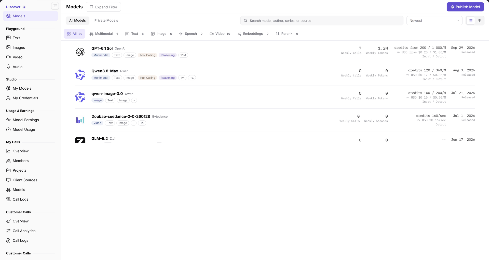
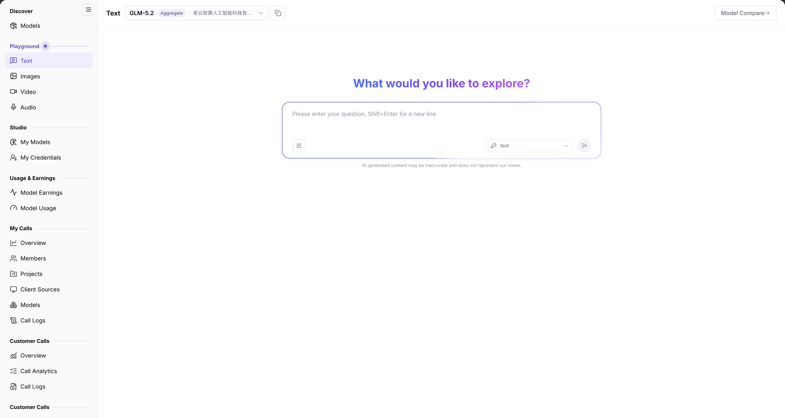

# {{DOCS_PRODUCT_NAME_EN}} User Guide for End Users

This guide connects sign-in, provider selection, Playground (the online testing console), application programming interface (API) integration, and call-log verification. Replace key and model placeholders with values authorized for the current account; no example model is guaranteed to remain available.

## Applicable Roles

- End Users trying and calling models; providers may inspect customer calls within their own permissions.

Confirm the model/provider, protocol, price, and visibility with the provider or model details page before calling. Callers use their own authorized keys. Share request times and model identifiers for investigation, not real keys in shared material.

## Before You Start

- Sign in to {{DOCS_PRODUCT_NAME_EN}} at {{DOCS_LOGIN_URL_EN}} with access to the target model.
- Verify account credit, the selected provider's price and billing unit, call authorization, and personal key (the account's call-authentication credential). Free-quota claiming is not a universal step for every model.
- Prepare non-sensitive test input. Playground and API requests can both consume credits; confirm cost and authorization first.

## 1. Discover a Model and Choose a Provider

1. Open **Model Services > Discover > Models**, search by model, author, family, or source, and narrow the list by capabilities, billing, or other available filters.
2. Click the target model name and review its identifier, context, protocols, and input/output modalities.
3. On **Providers**, compare the specific instances' prices, capabilities, and route identifiers (the model value that targets a specific provider instance). Providers for the same meta model need not share pricing or access rights.
4. Use the intended provider's **Playground** or **Quick Start**. Copy its route identifier rather than guessing from the display name.



The figure shows model search, capability categories, and the catalog. Models and counts change with publication and filtering; do not rely on a fixed list position.

## 2. Try It Online

1. For text, open **Playground > Text**, select a model, and check its provider and tags.
2. Enter a short test prompt, use **Shift+Enter** for a new line, and send it to inspect the response. Image-input support does not imply image-generation support.



The figure shows the model selector, chat input, and Model Compare entry. Check the selected model and provider before sending.

3. Choose a different entry for other generation tasks:

| Task | Menu and Procedure | Validate |
| --- | --- | --- |
| Generate images | [Images](../../../usermanual/model-services/user/playground/images/): select model, size, and image count, then enter a description | Result, count, and billing unit |
| Generate video | [Video](../../../usermanual/model-services/user/playground/video/): select model, resolution, and ratio, enter a scene description, and use Task query | Task and final video; this is not a video-upload frame-analysis flow |
| Generate speech | [Audio](../../../usermanual/model-services/user/playground/audio/): choose a model and enter the text to read | Audio output and listening check; recording recognition is not assumed |

## 3. Call the API

1. Return to the selected provider card and click **Quick Start**. Confirm its route identifier, full URL, protocol, and authentication instructions.
2. Use a key authorized for your account. Keep real values out of shared documents, screenshots, and repositories.
3. For a model supporting OpenAI Chat Completions, use the following example after confirming the current endpoint. curl is a command-line HTTP request tool. This body applies only to the corresponding chat-completions protocol; use the current Quick Start format for other modalities.

```bash
curl -X POST "{{DOCS_API_ENDPOINT_EN}}" \
  -H "Content-Type: application/json" \
  -H "Authorization: Bearer {API_KEY}" \
  -d '{"stream":true,"model":"{MODEL_IDENTIFIER}","messages":[{"role":"user","content":"Hello"}]}'
```

4. Replace placeholders with current Quick Start values and inspect valid output from the intended model. The absence of an error message alone does not establish successful generation.
5. For client integration examples, see [{{DOCS_PRODUCT_NAME_EN}} Best Practices]({{DOCS_OPENCODE_URL_EN}}).

## 4. Verify Call Records

1. Open **My Calls > Call Logs**, select the month, use **By Date** when needed, and narrow by Model, Client Source, or **Name or ID**.
2. Set **Result Category** to All or the relevant failure category and locate the request by call time.
3. Check **Model & Platform Route**, **Caller**, **Client Source**, **Usage**, and **Status & E2E**. Caller attribution and Client Source are different dimensions.
4. Use Actions to inspect the individual call. Providers check customer calls using their own permissions and matching time ranges; this is not a prerequisite for an end user to complete the task.

## Completion Checklist

| Check | Pass Criteria |
| --- | --- |
| Model and access | The model and provider are identified, with price and call authorization confirmed. |
| Playground | The matching modality returns a result that can be inspected. |
| API request | The intended protocol, route ID, and authorized key return valid output. |
| Logs | A record with matching time, model, and state can be located. |

## Troubleshooting

| Symptom | Check First and Continue |
| --- | --- |
| Model is missing | Clear filters and check All/Private scope and tenant visibility in [Models](../../../usermanual/model-services/user/discover/models/#faq). |
| Playground and API behave differently | Align provider, route, protocol, price, and key; do not mix different instances. |
| API authentication fails | Check the current Quick Start endpoint, authentication format, and account authorization. Never post keys in public tickets. |
| Logs are empty | Check month, model, source, name/ID, and result category in [Call Logs](../../../usermanual/model-services/user/my-calls/call-logs/#faq). |

## User Manual

- [Models](../../../usermanual/model-services/user/discover/models/)
- [My Calls Overview](../../../usermanual/model-services/user/my-calls/overview/)
- [Call Logs](../../../usermanual/model-services/user/my-calls/call-logs/)
