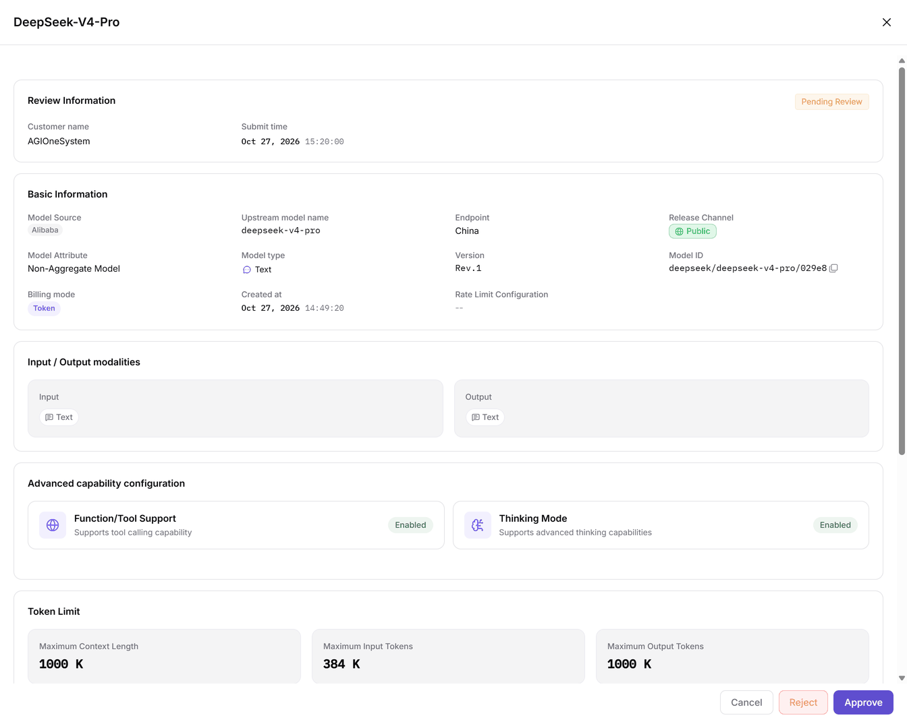

# Model Publishing Approval

This task checks the provider's submitted model revision and processes it through the operator's review drawer.

## Applicable Roles

- Operator Admin; the Model Provider assists with revision and publication-status verification.

The provider supplies the model identifier, submitted revision, visibility, and configuration evidence. The operator reviews that object and hands the processing status and any request for additional material back to the provider. Real credentials are not part of the shared handoff.

## Before You Start

1. Permission to view and process **Model Services > Approvals > Model Reviews**.
2. A pending record exists and its model, customer, revision, and visibility are confirmed.
3. Publication settings are available as review evidence; shared materials contain no real credentials.

## Procedure

1. Open **Approvals > Model Reviews**, filter by model name, pending status, visibility, type, or customer, then click **Search**. Read submission time and revision from the table rather than assuming they are filter controls.
2. Check customer, revision, submission time, and visibility on the target row. Click **Review** to open the right-hand drawer; there is no separate **Details** button.
3. Review source, upstream model name, Endpoint (service access point), Model ID (platform model identifier), release channel, revision, billing, and rate limits, followed by modalities, capabilities, token limits (text-processing unit limits), and protocols.

The figure shows the review drawer with Cancel, Reject, and Approve at the bottom. Opening it to inspect settings does not itself submit a decision.

4. Confirm the object and revision, then choose **Approve** or **Reject** according to business authorization. Use **Cancel** to leave without processing. Do not assume a mandatory comment form or automatic provider-visible comments; hand over requests for additional material through the agreed collaboration channel.
5. Query again to verify review status and time. The provider checks status and revisions in [My Models](../../../usermanual/model-services/user/studio/my-models/); after approval, an intended user's account verifies visibility and call authorization in [Models](../../../usermanual/model-services/user/discover/models/).

## Completion Checklist

| Check | Pass Criteria |
| --- | --- |
| Review object | Model ID, customer, revision, and intended visibility match. |
| Evidence | Modalities, protocols, billing, and rate limits have been checked. |
| Decision | A new query verifies review status and review time. |
| Publication | The provider checks the revision and authorized users verify visibility and calls. |

## Troubleshooting

| Symptom | Check First and Continue |
| --- | --- |
| Record is missing | Reset filters, keep pending status, then add conditions one at a time; see [Model Reviews](../../../usermanual/model-services/operator/approvals/model-reviews/#faq). |
| No Details button | Use the row's Review action; Cancel after inspection when no decision is needed. |
| Published model is invisible or inaccessible | Verify revision, publication method, and Access Mode (access control mode) in [My Models](../../../usermanual/model-services/user/studio/my-models/) and [Models](../../../usermanual/model-services/user/discover/models/). |
