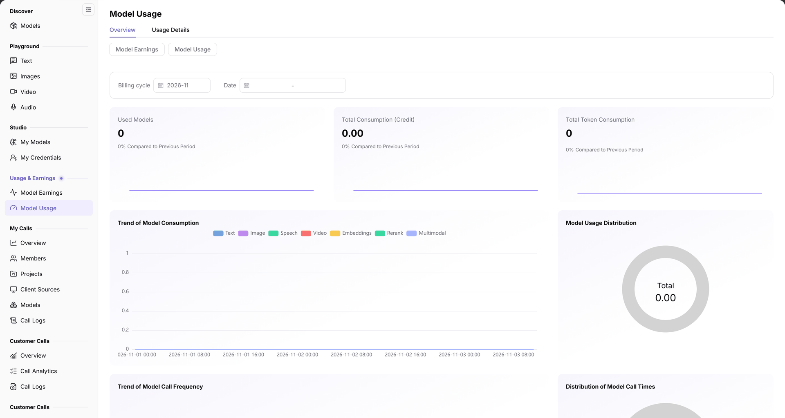
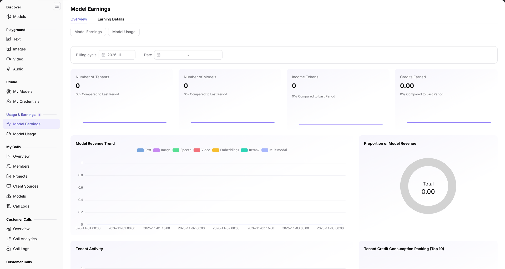

# Model Usage & Earnings

Callers inspect their consumption; providers inspect income from their own models. The pages have different scopes: total caller consumption is not automatically the provider's revenue. Credit is the platform's pricing unit; a token is a model text-processing unit, so their counts are not interchangeable.

## Applicable Roles

- End Users and Model Providers; operators assist when financial investigation is needed.

For handoff, the caller provides the time range and log identifiers; the provider adds effective revisions, prices, and earnings records. The operator takes over unexplained differences. Share only necessary reconciliation information, never credentials.

## Before You Start

1. Confirm whether this account is a caller or provider, then record model, provider, billing cycle, dates, and unit.
2. Prepare a call time or identifier without keys or full request bodies; confirm the active publication revision and price.

## Procedure

1. Open [My Calls logs](../../../usermanual/model-services/user/my-calls/call-logs/), narrow by month, model, and client source, and inspect call time, route, caller attribution, usage, and status. Caller attribution is a member/project dimension, not the application-source dimension.
2. Open **Usage & Earnings > Model Usage**, align **Billing cycle** and **Date**, and read **Used Models**, **Total Consumption (Credit)**, and **Total Token Consumption**. Open **Usage Details** for itemized checks. Do not assume the overview provides Model ID or member/project filters.

The figure shows consumption metrics and trends for the selected period; it is not a complete bill for an individual request.

3. The provider opens **Usage & Earnings > Model Earnings**, aligns cycle and dates, reads tenants, models, income tokens, and credits earned, then opens **Earning Details**.

The figure shows provider income. These metrics and caller consumption have different scopes and must be read separately.

4. When customer traffic needs checking, the provider uses [Customer Calls](../../../usermanual/model-services/user/provider-calls/overview/) and [Customer Call Logs](../../../usermanual/model-services/user/provider-calls/call-logs/) within its permission scope for the same model and period.
5. If values need investigation, the provider checks the effective revision, billing unit, price, and limits in [My Models](../../../usermanual/model-services/user/studio/my-models/), then hands specific records to the operator. Do not infer universal billing rules for failed or canceled requests from summary totals.

## Completion Checklist

| Check | Pass Criteria |
| --- | --- |
| Scope | Account, model/provider, cycle, dates, and unit are aligned. |
| Calls | Target logs are traceable; route, caller, source, and status are checked separately. |
| Consumption and income | Each overview/detail pair is read in its own scope rather than treated as identical. |
| Differences | Specific records, period, and price evidence can be handed over without credentials. |

## Troubleshooting

| Symptom | Check First and Continue |
| --- | --- |
| Usage is empty | Check period, dates, and actual calls in [Model Usage](../../../usermanual/model-services/user/usage-earnings/model-usage/#faq). |
| Earnings are empty | Check period, dates, and model pricing in [Model Earnings](../../../usermanual/model-services/user/usage-earnings/model-earnings/#faq). |
| Log is missing | Check month, source, and result category in [Call Logs](../../../usermanual/model-services/user/my-calls/call-logs/#faq). |
| Usage and earnings differ | Align role and statistical scope before checking effective prices. Hand unexplained differences to operators rather than immediately declaring a billing defect. |
