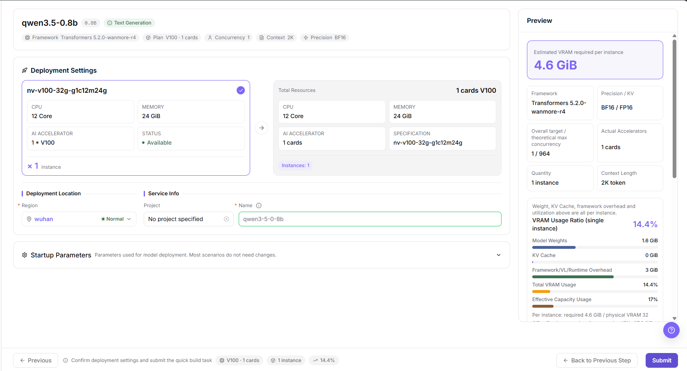
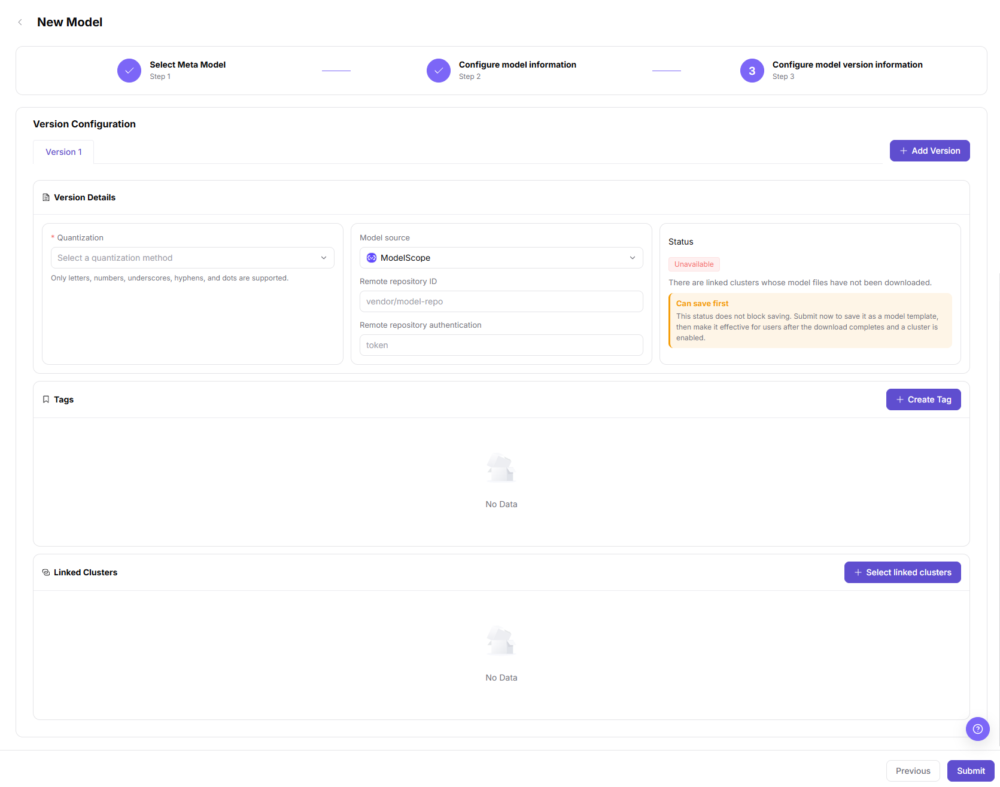

# New Model Template Preparation and Deployment Guide

This task connects On-Prem (on-premises compute management) model files, inference templates, instances, and service registration. Start with Scenario A when a deployable template exists. Otherwise the operator completes Scenario B before handing the prepared template to the provider for Scenario A.

## Applicable Roles

- Operator: model configuration, frameworks, and inference templates.
- Model Provider: template selection, instance creation, registration, and controlled call verification.

The operator supplies model versions, framework relations, and adapted accelerators. The provider checks the template and specification before creating an instance. After registration, hand the model identifier, protocol, and scope to the intended user, not shared plaintext keys.

## Before You Start

- Prepare target clusters, accelerators, framework images, resource specifications, and tenant quota in the intended region.
- Confirm model license, version, quantization, repository information, concurrency, and context needs. Ascend 910B and vLLM are optional adaptation choices, not fixed settings for every environment.
- Confirm resource, cost, and call authorization before creating an instance, publishing, or testing connectivity. Tests send real requests. API means application programming interface; a smoke test is a minimal connectivity check, not completed publication or authorized-call validation.
- Keep repository credentials, instance Endpoints (service access addresses), and request tokens out of shared material.

## Scenario A: Deploy and Call with an Existing Template (Provider)

### 1. Create an Instance from Templates

1. Open **On-Prem > Model Deployment > Templates**, search for the target model, and select a **Deployable** model. Do not look for a Start button in Model Services > My Models.
2. Check accelerators, business parameters, and recommended specifications. Use actual concurrency, context, precision, and headroom requirements rather than copying another hardware example.
3. Check total resources, region, project, and instance name in Deployment Settings; review the preview and click **Submit**.
4. Open **On-Prem > Model Deployment > Instances**, locate the instance by name and region, compare its model, framework, and resources, and continue after **Inference service ready**.

The figure shows an example of resources, deployment location, and service information. The example specification is not guaranteed to be available to the current account.

See [Templates](../../../usermanual/ai-infra-on-prem/user/model-deployment/templates/) for deployment parameters and [Instances](../../../usermanual/ai-infra-on-prem/user/model-deployment/instances/) for state and service ports.

### 2. Check Connectivity and Register a Private Model

1. On the target instance card, open **… > Publish Model**, then confirm the target service and **Selected service port**.
2. Use **Publish as Private Model** for this flow. The Public Model card provides **Contact Us**; it does not establish a completed public-publication path.
3. Check the inference-service port and protocol, obtain request authorization, and run the smoke test. Continue with **Jump to Publish** only after **API smoke test passed**.
4. On **My Models** with the Private tag, complete Basic Information, Billing Configuration, and Rate Limit Configuration. Passing the test or landing on this page does not complete publication.
5. Return to the publication list to check status and revision; hand over to [Model Publishing Approval](../model-publishing-approval/) when review is required.

### 3. Verify Calls with the Intended Account

1. Open **Model Services > Discover > Models**, locate the model within its authorized scope, and verify the provider.
2. Use the provider's **Playground** to inspect output for the intended modality, or **Quick Start** to confirm URL, protocol, and route identifier.
3. Execute a controlled request using the current integration example, inspect valid output, then locate the time and model in **My Calls > Call Logs**. See [Model Experience and API Calling](../model-experience-api-calling/).

## Scenario B: Prepare Model Versions and Templates (Operator)

### 1. Maintain Files and Linked Clusters

1. Open **On-Prem > Templates > Models** and check whether the model exists. To create it, click **Add model** and complete Select Meta Model, Configure model information, and Configure model version information.
2. Set category and parameter count. Under version information, verify quantization, **Model source** (file source such as ModelScope, HuggingFace, or Local), and repository information. This field is not Model Services > Settings > Model Sources.
3. Select linked clusters, review state, and submit. Return to the list to check **Model Download** and version. Saving first does not establish that files are downloaded or usable by tenants.

The figure shows version configuration. Quantization, file source, and linked clusters must match the target environment; another model's repository ID is not a default.

### 2. Maintain Inference Templates and Framework Relations

1. Open **On-Prem > Templates > Inference Templates**, click **Create Inference Template**, choose model, version, and framework version, check the name, and save.
2. Open details and separately inspect **Model Version Switch**, **Framework Relations**, runtime image, and bound accelerators; maintain the **Linked VRAM Factor Form** (parameters for estimating accelerator memory) when needed.
3. Check each relation's state and the list's **Deployable / Undeployable** conclusion. A framework relation marked **Available** does not alone prove the entire template is deployable.
4. After checking dependencies and visibility, hand model-version, framework, and specification information to the provider and verify user-side selection and deployment through Scenario A.

## Completion Checklist

| Check | Pass Criteria |
| --- | --- |
| Files | Version, file source, and target cluster download state have been checked. |
| Template | Model/framework combination, image, accelerators, and factor form agree, and the user-side template is deployable. |
| Instance | The card matches the preview; inference service is ready with the correct port and protocol. |
| Registration | Registration is completed after the smoke test; publication status and revision are checked. |
| Call | The authorized account receives valid output and can locate the call log. |

## Troubleshooting

| Symptom | Check First and Continue |
| --- | --- |
| Model files are not ready | Check version source, repository, and linked cluster download state in [Models](../../../usermanual/ai-infra-on-prem/operator/templates/models/#faq). |
| Template is undeployable | Check model version, framework relation, image, accelerators, and dependencies in [Inference Templates](../../../usermanual/ai-infra-on-prem/operator/templates/inference-templates/#faq). |
| No specification or instance | Verify region, quota, name, and filters in [Templates](../../../usermanual/ai-infra-on-prem/user/model-deployment/templates/) and [Instances](../../../usermanual/ai-infra-on-prem/user/model-deployment/instances/). |
| Publication smoke test fails | Verify readiness, port, and protocol in [Instance Publication](../../../usermanual/ai-infra-on-prem/user/model-deployment/instances/#publish-model). |
| Registered service cannot be called | Verify publication status, revision, and access scope, then follow the [Calling Guide](../model-experience-api-calling/). |
