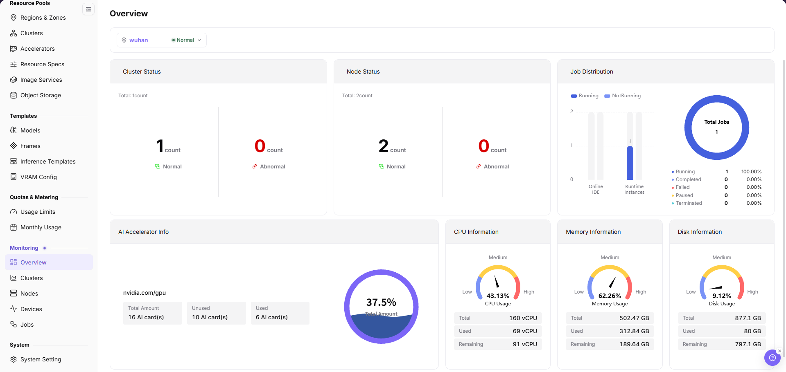

# Observability & Troubleshooting

This scenario helps operators, providers, and callers decide whether a problem belongs to calls, model services, cloud deployments, On-Prem resources, or metering before opening the corresponding logs and monitoring views. API means application programming interface. Usage tokens measure model processing; authentication tokens and keys are credentials, not usage units.

## Applicable Roles

- End User, Model Provider, and Platform Operator investigating issues within their permitted scope

## Target Outcome

- The issue includes role, time range, model or resource ID, and a reproducible symptom.
- The issue is narrowed to call, deployment, job, node, device, or metering level.
- Logs, events, monitoring, and usage use the same time range.
- Evidence is redacted and sufficient for the next owner.

## Before You Start

1. Record time, account role, tenant, subsystem, and page entry.
2. Record a redacted model, deployment, instance, job, or request identifier.
3. Classify the symptom as visibility, creation, runtime, call, performance, or usage.
4. Do not send full prompts, responses, tokens, keys, or internal endpoints in tickets or chats.

**Role handoff:** The caller supplies the incident time, object or request identifier, visible error, and sanitized symptom. The provider first inspects services and call records within their permission scope. Platform, cluster, or node issues go to an authorized operator; the original caller retests under the same conditions after resolution. Do not share keys or complete requests/responses.

## Routing Table

| Symptom | First Entry | Manual |
| --- | --- | --- |
| Model API call fails or response is abnormal | My Calls or Customer Call Logs | [Call Logs](../../../usermanual/model-services/user/my-calls/call-logs/), [Customer Call Logs](../../../usermanual/model-services/user/provider-calls/call-logs/) |
| Success rate, latency, or token use is abnormal | My Calls > Overview / Customer Calls > Overview | [My Call Overview](../../../usermanual/model-services/user/my-calls/overview/), [Customer Overview](../../../usermanual/model-services/user/provider-calls/overview/) |
| Cloud deployment fails or is unreachable | Deployment details, events, and monitoring | [My Deployments](../../../usermanual/ai-infra-on-cloud/user/model-services/my-deployments/) |
| On-Prem job is pending or failed | Job monitoring, instance events, and logs | [Job Monitoring](../../../usermanual/ai-infra-on-prem/operator/monitoring/jobs/), [Instances](../../../usermanual/ai-infra-on-prem/user/model-deployment/instances/) |
| Node or accelerator is abnormal | Node Statistics and Device Monitoring | [Node Statistics](../../../usermanual/ai-infra-on-prem/operator/monitoring/nodes/), [Device Monitoring](../../../usermanual/ai-infra-on-prem/operator/monitoring/devices/) |
| Quota, usage, or amount is abnormal | Quota, metering details, and model usage | [On-Prem Metering & Monitoring](../on-prem-resource-metering-monitoring/), [Model Usage & Earnings](../model-usage-revenue/) |

## General Sequence

1. Reproduce and capture the first error instead of only the final cascading error.
2. Confirm account, tenant, region, model, and time filters.
3. Move from user-visible state to events and logs, then to node or device monitoring.
4. For call issues, compare request logs with model service state.
5. For resource issues, compare job state, node capacity, and device health.
6. For usage issues, validate runtime records before metering details and period summaries.

Start with the current cards for the selected region in [On-Prem Monitoring Overview](../../../usermanual/ai-infra-on-prem/operator/monitoring/overview/), then open specialized monitoring. Node Statistics has no time-range control: record the observation time and align region, cluster, and object instead. Apply a common time range only on log or trend pages that actually provide that filter. A current snapshot is not a historical result for the incident time.

The figure shows current cluster, node, and job cards for the selected region, with resource-utilization summaries. It is a regional snapshot, not a historical result for the incident time.

## Completion Checklist

Check the results below; resolve failed items using the troubleshooting section before continuing.

| Check | Pass Criteria |
| --- | --- |
| 1 | The issue layer and current owner are clear. |
| 2 | Error, log, event, and monitoring times align. |
| 3 | Impact is classified as one request, instance, tenant, or the platform. |
| 4 | The same conditions were retested after mitigation or repair. |
| 5 | Handoff includes entry, steps, expected and actual results, time, and redacted evidence. |

## Troubleshooting and Common Mistakes

- Reviewing only aggregate monitoring without failed events or request logs.
- Using different time, region, or tenant filters across views.
- Treating permission-driven invisibility as missing resources.
- Mixing quota, account credit, and cluster capacity failures.
- Copying complete requests or credentials into evidence.
