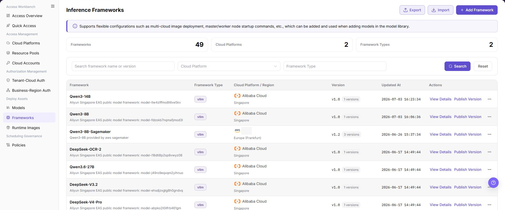
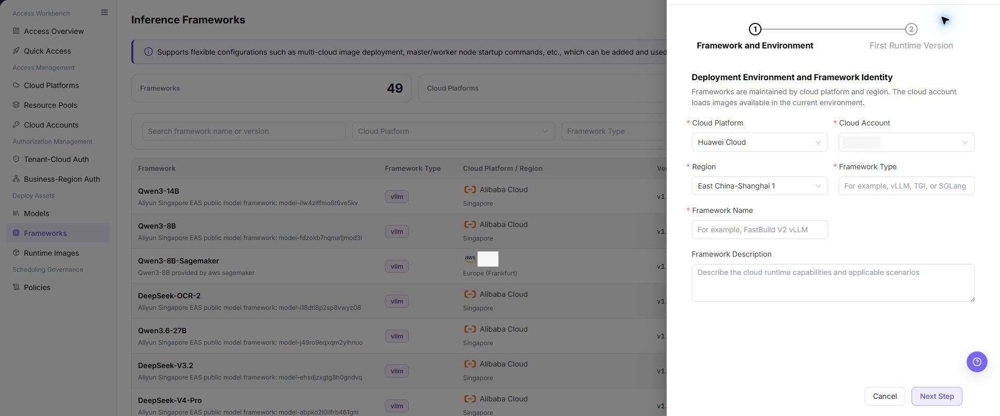

# Inference Frameworks

This task combines a runtime image, startup command, service port, and framework type into a reusable deployment runtime.

## Target Outcome

The framework version references the intended image and startup configuration and is selectable by Models after publication. Runtime startup still requires deployment validation.

## Applicable Roles

- Platform Operator

## Before You Start

- The inference image is prepared and validated.
- Framework type, startup command, model placeholder, service port, and health-check behavior are confirmed.

## Procedure

### Add a Framework and Publish Its Version

1. Open **On-Cloud > Deploy Assets > Frameworks** and review the cloud platform and existing framework versions.

2. Select **Add Framework**, provide basic information such as cloud account, region, framework name and type, and add an initial version.
3. Select the prepared runtime image, check the port and master-node command, and add worker commands, environment variables, and extended parameters only as required by the framework. Never include real secrets in commands or descriptions.
4. Select **Confirm**, then open details to read back the version, image, and startup configuration.

5. Locate the version in framework details, select **Publish**, review its image and scope, and confirm. Verify the published version is selectable in Models. Saving configuration alone does not prove publication or successful service startup.

## Completion Checklist

Check the results below; resolve failed items using the troubleshooting section before continuing.

| Check | Pass Criteria |
| --- | --- |
| 1 | Image, framework type, startup command, and port are compatible. |
| 2 | Service health and API behavior can be validated. |
| 3 | Model-asset configuration can select the framework. |

## Troubleshooting

| Symptom | Check First |
| --- | --- |
| Framework fails to start | Image compatibility, command parameters, model path, and port |
| Model asset cannot select the framework | Framework state, framework type, and target-cloud compatibility |

## User Manual

[Review complete fields, validation rules, and troubleshooting for Inference Frameworks](../../../../usermanual/ai-infra-on-cloud/operator/deploy-assets/frameworks/)
