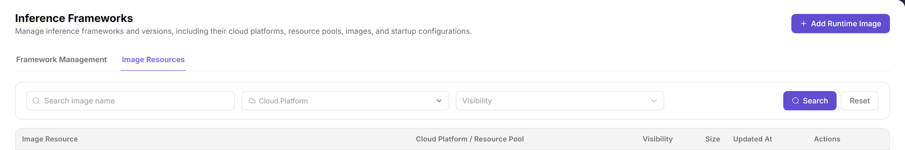
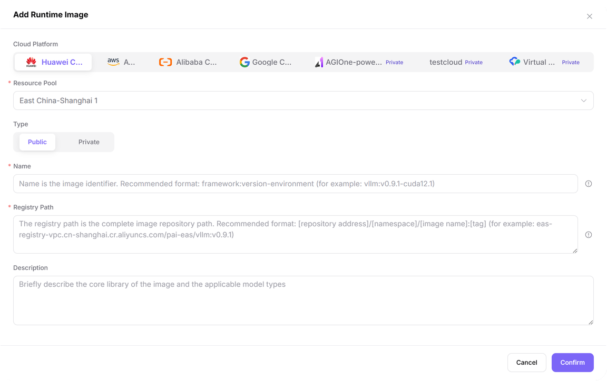

# Runtime Images

This task registers a cloud image used by inference frameworks. Image availability directly affects whether downstream services can start.

## Target Outcome

The target cloud environment can pull the image, and inference-framework configuration can select it.

## Applicable Roles

- Platform Operator

## Before You Start

- Confirm the full repository address, controlled version tag (the image version label), and supported framework types.
- Confirm that the target cloud environment has network access and pull permission for the image repository.

## Procedure

### Add an Image

1. From the sidebar, open **On-Cloud > Deploy Assets > Frameworks**, switch to **Image Resources** on the page, and review existing records for the target cloud platform and resource pool.

2. Select **Add Runtime Image**, choose the cloud platform, resource pool, and public/private type, and enter the name, complete registry path, and description. Do not fill in architecture fields that the initial form does not ask for.
3. Use an explicit version in the complete path, such as `registry.example.com/ai/runtime:example-tag`; this example is not a real pullable image.
4. Select **Confirm**, verify the record and scope, and check that the image can be selected by the framework version.

Image Resources is not a standalone sidebar entry: open **Frameworks** first, then switch to **Image Resources** on that page. If the entry is missing, check that the account can access Deploy Assets instead of searching the sidebar for “Runtime Images”. See the linked manual for complete fields and editing.

## Completion Checklist

Check the results below; resolve failed items using the troubleshooting section before continuing.

| Check | Pass Criteria |
| --- | --- |
| 1 | Repository address and tag uniquely identify a controlled image. |
| 2 | The target cloud environment can pull the image. |
| 3 | Inference-framework configuration can select the image. |

## Troubleshooting

| Symptom | Check First |
| --- | --- |
| Image pull fails | Repository address, tag, pull permission, network, and architecture |
| Image pulls but the service fails to start | Image content, framework compatibility, startup command, and port |

## User Manual

[Review complete fields, validation rules, and troubleshooting for Runtime Images](../../../../usermanual/ai-infra-on-cloud/operator/deploy-assets/runtime-images/)
