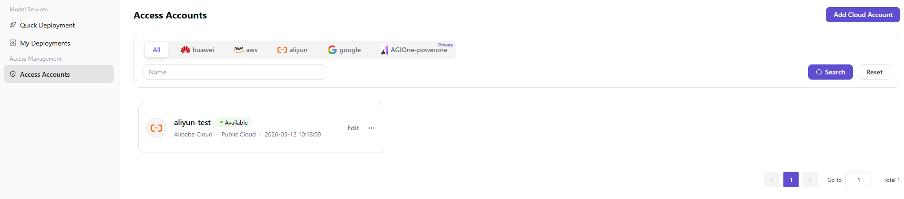
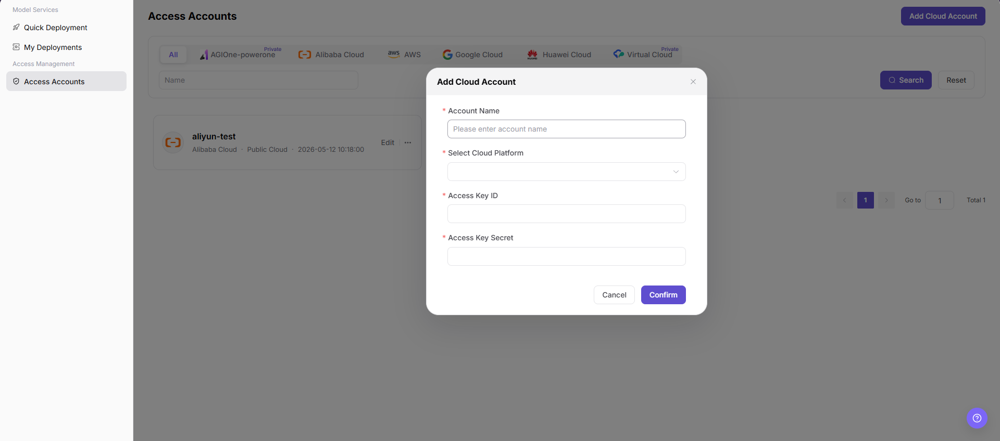

# Add a User Access Account

Add the user's own cloud access account before starting a cloud model deployment.

## Target Outcome

The model provider has a validated cloud account that quick deployment can use within the authorized scope.

## Applicable Roles

- Model Provider

## Before You Start

- Confirm that the Platform Operator has authorized the cloud platform and regions for your tenant.
- Prepare a dedicated least-privilege cloud credential.

## Procedure

### Add a Cloud Account

1. From the platform home page, select **Access Accounts** in the left navigation to open account management.
2. Select **Add Cloud Account** in the upper-right corner to open the Add Account dialog.

3. Configure the account:
   - Enter an **Account Name**, such as `aliyun-wh-dev`.
   - Select a cloud platform that the current version supports and the tenant is authorized to use, such as Alibaba Cloud or AWS.
   - Enter the cloud platform **Access Key ID**, such as `<ACCESS_KEY_ID>`.
   - Enter the cloud platform **Access Key Secret**, such as `<ACCESS_KEY_SECRET>`.
4. Review the information and select **Confirm** to add the account, or **Cancel** to discard the changes.

#### Parameter Reference

| Field | Type | Example | Description |
| --- | --- | --- | --- |
| Account Name | Text | `aliyun-wh-dev` | Required; a user-defined account identifier |
| Cloud Platform | Select | `Alibaba Cloud` | Required; the supported platform to which the account belongs |
| Access Key ID | Text | `<ACCESS_KEY_ID>` | Required; the cloud access-key ID |
| Access Key Secret | Password | `<ACCESS_KEY_SECRET>` | Required; the cloud access-key secret |

## Completion Checklist

Check the results below; resolve failed items using the troubleshooting section before continuing.

| Check | Pass Criteria |
| --- | --- |
| 1 | Account validation succeeds. |
| 2 | The account is visible only to the intended user or tenant scope. |
| 3 | Quick deployment can use the account in an authorized region. |

## Troubleshooting

| Symptom | Check First |
| --- | --- |
| Account validation fails | Credential validity, cloud permissions, network access, and platform selection |
| Quick deployment cannot select the account | Tenant authorization, region scope, and account validation state |

## User Manual

[Review complete fields, validation rules, and common issues for Access Accounts](/usermanual/ai-infra-on-cloud/user/access-management/access-accounts/)
