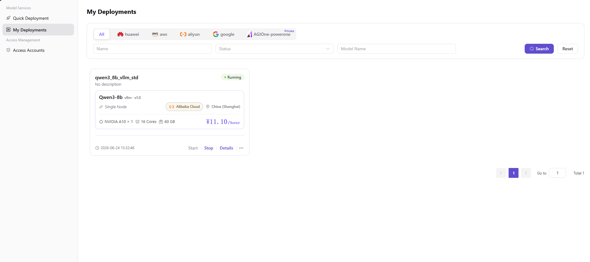

# My Deployments

Use My Deployments to verify runtime state, events, monitoring, API access, and lifecycle operations for a cloud model service.

## Target Outcome

The deployment reaches a healthy state, responds to a controlled request, and can be monitored and stopped when no longer needed.

## Applicable Roles

- Model Provider

## Before You Start

- Record the deployment name, cloud platform, region, and expected creation time.
- Prepare a harmless test request and understand that running resources may continue to incur cost.

## Procedure

1. Open **My Deployments** and locate the target service by name, supported cloud platform, and region.

2. Review deployment status and events until the service reaches a healthy running state. If it remains in Creating or fails, use the events to check the cloud account, quota, capacity, image, or startup command.
3. Open monitoring, use a time range that covers the service runtime, and review resource levels and abnormal trends.
4. Open API access, verify the request URL, method, headers, and parameter rules, then make a controlled request with the actual service endpoint and valid credentials in the authorized environment. Use only `<BASE_URL>`, `<ENDPOINT_PATH>`, and `<API_KEY>` in documentation and shared examples; placeholders are not callable endpoints.
5. Start, stop, or delete the deployment according to the usage plan. Before stopping or deleting, confirm business impact, cost changes, and data-retention requirements.

### Publish a Model (Extended Operation)

1. On the target deployment card, select **... > Publish**.
2. Select a publication area:
   - **Private Area**: visible only within the team or tenant.
   - **Public Area**: listed in the public catalog with independent billing and rate-limit configuration.
3. In the publishing form, verify the prefilled meta-model, model source, and upstream request URL. Maintain the API key securely and verify the Model Source ID.
4. Complete billing and rate-limit configuration, review, and submit. Verify the model in **Studio > My Models** and continue with the [publishing guide](../../publish-model/).

## Other Operations

| Operation | Procedure |
| --- | --- |
| Switch cloud-platform tab | Select a currently supported platform or **All** to view its deployments.  |
| Reset filters | Select **Reset** to clear name, status, and model-name filters. |
| View deployment details | Select **Details** to review basic information, API access, monitoring, and events. |
| Start a deployment | Select **Start** for a stopped deployment. |
| Stop a deployment | Select **Stop** for a running deployment and verify the cost change. |
| Publish a model | Select **... > Publish**, then choose the private or public area. |
| Delete a deployment | Select **... > Delete**. Deletion is irreversible, so confirm dependencies and data-retention requirements first. |

## Completion Checklist

Check the results below; resolve failed items using the troubleshooting section before continuing.

| Check | Pass Criteria |
| --- | --- |
| 1 | Runtime state and events show no repeated failure. |
| 2 | Monitoring reflects the service runtime window. |
| 3 | A controlled API call succeeds. |
| 4 | Lifecycle actions update state and release resources as expected. |

## Troubleshooting

| Symptom | Check First |
| --- | --- |
| Deployment stays in Creating or fails | Event records, cloud-account status, quota, capacity, image pull, and startup command |
| Service runs but API calls fail | API URL, request headers, model parameters, service port, and rate limit |

## User Manual

[Review My Deployments details, events, monitoring, API access, and lifecycle operations](/usermanual/ai-infra-on-cloud/user/model-services/my-deployments/)
