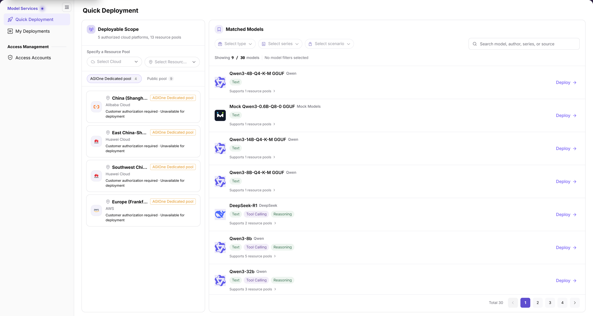
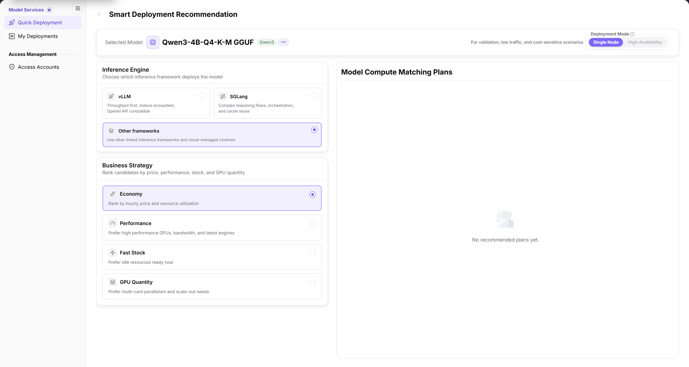
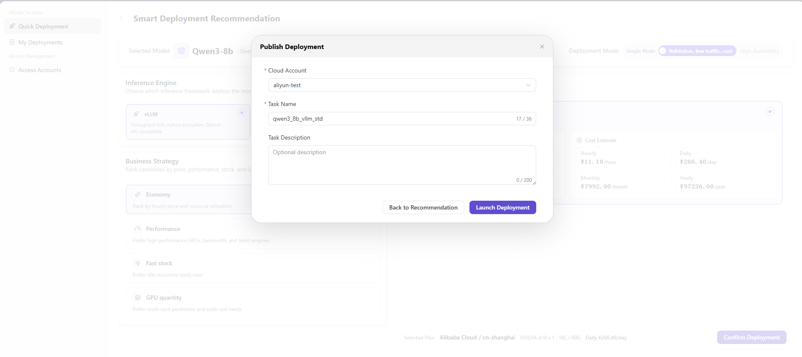

# Quick Deployment

Deploy a cloud model by selecting an authorized account, model, inference engine, strategy, and compute plan.

## Target Outcome

A deployment request is created with an understood resource plan and cost estimate, then appears in My Deployments.

## Applicable Roles

- Model Provider

## Before You Start

- Confirm that an authorized access account, region, and deployable model are available.
- Decide whether the workload needs a single-node or high-availability plan and define a cost limit.

## Procedure

### Step 1: Select a Cloud Account and Model

1. Open **On-Cloud > Model Services > Quick Deployment**.
2. In **Deployable Scope**, use **Select Cloud** and **Select Resource Pool** to locate the target resources; the page splits them into the **AGIOne Dedicated pool** and the **Public pool**, and each card shows its authorization and deployment availability.
3. In **Matched Models**, filter by **Select type**, **Select series**, or **Select scenario**, or search by model, author, series, or source.
4. Verify the model name, capability tags, and supported pools, then select **Deploy** on the model card to open Step 2.

#### Parameter Reference

| Field | Type | Example | Description |
| --- | --- | --- | --- |
| Select Cloud | Dropdown filter | `Alibaba Cloud` | Locates deployable resources by cloud platform |
| Select Resource Pool | Dropdown filter | `China East 2 (Shanghai)` | Required; sets the resource scope that determines the models and compute plans available next |
| Pool section | Section switch | `AGIOne Dedicated pool` / `Public pool` | Splits resource pools into two sections, with authorization and deployment availability shown per card |
| Select type | Dropdown filter | `Text Generation` | Optional; filters matched models by model type |
| Select series | Dropdown filter | `Qwen` | Optional; filters matched models by model series |
| Select scenario | Dropdown filter | `General Chat` | Optional; filters matched models by application scenario |
| Search | Text | `Qwen` | Optional; searches by model, author, series, or source |
| Model card | Model row | `Qwen` series model with capability tags | Required; select **Deploy** to open Smart Deployment Recommendation |

### Step 2: Review the Recommended Deployment

1. After selecting **Deploy** on a model card, the **Smart Deployment Recommendation** page opens and shows the selected model at the top.
2. Choose the **Deployment Mode** — **Single Node** or **High Availability** — using the options enabled on the current page.
3. Under **Inference Engine**, select **vLLM**, **SGLang**, or **Other frameworks**.
4. Under **Business Strategy**, select **Economy**, **Performance**, **Fast Stock**, or **GPU Quantity**; the matching plans appear on the right.
5. Review the cloud platform, region, resource specifications, and cost estimate in the Model Compute Matching Plans. If **No recommended plans yet.** appears, no plan in the result area can be confirmed, so resource specifications, cost, and the deployment result cannot be established from this page.

6. Select **Confirm Deployment** to open **Publish Deployment**; this does not yet submit a task. Select the **Cloud Account**, enter the **Task Name**, and optionally add a **Task Description**. Select **Launch Deployment** to submit, or **Back to Recommendation** without submitting. Verify the new record and state in **My Deployments**; do not repeatedly submit the same failed task.

#### Parameter Reference

| Field | Type | Example | Description |
| --- | --- | --- | --- |
| Deployment Mode | Single-select tab | `Single Node` / `High Availability` | Selects the deployment architecture, subject to the options enabled on the current page |
| Inference Engine | Single-select card | `vLLM` / `SGLang` / `Other frameworks` | Required; selects the inference framework used to serve the model |
| Business Strategy | Single-select card | `Economy` / `Performance` / `Fast Stock` / `GPU Quantity` | Required; ranks candidate plans by price, performance, stock, and GPU count |
| Model Compute Matching Plan | Recommendation card | `Alibaba Cloud / cn-shanghai / vLLM / ecs.gn6i-c4g1.xlarge` | Shows cloud platform, region, resource specifications, and cost estimates; displays `No recommended plans yet.` when nothing can be confirmed |
| Publish Deployment - Cloud Account | Select | `Alibaba Cloud` | Required; selects the cloud account that executes this deployment |
| Publish Deployment - Task Name | Text | `qwen-demo-deploy` | Required; identifies the task in My Deployments |
| Publish Deployment - Task Description | Text area | `Validate the quick deployment flow` | Optional; describes the purpose of this deployment |
| Publish Deployment - Actions | Button | `Back to Recommendation` / `Launch Deployment` | Adjust the plan before submitting; do not submit the same failed task twice |

## Completion Checklist

Check the results below; resolve failed items using the troubleshooting section before continuing.

| Check | Pass Criteria |
| --- | --- |
| 1 | Cloud, resource pool, model, inference engine, and compute plan are selectable. |
| 2 | The request is submitted with the expected cost and scope. |
| 3 | My Deployments contains the new record. |

## Troubleshooting

| Symptom | Check First |
| --- | --- |
| No model or compute plan can be selected | Account authorization, region, asset compatibility, quota, and current capacity |
| Deployment creation fails | Required fields, cost selection, cloud-account state, and event details |

## User Manual

[Review the complete Quick Deployment steps, validation rules, and common issues](/usermanual/ai-infra-on-cloud/user/model-services/quick-deployment/)
