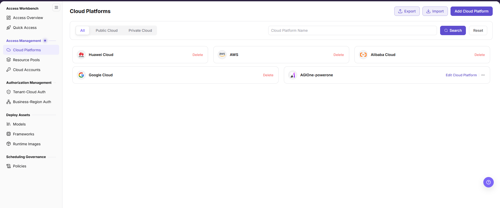
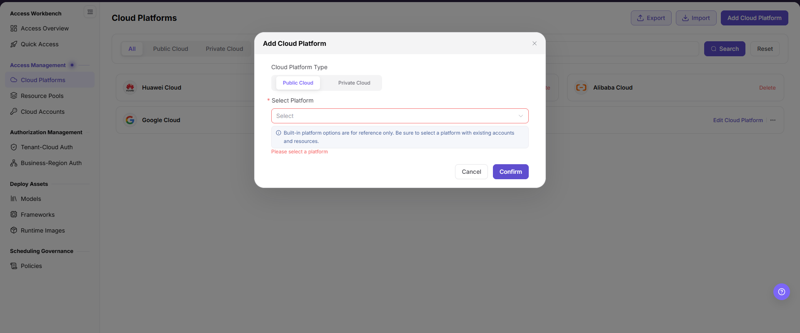

# Connect a Cloud Platform

Register the cloud-platform type before connecting accounts and regions.

## Target Outcome

The required public- or private-cloud platform is available for later account access and authorization.

## Applicable Roles

- Platform Operator

## Before You Start

- Confirm the cloud type, vendor identifier, localized display name, and private-cloud URL when applicable.
- Confirm that you are authorized to maintain platform-level access settings.

## Procedure

### Add a Platform

1. Open **On-Cloud > Access Management > Cloud Platforms** and check that the platform is not already registered.
2. Select **Add Cloud Platform**, choose **Public Cloud** or **Private Cloud**, and select the target in **Select Platform**.

3. Review the type and platform, select **Confirm**, and verify the record in the list.

Adding a platform selects an existing platform. Provider identifier, display name, link address, and logo belong to maintenance of an existing private-cloud record, not required fields of the add flow. To maintain them, open **Edit Cloud Platform** on the private-cloud card and follow the [user manual](../../../../usermanual/ai-infra-on-cloud/operator/access-management/cloud-platforms/).

## Completion Checklist

Check the results below; resolve failed items using the troubleshooting section before continuing.

| Check | Pass Criteria |
| --- | --- |
| 1 | Platform identifier and display names are correct. |
| 2 | Private-cloud access URL is reachable when applicable. |
| 3 | The platform is available in account creation. |

## Troubleshooting

| Symptom | Check First |
| --- | --- |
| The platform is missing when adding an account | Platform status, vendor identifier, and saved display configuration |
| A private-cloud page cannot be opened | Access URL, DNS, network route, and certificate |

## User Manual

[Review complete fields, validation rules, and common issues for Cloud Platforms](/usermanual/ai-infra-on-cloud/operator/access-management/cloud-platforms/)
