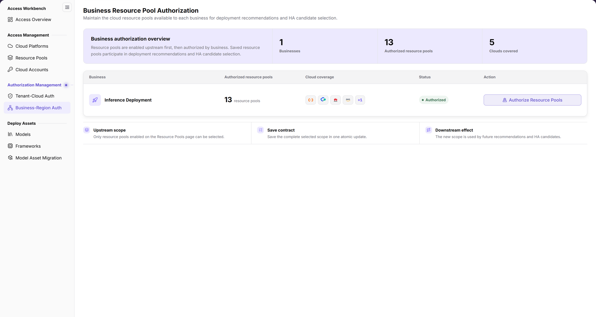
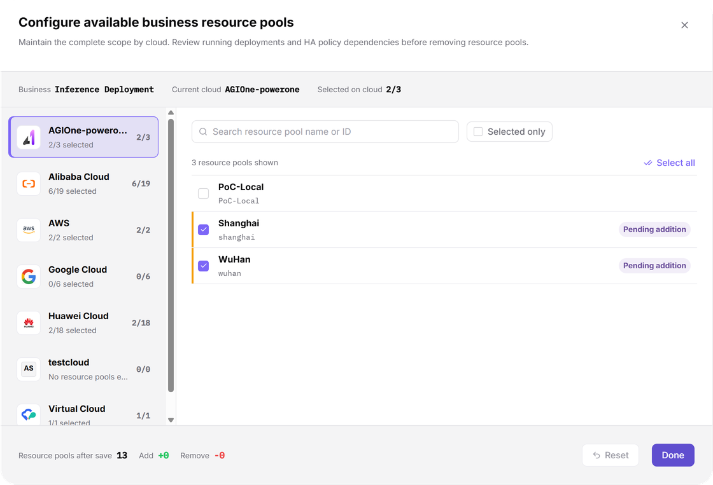

# Authorize Business Types to Regions

Grant each business type access to the cloud regions it may use.

## Target Outcome

Each business type, such as inference deployment, can schedule only to its approved cloud regions.

## Applicable Roles

- Platform Operator

## Before You Start

- Enable the required resource-pool regions first.
- Confirm which business types are allowed in each region.

## Procedure

### Configure Available Resource Pools

1. From the platform home page, open **On-Cloud > Authorization Management > Business-Region Auth**.
2. Review the authorized resource pools, cloud coverage, and status of the target business in the business list. The lower area explains Upstream scope, Save contract, and Downstream effect; the save contract is a complete-scope, one-atomic-update submission.

3. Select **Authorize Resource Pools** for the target business to open the Configure available business resource pools dialog.
4. Review **Business**, **Current cloud**, and **Selected on cloud** at the top of the dialog to confirm the target business and cloud.
5. Use the cloud list on the left to switch clouds, then locate a pool with **Search resource pool name or ID** and check it. **Selected only** reviews current selections; **Select all** sits above the pool list. Unchecked pools remain unauthorized.
6. Review **Resource pools after save**, **Add**, and **Remove** in the footer to confirm the complete selection is submitted rather than only the newly added items.
7. Select **Done** to submit. **Reset** clears the current selection and is not a close button. For inspection only, use the upper-right close button to exit without saving.

The figure shows the Configure available business resource pools dialog: business, current cloud, and selected-on-cloud at the top, cloud switching on the left, pool search and selection on the right, and the footer summary with Reset and Done. It does not prove a successful save or effective downstream access; after saving, verify the business list and the deployment entry.

> This authorization defines the resource pools available to one business. Whether a tenant may use a given cloud still depends on tenant-cloud authorization.

#### Parameter Reference

| Field | Type | Example | Description |
| --- | --- | --- | --- |
| Business | Read-only | `Inference Deployment` | The business being authorized, shown at the top of the dialog |
| Current cloud | Read-only | `Alibaba Cloud` | The cloud whose pool list appears on the right after switching on the left |
| Selected on cloud | Read-only | `3 / 8` | Selected and available pool counts for the current cloud |
| Resource Pool | Checkbox | `China East 2 (Shanghai)` | Pools authorized for the business; unchecked pools stay unauthorized |
| Resource pools after save / Add / Remove | Read-only summary | `5 / 2 / 1` | Pre-submission scope review, not a saved result |

## Completion Checklist

Check the results below; resolve failed items using the troubleshooting section before continuing.

| Check | Pass Criteria |
| --- | --- |
| 1 | The business contains only the intended clouds and resource pools. |
| 2 | Saved authorization persists after refresh, and cloud coverage in the business list is updated. |
| 3 | User deployment options follow the granted resource pools. |

## Troubleshooting

| Symptom | Check First |
| --- | --- |
| No pool can be selected | Resource-pool enablement and cloud-platform status |
| Deployment shows an unexpected region | Business type, saved region selection, and current tenant authorization |

## User Manual

[Review complete authorization rules and common issues for Business-Region Authorization](/usermanual/ai-infra-on-cloud/operator/auth-management/business-region-auth/)
