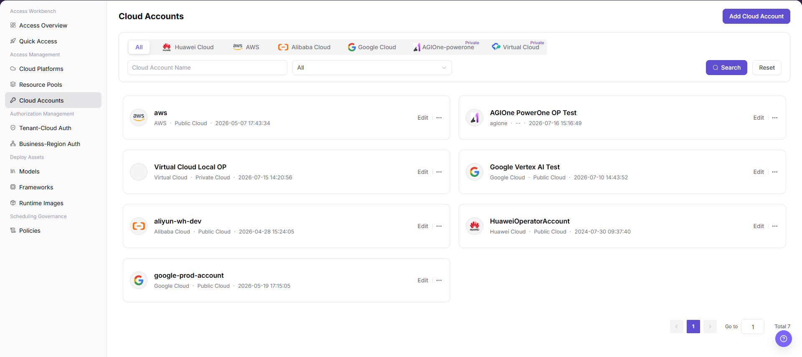
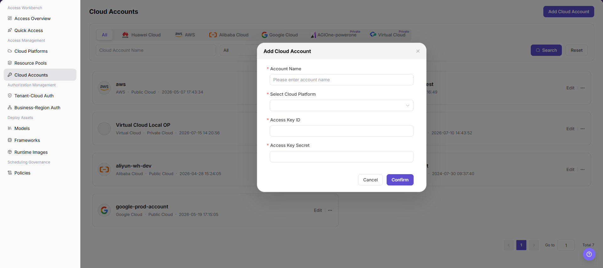

# Connect a Cloud Account

Connect an operator-managed cloud account used to discover and deploy regional resources.

## Target Outcome

{{DOCS_PRODUCT_NAME_EN}} can validate the cloud account and discover only the regions and resources that it is permitted to use.

## Applicable Roles

- Platform Operator

## Before You Start

- Create a dedicated least-privilege cloud credential for {{DOCS_PRODUCT_NAME_EN}}.
- Confirm that the target cloud platform has already been connected.

## Procedure

### Add a Cloud Account

1. From the platform home page, select **Access Management > Cloud Accounts**.
2. Select **Add Cloud Account** in the upper-right corner.

3. Configure the account:
   - Enter an **Account Name**.
   - Select a currently supported cloud platform, such as Alibaba Cloud or AWS.
   - Enter the **Access Key ID**.
   - Enter the **Access Key Secret** through the protected field.
4. Review the information and select **Confirm**, or **Cancel** to discard it.

#### Parameter Reference

| Field | Type | Example | Description |
| --- | --- | --- | --- |
| Account Name | Text | `aliyun-wh-dev` | Required; a user-defined account identifier |
| Cloud Platform | Select | `Alibaba Cloud` | Required; the supported target cloud platform |
| Access Key ID | Text | `<ACCESS_KEY_ID>` | Required; the cloud credential ID |
| Access Key Secret | Password | `<ACCESS_KEY_SECRET>` | Required; the cloud credential secret |

## Completion Checklist

Check the results below; resolve failed items using the troubleshooting section before continuing.

| Check | Pass Criteria |
| --- | --- |
| 1 | Account validation succeeds. |
| 2 | Only required cloud permissions are granted. |
| 3 | Regions and resources are discovered as expected. |

## Troubleshooting

| Symptom | Check First |
| --- | --- |
| Account validation fails | Credential status, required cloud permissions, time synchronization, and network access |
| Regions are missing | Cloud permissions, account region scope, and resource synchronization status |

## User Manual

[Review complete fields, validation rules, and common issues for Cloud Accounts](/usermanual/ai-infra-on-cloud/operator/access-management/cloud-accounts/)
