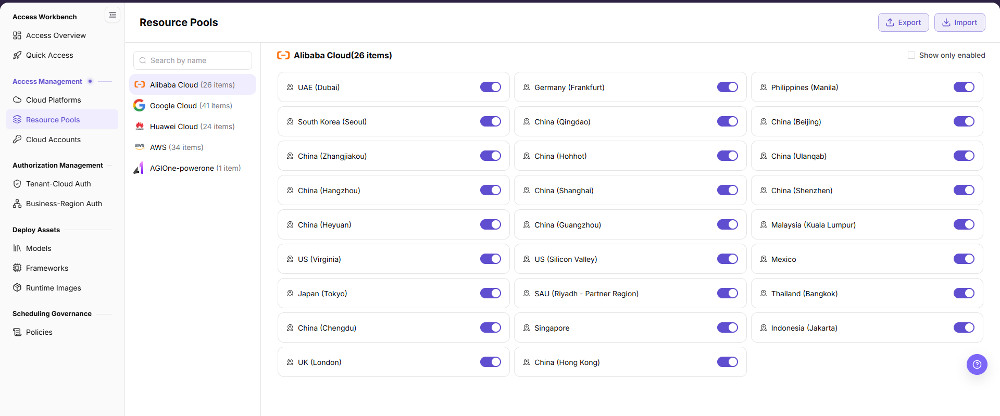

# Enable Cloud Resource Pools

Enable the cloud regions that {{DOCS_PRODUCT_NAME_EN}} may use and maintain readable localized names.

## Target Outcome

Only approved cloud regions are enabled as resource pools and can be selected by later authorization flows.

## Applicable Roles

- Platform Operator

## Before You Start

- Confirm that the cloud account has synchronized the expected regions.
- Decide which regions are approved for business use and how they should be displayed.

## Procedure

### Enable or Disable Regions

1. From the platform home page, select **Resource Pools**.
2. Search the currently supported cloud providers in the left panel. The list shows how many regions have been synchronized for each provider. Select a target provider, such as Alibaba Cloud or AWS.
3. Review the region cards for the selected provider.
4. Use the switch on each region card to enable or disable that region for business use.

### Verify the Region and Saved State

Before enabling or disabling a pool, assess tenant grants, business grants, scheduling policies, and existing deployments. After toggling the switch, review the region and action in the confirmation prompt, confirm the change, and refresh. Verify the scope again on authorization and deployment pages. Use **Enabled Only** when narrowing the list.

The current manual documents viewing and enabling/disabling pools, not a required region-renaming flow. If a name is incorrect, have the resource owner verify the cloud region and platform record before using an action actually offered by the page.

## Completion Checklist

Check the results below; resolve failed items using the troubleshooting section before continuing.

| Check | Pass Criteria |
| --- | --- |
| 1 | Required regions are enabled and clearly named. |
| 2 | Unapproved regions remain unavailable. |
| 3 | Authorization pages can select the enabled regions. |

## Troubleshooting

| Symptom | Check First |
| --- | --- |
| A region is absent | Account synchronization, cloud permissions, and platform-region support |
| A region cannot be authorized | Region enablement state and saved resource-pool configuration |

## User Manual

[Review complete fields, validation rules, and common issues for Resource Pools](/usermanual/ai-infra-on-cloud/operator/access-management/resource-pools/)
