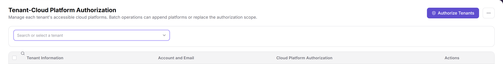
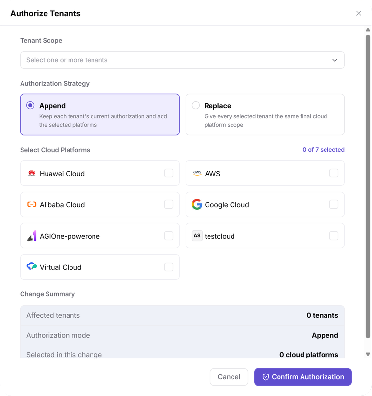

# Authorize Tenants to Cloud Platforms

Grant selected tenants access to a cloud platform after the platform and regions are ready.

## Target Outcome

The intended tenant can see the authorized cloud platform, while unrelated tenants cannot.

## Applicable Roles

- Platform Operator

## Before You Start

- Confirm that the tenant exists and the cloud platform is enabled.
- Decide whether this change appends to existing grants or overrides them.

## Procedure

### Add Authorization

1. Open **On-Cloud > Authorization Management > Tenant-Cloud Auth** (route `/infrahub/op/auth/platform-auth`).
2. Select **Authorize Tenants** to open the authorization form.

3. In **Select Cloud Platforms**, select one or more connected cloud platforms, such as Alibaba Cloud, AWS, or {{DOCS_CLOUD_PLATFORM_EN}}.
4. In **Tenant Scope**, use **Select one or more tenants** and select the target tenants.
5. Choose an **Authorization Strategy**: **Append** keeps each tenant's current grants and adds the selected platforms, while **Replace** makes all affected tenants use the same platform scope. Review the **Change Summary** — affected tenants, authorization mode, and platforms selected in this change — before you submit.
6. Select **Confirm Authorization**, or **Cancel** to inspect the form without submitting. Before cancelling, confirm that no running deployment or high-availability instance depends on a grant you are about to remove.

> This authorization controls platform visibility. After it is saved, a tenant can access only the cloud platforms granted to it.

#### Parameter Reference

| Field | Type | Example | Description |
| --- | --- | --- | --- |
| Select Cloud Platforms | Multi-select | `Alibaba Cloud / AWS / {{DOCS_CLOUD_PLATFORM_EN}}` | Required; select any number of connected platforms |
| Tenant Scope | Tenant picker | `Select one or more tenants` | Required; determines which tenants this change covers |
| Authorization Strategy | Single select | `Append / Replace` | Required; append keeps current grants, replace makes every affected tenant use the same platform scope |
| Change Summary | Read-only review | — | Review affected tenants, authorization mode, and selected platforms so that a grant a running deployment depends on is not removed |

## Completion Checklist

Check the results below; resolve failed items using the troubleshooting section before continuing.

| Check | Pass Criteria |
| --- | --- |
| 1 | Only intended tenants receive the cloud grant. |
| 2 | A fresh tenant session reflects the authorization. |
| 3 | Revoked tenants no longer see the platform. |

## Troubleshooting

| Symptom | Check First |
| --- | --- |
| The tenant cannot see the platform | Whether the tenant was missed in Tenant Scope, platform status, and a refreshed user session |
| Too many tenants can see the platform | Whether **Replace** included extra tenants, or an earlier append grant was not cleaned up |

## User Manual

[Review complete rules and common issues for Tenant-Cloud Authorization](/usermanual/ai-infra-on-cloud/operator/auth-management/tenant-cloud-auth/)
