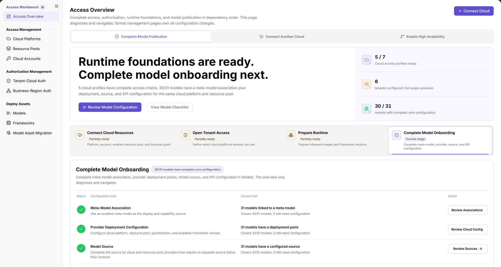

# Configure and Validate an On-Cloud Scheduling Policy

Use this task to confirm whether the scheduling-policy entry is configurable, check the access and authorization prerequisites, and then, once the entry opens, follow the historical flow documented in the manual and verify the result with a test deployment.

## Applicable Roles

- Platform Operators, multi-cloud resource administrators, and deployment-policy administrators

## Before You Start

1. Confirm that cloud platforms, cloud accounts, and resource pools are healthy.
2. Confirm that the target tenant and business region are authorized for preferred and fallback pools.
3. Confirm the model has at least one available deployment target and prepare the framework version, resource specifications, primary/backup node plan, and health-probe requirements.

## Procedure

### 1. Confirm Whether the Entry Is Configurable

Open `/infrahub/op/schedule/policy`. If the page only shows `Coming Soon!` and a `Back to Home` link, the environment has no configurable policy entry: record the route, interface language, and notice text, then stop. Do not keep refreshing or resubmitting.

The sidebar does not show a Policies entry; its historical path under On-Cloud is **On-Cloud > Scheduling Governance > Policies** (earlier builds placed it under the AI Infra top-level group). The remaining sections describe prerequisites and what to do once the entry opens — do not treat historical screenshots as the current form.

### 2. Check Access and Authorization

Open [Access Overview](../../../usermanual/ai-infra-on-cloud/operator/access-workbench/access-overview/) and confirm target cloud-account and resource-pool state. Then review tenant-cloud authorization, business-region authorization, and available capacity. Do not create a scheduling policy while required authorization is missing.

### 3. Read the Historical Configuration Flow (Not Executable Today)

The [Policies manual page](../../../usermanual/ai-infra-on-cloud/operator/scheduling-governance/policies/) keeps three historical sections — basic information and model association, primary and backup route topology, and health probe rules — that explain the concepts a policy involves. The current placeholder page shows no policy list, add entry, configuration wizard, save, or probe controls, so do not look for **Add Policy**, **Next**, or **Submit** from the historical screenshots.

### 4. Validate Once the Entry Opens

Once the entry opens, deploy a low-risk model and record the selected resource pool, region, deployment state, and events. Validate the preferred pool first, then validate fallback or a clear failure under controlled conditions. Afterwards review actual cost, startup latency, and resource usage, and periodically re-check pool capacity, authorization, and policy priority.

Tenant grants and regional capacity are prerequisites, not the "applicable tenant" or "capacity threshold" fields of the wizard. Assess cross-cloud or cross-region cost and compliance before the change; a saved policy does not prove those requirements are satisfied.

## Completion Checklist

The first two checks close the task while the entry shows only the placeholder; the remaining checks run once the entry opens.

| Check | Pass Criteria |
| --- | --- |
| Entry state | The notice, route, and interface language are confirmed; when only the placeholder shows, the notice is recorded and the task stops. |
| Authorization foundation | Preferred and fallback pools are available to the target scope. |
| Validation plan | The test deployment and fallback validation steps, model, and resource pools are written down, and the historical flow is not treated as current capability. |
| Operational review | Capacity, cost, latency, and compliance impact are recorded. |

## Troubleshooting

| Symptom | Check First |
| --- | --- |
| The page only shows `Coming Soon!` | The entry is not open in this environment; record the notice and wait for release instead of refreshing or resubmitting |
| No Policies entry in the sidebar | The entry is not in the current sidebar; open `/infrahub/op/schedule/policy` directly and check the page notice |
| After the entry opens, the deployment does not select the preferred pool | Capacity, enabled state, business-region authorization, and policy priority |
| After the entry opens, no fallback occurs when the preferred pool is unavailable | Fallback configuration, authorization, capacity, and cross-region constraints |
