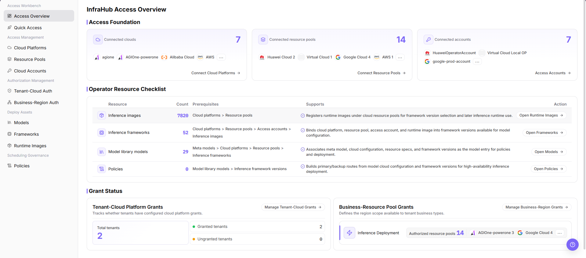
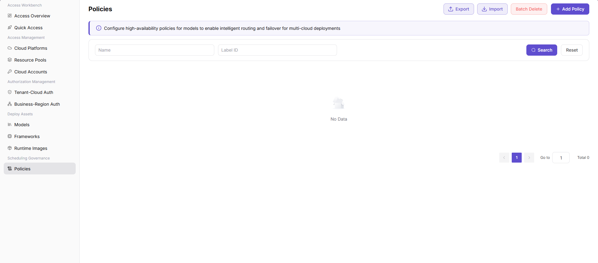

# Configure and Validate an On-Cloud Scheduling Policy

Use this task to configure primary/backup route topology and health probes for an associated model version, then verify the result through an approved test deployment.

## Applicable Roles

- Platform Operators, multi-cloud resource administrators, and deployment-policy administrators

## Before You Start

1. Confirm that cloud platforms, cloud accounts, and resource pools are healthy.
2. Confirm that the target tenant and business region are authorized for preferred and fallback pools.
3. Confirm the model has at least one available deployment target and prepare the framework version, resource specifications, primary/backup node plan, and health-probe requirements.

## Procedure

### 1. Check Access and Authorization

Open [Access Overview](../../../usermanual/ai-infra-on-cloud/operator/access-workbench/access-overview/) and confirm target cloud-account and resource-pool state. Then review tenant-cloud authorization, business-region authorization, and available capacity. Do not create a scheduling policy while required authorization is missing.

### 2. Configure the Scheduling Policy

Open **On-Cloud > Scheduling Governance > [Policies](../../../usermanual/ai-infra-on-cloud/operator/scheduling-governance/policies/)** and use the current three-step wizard:

1. **Basic Information and Model Association**: select **Add Policy**, enter the name, scenario, and description, select the target model and version, verify available routing nodes, and select **Next**.
2. **Define Primary and Backup Route Topology**: select primary and backup route nodes, set backup priority, and review platform, region, specification, framework version, and cost.
3. **Define Health Probe Rules**: configure the probe type and required path, interval, failure threshold, recovery rule, and timeout. Review the configuration before selecting **Submit**.

Tenant grants and regional capacity are prerequisites, not tenant-scope or capacity-threshold fields in this wizard. Assess cross-cloud or cross-region cost and compliance before the change; saving a policy does not prove those requirements are satisfied.

### 3. Run a Test Deployment

Deploy a low-risk model and record the selected resource pool, region, deployment state, and events. Validate the preferred pool first. Under controlled conditions, validate fallback or a clear failure when preferred capacity is unavailable.

### 4. Review Results and Establish Routine Checks

Confirm that the deployment result matches the policy and record actual cost, startup latency, and resource usage. Review pool capacity, authorization, and policy priority periodically so that prerequisite changes do not invalidate the policy.

## Completion Checklist

Verify the policy with an authorized test deployment; resolve failed authorization, capacity, or configuration checks.

| Check | Pass Criteria |
| --- | --- |
| Authorization foundation | Preferred and fallback pools are available to the target scope. |
| Policy configuration | The associated model/version, primary/backup routes, priority, and health probes match the plan. |
| Preferred validation | With normal capacity, the test deployment selects the preferred pool. |
| Fallback validation | When the preferred pool is unavailable, the policy falls back or returns a clear reason. |
| Operational review | Capacity, cost, latency, and compliance impact are recorded. |

## Troubleshooting

| Symptom | Check First |
| --- | --- |
| Deployment does not select the preferred pool | Capacity, enabled state, business-region authorization, and policy priority |
| No fallback when the preferred pool is unavailable | Fallback configuration, authorization, capacity, and cross-region constraints |
| Policy and deployment results differ | Check the model version, route nodes, and effective configuration used by the deployment; retain events for the policy owner instead of recreating existing instances |
| Cost or latency rises after fallback | Resource pricing, region distance, network, and SLA (service-level agreement) constraints |
