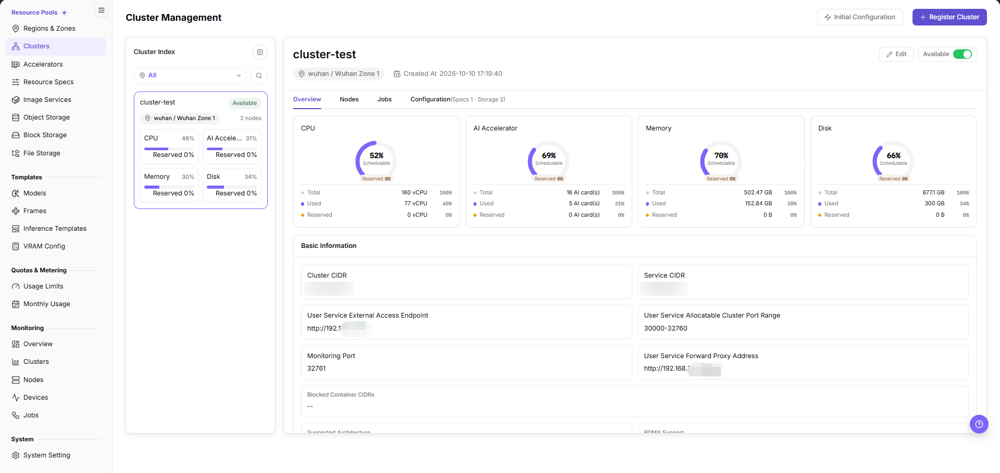

# Onboard the Cluster and Verify Devices

## Target Outcome

The cluster is available, all target devices in the hardware inventory are discovered on the expected nodes, and compatible specifications can be associated.

A cluster is a managed group of Kubernetes nodes, and Ready indicates node readiness. Check device counts against the actual hardware inventory.

## Applicable Roles

- Platform Operator

## Before You Start

- Prepare the cluster endpoint, registration information, network route, and required agent or credential.
- Record the expected node count, actual target NPU count, and physical distribution.

## Entry

- **Role:** Operator
- **Menu:** On-Prem > Resource Pools > Clusters
- **Route:** `/powerone/resourcepool/cluster`

## Steps

1. Confirm that the target region and availability zone exist.
2. Register the cluster through the four-step wizard: ingestion mode, control-plane connection and credentials, network planning and service access, then region, zone, and the auto-generated registration name.
3. Wait until the cluster becomes available.
4. Open cluster details and verify that all accelerator nodes are Ready.
5. Verify that the reported target NPU count matches the hardware inventory, with no missing or duplicate devices.

6. Select the cluster and review its **Overview** and **Configuration** tabs for region, availability zone, state, associated specifications, and storage.
7. Open the **Nodes** tab and confirm node state, device visibility, and resource reporting for every node that hosts an accelerator.
8. If a cluster is toggled to unavailable via the **Available** switch, do not select it for new resource creation until it is enabled again and its nodes return to the expected state.

## How to Verify All Four NPU Cards

**Worked example:** This section retains a four-NPU example. Use these tiers only when the model, capacity, and scheduling topology support them; other environments use their actual device inventory and workload requirements.

| Check | Expected Result |
| --- | --- |
| Cluster state | Available |
| Node state | Every node hosting an NPU is Ready |
| Device total | Four NPU cards |
| Allocatable count | Matches actual usage after subtracting running workloads |
| Resource key | Matches the Accelerators page and specification metrics |

## Completion Checklist

Check the results below; resolve failed items using the troubleshooting section before continuing.

| Check | Pass Criteria |
| --- | --- |
| 1 | Cluster, node, and device data are visible. |
| 2 | All target NPU cards in the hardware inventory are recognized. |
| 3 | A one-card test workload enters scheduling successfully. |

## Troubleshooting

| Symptom | Check First |
| --- | --- |
| Cluster registration fails | Endpoint, network, registration data, agent state, and time synchronization |
| Fewer cards than the inventory expects appear | Node health, driver, device plug-in, accelerator mapping, and hardware visibility |
| The detail pane has no expected data | Cluster state, selected region/zone, permission scope, synchronization time, and whether the cluster has finished onboarding |
| The Nodes tab is empty | Cluster availability, node registration, node permission scope, and synchronization or collection status |
| A disabled cluster is still selectable | Refresh the page, recheck cluster state and downstream associations, and do not submit a workload until the selectable scope is corrected |
| Workloads cannot access cluster storage after a change | Cluster storage association, region/zone binding, storage component health, and workload mount configuration |

## User Manual

[Clusters](/usermanual/ai-infra-on-prem/operator/resource-pools/clusters/)
