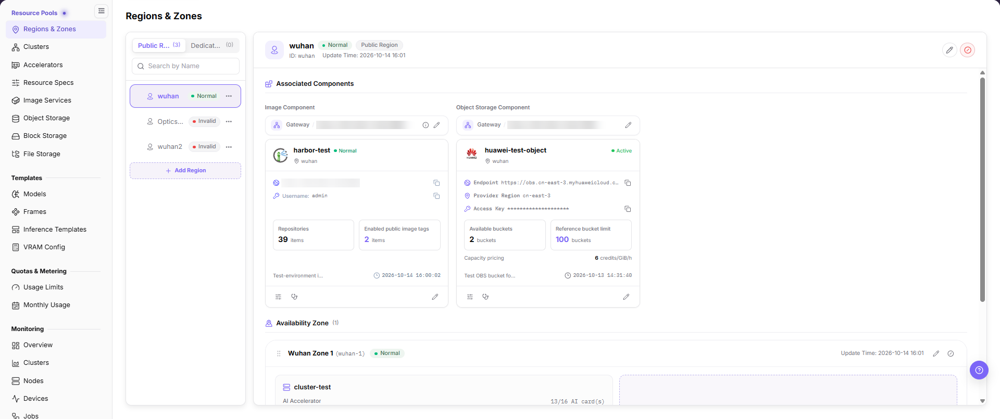
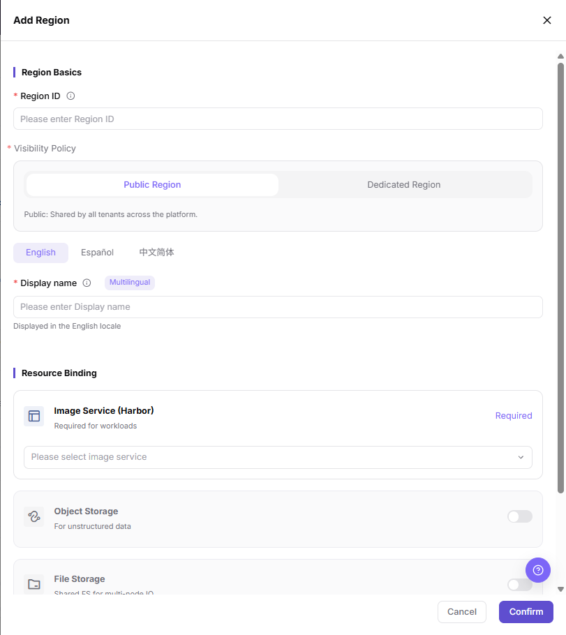
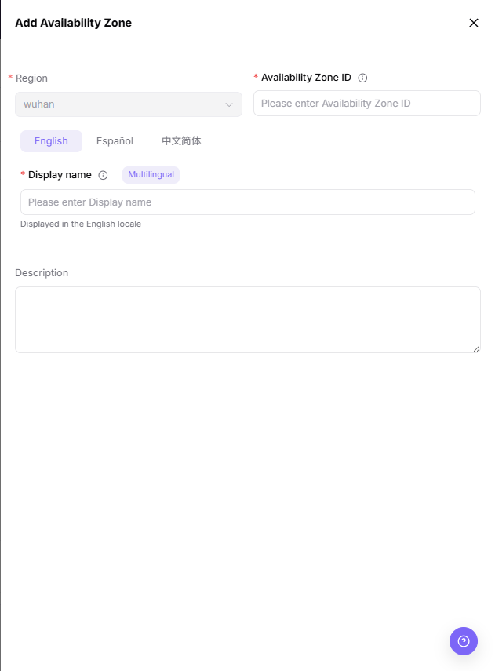

# Create Regions and Availability Zones

## Scenario Goal

Create the region and availability zone for a local cluster so that clusters, specifications, images, storage, and workloads use the same resource boundary.

## Applicable Roles

- Platform operator

## Before You Start

- Map the data center, site, or resource group to the intended region and availability zone.
- Prepare unique identifiers and localized display names that do not duplicate existing records.
- Confirm the availability zone, network boundary, and storage boundary for the target cluster.

## Feature Entry

- **Role:** Operator
- **Menu:** On-Prem > Resource Pools > Regions & Zones
- **Page route:** `/powerone/resourcepool/region`

## Procedure

1. Open Regions & Zones and review existing regions, availability zones, and states before creating records.

2. Click **Add Region** at the bottom of the region list, fill in the region ID, select the `Public Region` / `Dedicated Region` visibility policy, maintain the localized display names in each language tab, bind the required image service (Harbor), and confirm the region is available for downstream resource onboarding.

3. To set the region's data Gateway endpoints, select the region and, in the `Associated Components` area, click **Configure Data Gateway Endpoints** on the image component card. Fill in `Image Gateway Endpoint` and `Object Storage Gateway Endpoint` (a domain, an `IP:port`, or an address with a protocol; `HTTPS` is used when no protocol is given) and click **Save**. The dialog's **Go to System Settings to manage all Gateways** link opens `On-Prem > System > System Setting` for central Gateway management.

4. Select the target region, then click **Create AZ** in the availability-zone section. The `Region` field is prefilled and read-only; enter the availability zone ID and localized display names.

5. Return to the list, confirm that both records are visible and available, and record the availability zone to select during cluster registration. A newly created zone with no cluster yet shows the `Abnormal` state with the hint `No cluster is available under the current resource`; expand the zone and use the dashed `Associate Cluster` placeholder card on the right of the expansion area to open the cluster registration wizard for that zone.

6. To temporarily stop new use of a region, open its `...` actions menu and select **Disable**; the same applies to a zone via its row **Disable** icon. A `Normal` zone row shows **Edit** and **Disable**; a disabled zone shows **Enable**; an `Abnormal` zone shows **Edit** and **Delete**. If the object is not shown, clear the name search box and check the other region type tab.
7. To bring a disabled region or availability zone back into service, use the **Enable** action that appears on its row (or, for a region, on the detail header) once it is in the disabled state. Regions have **no Delete** action, while an availability zone also provides **Delete** (shown on the row by state) for permanent removal — prefer Disable/Enable to pause and restore, and use Delete only when a zone must be removed after confirming no cluster or job still depends on it. The operator manual page `On-Prem > Resource Pools > Regions & Zones` documents availability-zone deletion and cluster association as page behaviour rather than as a step-by-step operation, so follow the actions and prompts the live page displays for these two flows.
8. Refresh the list and confirm the changed state before continuing to cluster registration or workload scheduling. Existing resources are not deleted by a disable operation, but new registration, creation, or scheduling may be restricted.

## Completion Checklist

> **Purpose:** Use these checks to confirm that the resource boundary is ready for cluster onboarding. Do not register the cluster while any check fails.

| Check Item | Success Criteria |
| --- | --- |
| Region | The region name, unique identifier, and state are correct. |
| Availability zone | The zone belongs to the correct region and has a unique name and identifier. |
| Downstream selection | The target region and availability zone are selectable during cluster registration. |

## Troubleshooting

| Symptom | Check First |
| --- | --- |
| A region or zone cannot be created | Account permissions, required fields, unique identifiers, and duplicate records |
| The zone is unavailable during cluster registration | Region and zone state, assignment, and current tenant scope |
| Resources appear in the wrong location | Region choices for the cluster, specifications, images, and storage |
| The Enable action is not visible | The object may still be in the Normal state (which shows Disable, not Enable); confirm the state badge, the selected object, and Operator permission. Availability zones additionally show Delete, while regions do not |
| A disabled region or zone cannot be re-enabled | Verify the object's state badge is disabled so Enable appears, then use the row Enable action; check parent-region state and downstream cluster or workload dependencies before restoring |

## User Manual

[Review the complete fields and maintenance guidance for Regions & Zones](/usermanual/ai-infra-on-prem/operator/resource-pools/regions-zones/)
