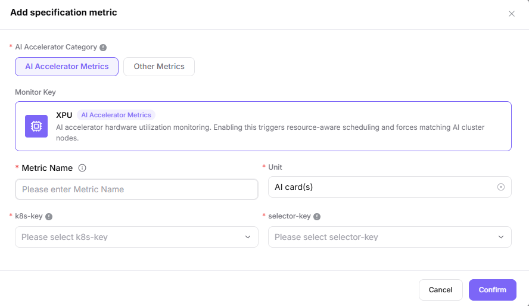

# Configure Metrics and Resource Specifications

## Target Outcome

Users can request NPU tiers that match actual needs and capacity, each mapped to the correct scheduler resource key.

A resource specification is the resource bundle requested by a workload. k8s-key identifies the resource, while selector-key identifies the node label used for matching; they are not interchangeable.

## Applicable Roles

- Platform Operator

## Before You Start

- Confirm the accelerator entry and the resource key reported by the cluster device plug-in.
- Decide which card combinations are supported and how CPU and memory scale with NPU count.

## Entry

- **Role:** Operator
- **Menu:** On-Prem > Resource Pools > Resource Specs (metrics are maintained in the left specification group panel)
- **Routes:** `/powerone/resourcepool/flavor/list`

## Steps

1. Open **Resource Specs** and use the left **Specification group navigation > Specification Metrics** panel. If the accelerator metric is missing, select **Add specification metric**, choose **AI Accelerator Metrics**, verify the name, unit, k8s-key, and selector-key against node reporting, and submit.

2. In **Resource Specifications**, create the card-count tiers required by the approved workload; all one-/two-/four-card plans are not mandatory.
3. Use the round plus button at the end of the search row, enter the specification ID, and maintain CPU, memory, and accelerator rows with quantities and units in **Configuration**. Pricing is maintained through **Assisted pricing / Adjust prices**, not the create dialog. After creation, verify association in the cluster’s **Configuration > Associated Specifications**.

The image shows the Resource Specs page: specification metrics in the left group-navigation panel, the specification/resource/pricing/status table on the right, and the round plus button at the search-row end. It is not evidence of a successful creation or scheduled test workload.

4. Validate the base configuration with an approved small test plan, then test the target tiers actually required and supported by capacity.

5. Before exposing a specification to users, confirm that its enabled state, associated cluster, region/availability-zone scope, and tenant quota allow the intended downstream template or workload to select it.

## Recommended Four-Card Plan

**Worked example:** This section retains a four-NPU example. Use these tiers only when the model, capacity, and scheduling topology support them; other environments use their actual device inventory and workload requirements.

| Flavor | NPU Count | Typical Use |
| --- | ---: | --- |
| `npu-1` | 1 | Functional checks and small-model inference |
| `npu-2` | 2 | Two-card parallel inference |
| `npu-4` | 4 | A workload that exclusively uses all cards |

Do not assume that a single pod (the smallest container scheduling unit) can request all four cards when they are distributed across nodes.

## Completion Checklist

Check the results below; resolve failed items using the troubleshooting section before continuing.

| Check | Pass Criteria |
| --- | --- |
| 1 | The planned specifications approved for this workload are selectable. |
| 2 | Resource keys match node reporting. |
| 3 | The base configuration and required target specification are validated without creating unrelated resource tiers. |

## Troubleshooting

| Symptom | Check First |
| --- | --- |
| A specification is not selectable | Status, tenant quota, cluster association, and region availability |
| A workload remains pending | Resource key, requested card count, free capacity, and node labels |
| A specification is visible in the list but unavailable downstream | Enabled state, cluster association, region/zone scope, tenant quota, and stale page data |

## User Manual

- [Resource Specifications](/usermanual/ai-infra-on-prem/operator/resource-pools/resource-specs/)
