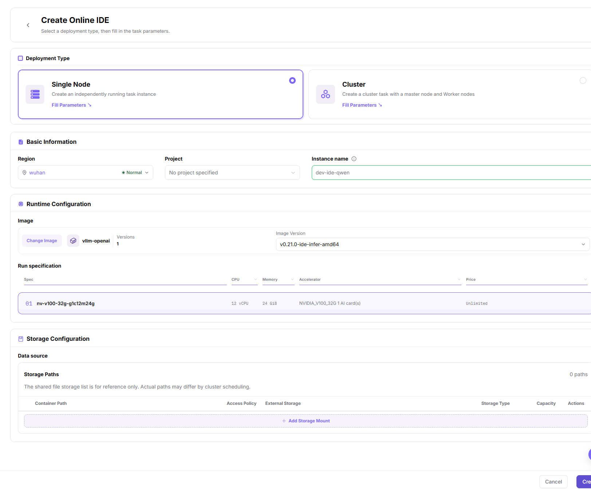
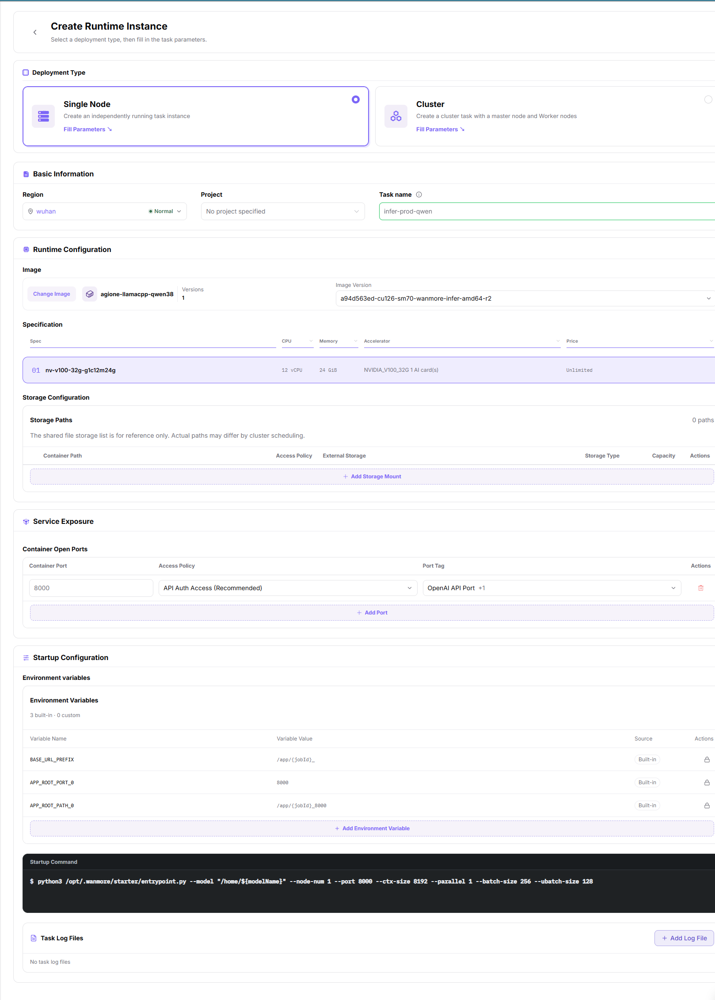

# On-Prem Development, Training & Assets

This scenario guides users through creating an On-Prem development or training environment and preserving code, data, images, models, and outputs as reusable assets.

An online IDE (integrated development environment) supports coding and debugging. A persistent workspace is a location intended to retain data across instance lifecycles, not an arbitrary container directory.

## Applicable Roles

- End User creating development or training workloads
- Platform Operator preparing images, storage, compute, quota, and monitoring

## Target Outcome

- Users can create development or training environments with an available image, flavor, and storage.
- Code and data reside on persistent storage instead of an ephemeral container filesystem.
- Customized environments can be saved as images and model outputs can be stored in controlled locations.
- Logs, monitoring, and usage remain visible, and idle resources can be released.

## Before You Start

1. The operator has enabled the target region, images, storage, flavors, and tenant quota.
2. Estimate CPU, memory, accelerator, and runtime requirements.
3. Prepare the code repository, data paths, base image, and output directory.
4. Confirm data governance, image provenance, and external network boundaries.

Before users start the steps below, the Platform Operator confirms the available image, storage, specification, and quota scope. A training script does not perform that preparation automatically.

## Procedure

1. Prepare available persistent storage and verify data and output locations. If File Storage only shows an unavailable-feature notice, do not assume shared-directory creation or mounting is available. Ask the administrator to confirm access through existing cluster shared storage or object storage. See [Object Storage](../../../usermanual/ai-infra-on-prem/user/storage/object-storage/) and [File Storage](../../../usermanual/ai-infra-on-prem/user/storage/file-storage/).
2. Prepare or select a versioned runtime image that the target region can pull. See [Images](../../../usermanual/ai-infra-on-prem/user/extensions/images/).
3. Open [Online IDE](../../../usermanual/ai-infra-on-prem/user/dev-resources/online-ide/), select **Create IDE**, choose Single Node or Cluster, then **Fill Parameters**. Verify region, project, image version, resource specification, and storage settings. Select **Create** and verify the service entry in instance details.

4. Open [Runtime Instances](../../../usermanual/ai-infra-on-prem/user/dev-resources/runtime-instances/), select **Create Instance**, choose the deployment type, and select **Fill Parameters**. Verify region, project, image/version, specification, mounts, and startup command. Register required file logs through **Add Log File**, then select **Create** and check the actual state and logs.

5. Preserve images, models, and outputs in controlled storage so later workloads can reuse them.
6. Review [Resource Usage](../../../usermanual/ai-infra-on-prem/user/quotas-usage/usage/), then stop idle instances.

## Asset Guidance

| Asset | Recommended Location | Do Not Keep Only In |
| --- | --- | --- |
| Code and configuration | Version control and persistent workspace | Ephemeral container directory |
| Datasets | Object or file storage | Local temporary disk |
| Runtime environment | Versioned image | Manual installation notes |
| Model weights | Controlled object storage or model directory | One instance filesystem |
| Logs and outputs | Persistent output directory | Terminal scrollback |

## Completion Checklist

Check the results below; resolve failed items using the troubleshooting section before continuing.

| Check | Pass Criteria |
| --- | --- |
| 1 | The development or training instance is healthy without repeated errors. |
| 2 | Persistent code and data remain available after restart or rebuild. |
| 3 | Images, models, and outputs have clear versions and owners. |
| 4 | Flavor, runtime, and usage records match expectations. |
| 5 | Unused instances and temporary resources are stopped or removed. |

## Troubleshooting

| Symptom | Check First |
| --- | --- |
| No image or flavor is available | Region, authorization, image state, cluster association, and quota |
| IDE cannot be opened | Instance state, service port, network entry, and logs |
| Data is missing | Storage component, mount path, permissions, and region |
| Workload remains pending or fails | Capacity, image, command, accelerator, and quota |
| Artifacts disappear | Whether they were written to temporary storage and synchronized before completion |
