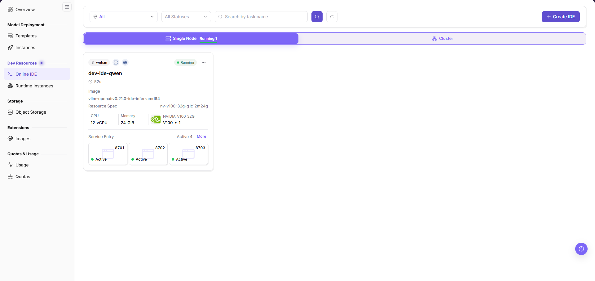
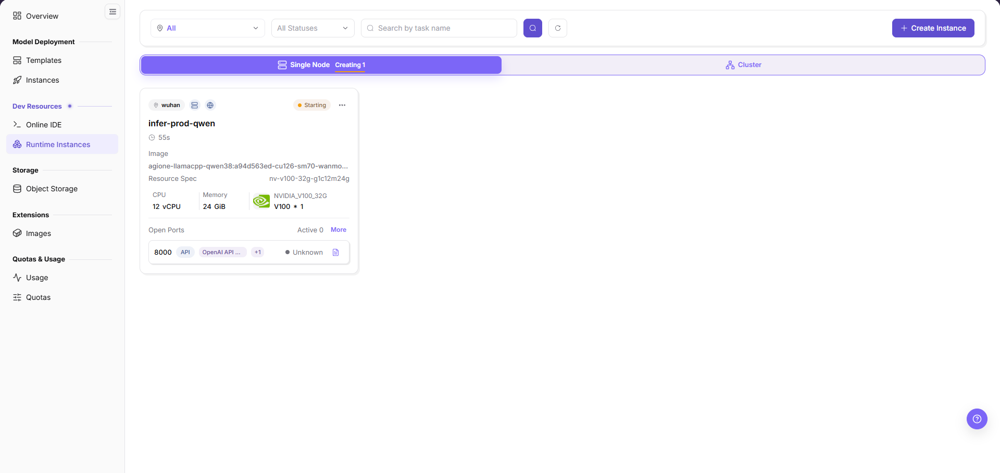

# Scenario Overview - On-Prem Development, Training, and Assets

This scenario covers development environments, training workloads, and the durable storage of models, images, datasets, and outputs.

An IDE (integrated development environment) supports online coding and debugging. Images provide the runtime environment; persistent storage holds data that must outlive an instance. An arbitrary container path is not automatically persistent.

## Applicable Roles

- End User
- Operator maintaining images, storage, and compute resources

**Role handoff:** The Platform Operator first prepares available images, storage, specifications, and quota. Users create IDEs or runtime instances and preserve their artifacts. For infrastructure problems, users provide the task identifier, time, and relevant logs for the operator to investigate the resource side.

## Goals

- Run development and training with authorized compute.
- Store data and outputs in persistent storage.
- Feed trained artifacts into later model deployment.

## Scenario Flow

**Main path:** Prepare storage and images → Create a development environment → Run training or batch work → Preserve and reuse assets

| Stage | Key Result |
| --- | --- |
| 1. Prepare dependencies | Data, output paths, images, compute, and quota are available |
| 2. Develop and debug | The online IDE can access code, data, and a persistent workspace |
| 3. Run workloads | Runtime instances execute normally and emit logs and monitoring data |
| 4. Preserve assets | Models, images, data, and results are stored in reusable locations |

The image shows an Online IDE example card marked **Running**, with active service entries. It illustrates list filters, the creation entry, and card fields; it is not evidence that the IDE created for this task is ready.

The image shows a Runtime Instances example card marked **Starting**, with an **Unknown** port state. It illustrates task and resource fields, not a completed training run.

## Before You Start

- Prepare an image, resource specification, and tenant quota.
- Prepare code, datasets, and persistent storage paths.

## Recommended Reading Order

1. Create a development environment
2. Mount code, data, and storage
3. Configure and run the training script in Runtime Instances
4. Save models, logs, and outputs

## Document Index

| Document | Description |
| --- | --- |
| [Development and Training Workflow](./development-training-workflow) | Development, training, storage, asset steps, and screenshots |

## Completion Checklist

Confirm the results below before moving on; use the linked procedure to resolve failed checks.

| Check | Pass Criteria |
| --- | --- |
| 1 | The online IDE or training instance reaches Running without repeated startup errors. |
| 2 | Data, models, and outputs are stored persistently and can be read by a later workload. |
| 3 | Usage and monitoring records are traceable and idle instances are stopped or released. |
