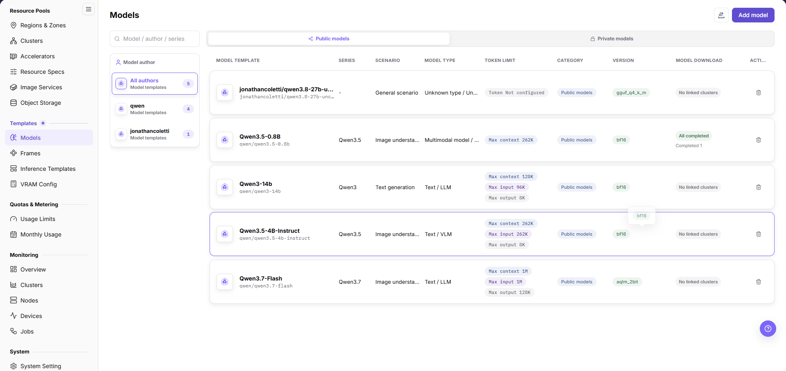
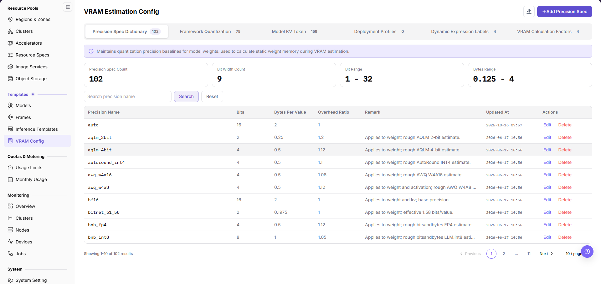
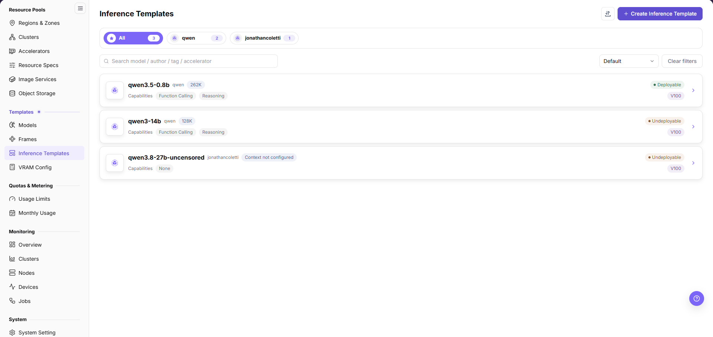

# Build an NPU Inference Template

## Target Outcome

The template exposes compatible framework, model, and runtime configuration so the required NPU card-count plan can be checked during deployment.

An inference template relates a model version to an adapted framework version. NPU means neural processing unit, and accelerator memory is the memory used to run the model.

## Applicable Roles

- Platform Operator

## Before You Start

- Prepare the model configuration, framework, image, resource specification, ports, and storage requirements.
- Decide the actual card count, single- or multi-node topology, and whether to use multiple smaller instances.

## Entry

- **Role:** Operator
- **Menu:** On-Prem > Templates > Inference Templates
- **Route:** `/powerone/fast-build-v2/inference-templates`

## Steps

1. Open [Model Configuration](../../../../usermanual/ai-infra-on-prem/operator/templates/models/) and confirm that model name, type, storage location, and state are available.

2. Open [Frames](../../../../usermanual/ai-infra-on-prem/operator/templates/frames/) and confirm that framework version and runtime image support the target NPU.
3. Open [VRAM Config](../../../../usermanual/ai-infra-on-prem/operator/templates/vram-config/) and confirm one-card and multi-card memory requirements for the parameter scale, precision, and parallel method.

4. Return to **On-Prem > Templates > Inference Templates**, select **Create Inference Template**, choose **Model** and the required **Model Version**, select a compatible **Framework Version**, verify the template name, and select **Save**. The same model-version/framework-version combination cannot be created twice.
5. Open template details and locate the combination in **Model Version Switch** and **Framework Relations**. Check the runtime image in **LINKED FRAMEWORK INFO**, **TEMPLATE EXTRA PARAMETERS**, **BOUND ACCELERATORS**, and the linked VRAM factor form.
6. The list’s **Deployable/Undeployable** state is distinct from a framework relation’s **Available** state. Do not treat switching an entire template to Available as a creation step; verify dependencies and each relation instead.
7. Card count and the actual resource plan are confirmed with business parameters and specifications in the user deployment wizard. The create-template dialog has no card-count, port, or health-check fields; framework commands and service exposure belong to **Frames**.
8. Use an approved test deployment to check accelerator model, count, memory, and startup. Saving a template does not prove a running service.

## Four-NPU Strategy

**Worked example:** This section retains a four-NPU example. Use these tiers only when the model, capacity, and scheduling topology support them; other environments use their actual device inventory and workload requirements.

- Maintain a template per model-version/framework-version combination. Verify one-, two-, or four-card plans during deployment instead of creating duplicate templates for the same combination.
- State whether a four-card template requires one node or supports multi-node deployment.
- Validate drivers, runtime, collective communication, and health checks with a small model first.

## Completion Checklist

Check the results below; resolve failed items using the troubleshooting section before continuing.

| Check | Pass Criteria |
| --- | --- |
| 1 | Model, framework, VRAM estimation, and template records are visible and available. |
| 2 | The framework relation binds the intended accelerator model, and the deployment specification matches the required card count. |
| 3 | A test deployment runs and passes a service-health or minimal-call check; Creating alone is not a successful validation. |

## Troubleshooting

| Symptom | Check First |
| --- | --- |
| Framework or model is unavailable | Status, region, compatibility, and template prerequisites |
| Four-card deployment cannot start | Specification, distributed parameters, free cards, ports, and storage |
| Template remains unavailable | Model or framework state, accelerator relation, VRAM factor, required fields, and the list deployability and individual framework-relation states |
| Extra parameters cause a startup failure | Parameter names, value format, framework support, and whether the parameter requires professional-service validation |

## User Manual

[Inference Templates](/usermanual/ai-infra-on-prem/operator/templates/inference-templates/)
