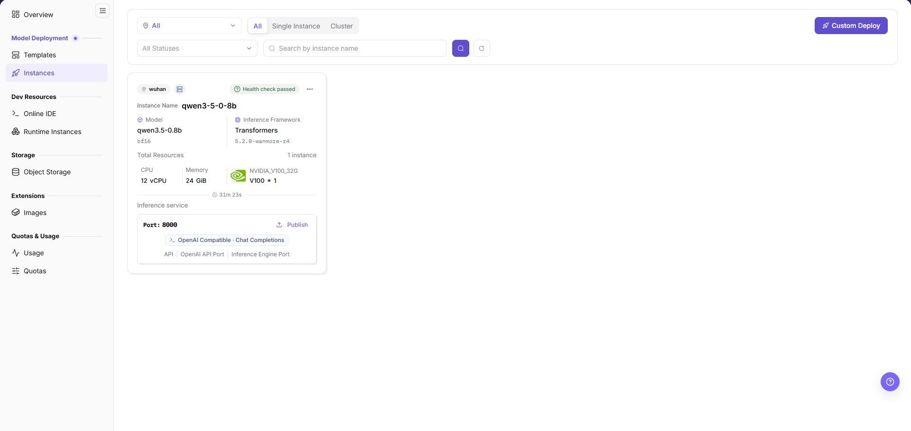

# Deploy and Check a Model

## Target Outcome

The instance reaches Running, events and logs remain clean, and a controlled request validates the selected NPU plan.

NPU means neural processing unit. A resource specification describes the requested resource bundle; verify the actual card count in instance and task information.

## Applicable Roles

- End User
- Model Provider
- Platform Operator when infrastructure troubleshooting is required

## Before You Start

- Confirm template availability, tenant quota, storage, and a deployment plan with the card count actually required.
- Prepare a harmless test request and record the instance name.

## Entry

- **Role:** Provider / End User
- **Menu:** On-Prem > Model Deployment > Deployment Templates / Model Instances
- **Instance route:** `/powerone/quickstart/model-service`

## Steps

1. Open **On-Prem > Model Deployment > Templates**, select a **Deployable** model, and verify its version and managed NPU models.
2. In **Business Parameters**, confirm framework, accelerator, concurrency, context, weight format, and KV cache precision. Compare **Single Instance/Cluster** recommendations and verify card count and physical memory.
3. Confirm name, region, specification, and replicas in deployment settings, review cost and impact, and perform the final deployment action. Do not look for image, port, and storage fields specific to Custom Deploy in this template wizard. After submission, locate the record in **Instances**.
4. If creation stalls, inspect workload events, image pulls, and scheduling results.
5. When running, verify the endpoint, health status, and actual NPU allocation.

The example card is marked **Health check passed** and shows the model, framework, CPU/memory, one NVIDIA V100, and service-port information. It is not proof of a successful target NPU deployment. Verify the actual accelerator model, card count, events, and call result for the instance created for this task.

## Status Guide

| State | Action |
| --- | --- |
| Creating | Wait for image pull and scheduling; inspect workload events |
| Running | Verify health, endpoint, and device usage |
| Queued | Check quota, flavor, and available NPU count |
| Failed | Check image, command, driver, storage, and multi-card communication |

## Four-NPU Validation Focus

**Worked example:** This section retains a four-NPU example. Use these tiers only when the model, capacity, and scheduling topology support them; other environments use their actual device inventory and workload requirements.

- A four-card instance must actually occupy four cards; do not rely on the template name alone.
- If the four-card specification cannot be scheduled, validate one card first, then two cards, and finally four cards.
- A sufficient cluster-wide card total does not guarantee that one scheduling topology can satisfy a four-card request.

## Completion Checklist

Check the results below; resolve failed items using the troubleshooting section before continuing.

| Check | Pass Criteria |
| --- | --- |
| 1 | The instance is running. |
| 2 | Device monitoring shows the requested cards assigned to the workload. |
| 3 | A minimal service request succeeds. |

## Troubleshooting

| Symptom | Check First |
| --- | --- |
| Instance remains queued | Tenant quota, free cards, specification, cluster association, and scheduler events |
| Instance runs but calls fail | Logs, model path, ports, protocol, request parameters, and rate limits |

## User Manual

[Model Instances](/usermanual/ai-infra-on-prem/user/model-deployment/instances/)
