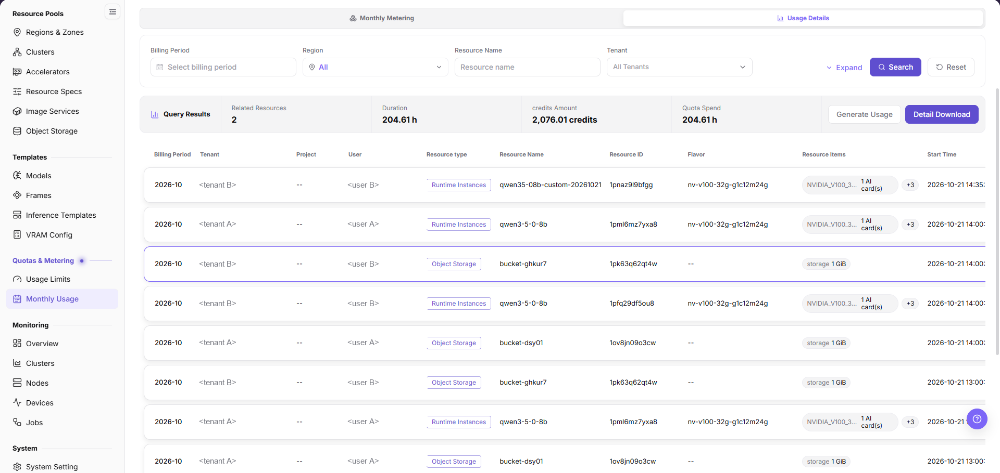
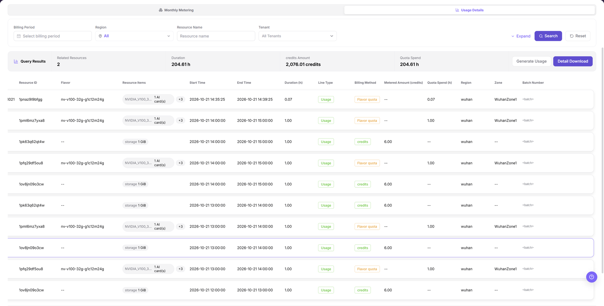

# Reconcile On-Prem Monthly Metering and Details

## Target Outcome

Map tenant credits, monthly usage, and metering details to actual instances or workloads for the same tenant and billing cycle.

Credits are platform accounting units, while specification-quota consumption is measured in hours. Reconcile them separately rather than adding the two measures.

## Applicable Roles

- Platform Operator
- Model Provider and End User reviewing their own resource consumption

## Before You Start

- Identify the target tenant, billing cycle, instance or workload ID, and metering unit.
- Confirm that monitoring and metering collection is reporting and start and end times are traceable.

## Steps

1. Open [Usage Limits](../../../../usermanual/ai-infra-on-prem/operator/quotas-metering/usage-limits/), select the region and tenant, and expand resource limits and specification quota. Use the read-only recharge/consumption drawers to trace quota sources and use. Resource limits are quantities; specification quota is hours.

2. Open [Monthly Usage](../../../../usermanual/ai-infra-on-prem/operator/quotas-metering/monthly-usage/), select the same tenant and billing cycle, and review resource type, specification, and summarized usage.

The image actually highlights **Usage Details**. It illustrates the record and summary layout, not a selected **Monthly Metering** view or a completed query for the current task. Verify the active tab and filters on the live page.

3. First check related resources, duration, credits amount, and quota spend in the Monthly Usage summary. One resource can produce many hourly rows; count distinct resource IDs rather than rows. For further tracing, open **Usage Details** and use the filters actually provided.

4. Compare runtime and specification in device, node, and workload monitoring. Confirm that end time, card count, and metering unit agree.

5. For an approved offline reconciliation, use **Detail Download** with the same filters. Do not select **Generate Usage** during read-only review, because it rewrites metering data. Keep the exported file under access control and record the selected tenant, region or availability zone, resource type, and time range with the evidence.

## Completion Checklist

Trace credit changes and monthly totals to workloads, not just summary figures.

| Check | Pass Criteria |
| --- | --- |
| Credit changes | Opening, allocation, deductions, and remaining credits can be explained. |
| Monthly total | Tenant, cycle, resource type, and metering unit are consistent. |
| Detail trace | Summarized usage maps to instances or workloads and time ranges. |
| Monitoring match | Card count, runtime, and end time agree with monitoring records. |

## Troubleshooting

| Symptom | Check First |
| --- | --- |
| Monthly usage differs from detail totals | Billing-cycle boundary, time zone, aggregation delay, and metering unit |
| Usage continues after the instance stops | Workload end time, residual instance, and state synchronization |
| Credits remain but workload creation fails | Tenant quota, specification capacity, template, and free cluster resources |
| Detail download does not match the page | Reapply the same tenant, region/zone, resource-type, billing-period, time-zone, and pagination filters before comparing totals |
