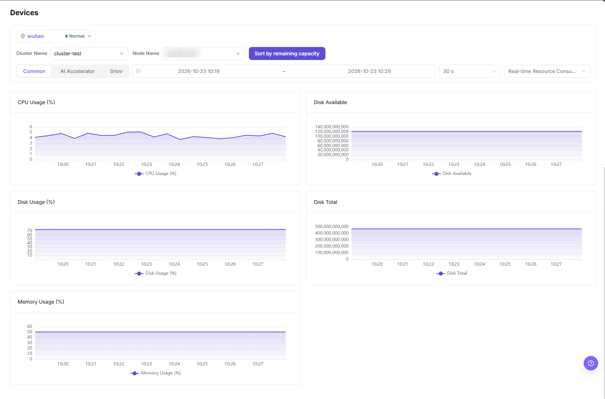
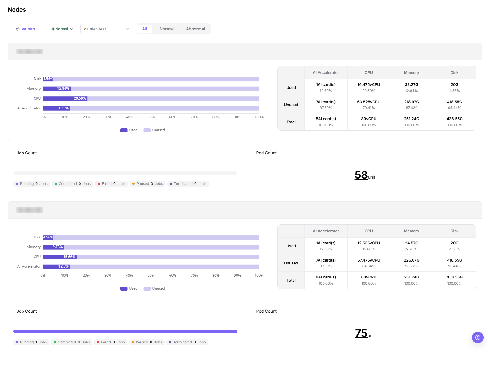
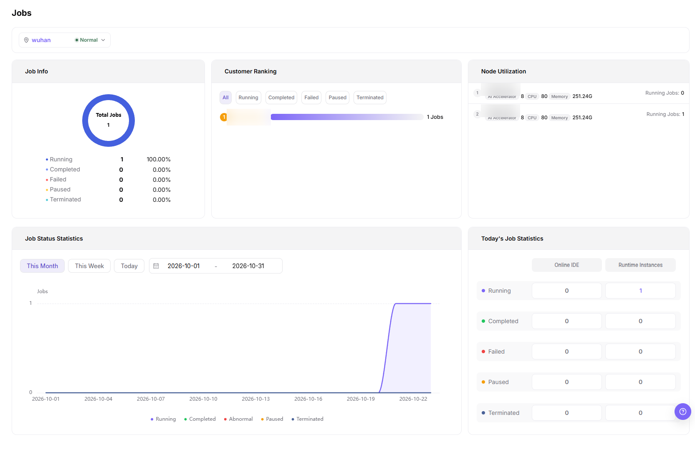

# Monitor Devices, Nodes, and Workloads

## Target Outcome

Check target NPU health and utilization against the actual hardware inventory and correlate abnormalities using node and instance records.

NPU means neural processing unit. Device utilization describes runtime load, not the card count requested by a workload or its tenant quota.

## Applicable Roles

- Platform Operator
- End User reviewing authorized workload monitoring

## Before You Start

- Record the cluster, node, device, and workload names used during onboarding and deployment.
- Use one common time range for device, node, and workload comparisons.

## Entry

- **Role:** Operator
- **Menu:** On-Prem > Monitoring > Device / Node / Workload Monitoring
- **Routes:** `/powerone/monitor/device`, `/powerone/monitor/node`, `/powerone/monitor/work`

## Steps

1. Open **Devices** and select the region, cluster, and node. The default **Common** tab shows host metrics; switch to **AI Accelerator** for device metrics. Verify only devices and fields actually returned rather than assuming the default tab lists every target card in the inventory.

The **Common** tab shows CPU, disk, and memory trends for the selected cluster, node, and time range. It does not show NPU device metrics or prove that all accelerators have been recognized.

2. In **Node Monitoring**, verify that accelerator nodes are Ready and not resource constrained.

3. In **Workload Monitoring**, review job-status totals and node utilization, then use deployment or runtime-instance details to confirm the task and resource allocation. Do not infer a per-card allocation map directly from the aggregate dashboard.

The image contains job and node aggregates, not a one-to-one map between physical NPU cards and individual workloads.

4. Correlate an abnormal device with its node and workload before choosing a hardware, driver, quota, or application fix.

Align region, cluster, node, and observation time. Devices provides a time range, but the Nodes manual does not show a time-range control, so do not require a nonexistent filter. Start with status totals and node utilization in Jobs, then inspect the individual instance. Aggregate charts alone do not prove a mapping from a physical card to a specific job.

## Four-NPU Inspection Table

**Worked example:** This section retains a four-NPU example. Use these tiers only when the model, capacity, and scheduling topology support them; other environments use their actual device inventory and workload requirements.

| Check | Expected Result |
| --- | --- |
| Device count | All four cards are visible |
| Health state | No offline card, missing card, or persistent alert |
| Device usage | Matches the card count requested by running workloads |
| Node state | Ready, with metrics updating continuously |
| Workload state | No abnormal queueing or repeated failure |

## Completion Checklist

Check the results below; resolve failed items using the troubleshooting section before continuing.

| Check | Pass Criteria |
| --- | --- |
| 1 | The device’s node is recorded and instance or job details confirm resource allocations; aggregate charts do not replace per-instance evidence. |
| 2 | Allocated cards match the request and tenant usage stays within its resource limit; the limit need not equal current usage. |
| 3 | A single unhealthy card can be isolated without treating the entire cluster as unavailable. |

## Troubleshooting

| Symptom | Check First |
| --- | --- |
| Device metrics are empty | Monitoring agent, device plug-in, time range, cluster state, and device mapping |
| A card is idle while jobs wait | Requested specification, scheduler events, node labels, quota, and card health |
| Device, node, and workload totals differ | Region/zone scope, time range, update time, aggregation level, and collection delay |

## User Manual

- [Device Monitoring](/usermanual/ai-infra-on-prem/operator/monitoring/devices/)
- [Node Monitoring](/usermanual/ai-infra-on-prem/operator/monitoring/nodes/)
- [Workload Monitoring](/usermanual/ai-infra-on-prem/operator/monitoring/jobs/)
