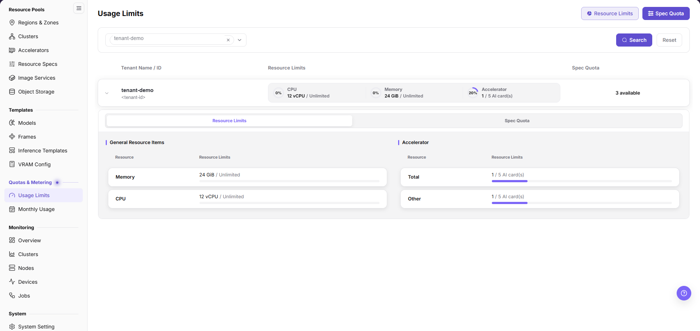

# Configure Tenant NPU Quota

## Target Outcome

The tenant can request approved NPU plans without exceeding its authorized limit in the actual resource pool.

Resource limits cap quantities, while specification quota is available usage time. Setting a card limit does not reserve that many physical cards.

An operator authorized to maintain tenant limits performs this page’s changes. Users verify their own available scope; this workflow does not authorize changes to other tenants or platform defaults.

## Applicable Roles

- Platform Operator

## Before You Start

- Confirm actual total capacity, current allocations, and whether quota is counted by card or specification.
- Define the tenant's required workload tiers and maximum concurrent resource use.

## Entry

- **Role:** Operator
- **Menu:** On-Prem > Quotas & Metering > Usage Limits
- **User manual:** [Usage Limits](../../../../usermanual/ai-infra-on-prem/operator/quotas-metering/usage-limits/)

## Steps

1. Open **Usage Limits**, select the region and target tenant with the tenant selector, and select **Search**. Expand the tenant row to read resource limits and specification quota.
2. Select the page-header **Resource Limits** button and switch to **Allocate Resource Limits**. Verify the target in **Select Tenant** again; do not accidentally modify **Default Resource Limits**, which affects other tenants.
3. In **Accelerator**, select the matching category and enter the approved **Allocate resource** amount in **AI card(s)**. A four-card workload also requires a matching specification and schedulable capacity, not quota alone.
4. Select **Confirm**, expand the tenant row to read back the result, and check used resources with an approved test workload.
5. **Spec Quota** is measured in **Hours**, not card count. For changes, distinguish **Default Spec Quota**, **Overwrite Initialization Quota**, and **Adjust Spec Quota** as documented. Overwrite initialization removes unlisted quotas and is not a normal append operation.

## Quota Strategy

**Example scope:** The four-card pool and four-card workload below are quantity examples; set limits from physical capacity and approved requirements.

- With only four physical cards, avoid granting multiple tenants a simultaneous guaranteed four-card allocation.
- A four-card flavor and a tenant limit of four are separate requirements; both must pass.
- Reserve operational capacity when the cards should not be occupied permanently.

## Completion Checklist

Check the results below; resolve failed items using the troubleshooting section before continuing.

| Check | Pass Criteria |
| --- | --- |
| 1 | Tenant quota is updated. |
| 2 | Authorized NPU flavors are selectable. |
| 3 | Resource limits and specification hours have been read back, and the test workload’s actual state and feedback have been checked. |

## Troubleshooting

| Symptom | Check First |
| --- | --- |
| Quota looks sufficient but creation fails | Specification availability, tenant credits, capacity, and current workloads |
| Quota does not recover after release | Instance final state, metering delay, and stale allocation |
| The target flavor is not selectable after the change | Enabled specification, cluster association, region/zone scope, tenant credits, and current card capacity |

## User Manual

For operator-side verification, use [Monthly Usage](../../../../usermanual/ai-infra-on-prem/operator/quotas-metering/monthly-usage/) and its `Usage Details` tab.
