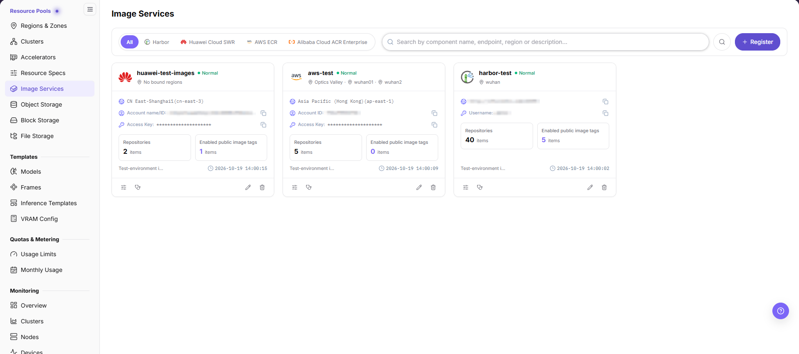
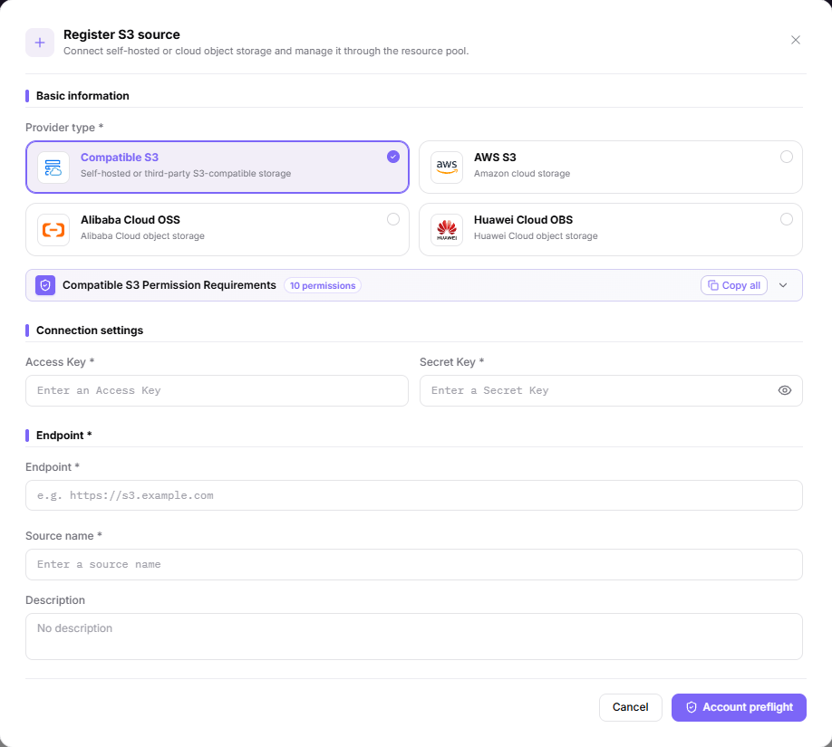

# Configure On-Prem Runtime Images and Storage

Use this task to prepare runtime images and storage for an onboarded local cluster.

## Applicable Roles

- Platform Operators, on-prem compute administrators, and storage administrators

## Before You Start

1. Confirm that the target region and cluster are onboarded and nodes are healthy.
2. Confirm that cluster nodes can reach the image registry and storage services.
3. Prepare minimum-privilege registry and storage credentials and the certificate policy.
4. Define the test workload, image version, capacity, and access requirements.

## Procedure

### 1. Register and Validate the Image Service

Open [Image Services](../../../usermanual/ai-infra-on-prem/operator/resource-pools/image-services/), select **Register**, choose an available provider, and enter its credentials, Harbor endpoint (service access address) or cloud region, public and tenant-private registry namespaces, and component name. Select **Account preflight** to submit and check card health afterward. There is no separate Save action in the register dialog; verify regional binding in region configuration. Browser access alone does not prove nodes can pull the image.

### 2. Synchronize or Upload Runtime Images

After the operator provides the available component and region scope, a user with image-push permission opens [Images](../../../usermanual/ai-infra-on-prem/user/extensions/images/) and verifies image groups, repositories, and tags (image version labels). For upload, follow **Upload guide** for controlled push instructions. Use explicit versions and confirm node pull access; component registration does not itself prove image upload or synchronization.

### 3. Select Storage for the Workload

- For object data, open [Object Storage](../../../usermanual/ai-infra-on-prem/operator/resource-pools/object-storage/), select **Register**, choose a provider, enter credentials, endpoint or provider region, and source name, then select **Account preflight**. Capacity, bucket limits, and pricing are maintained afterward through **Configure limits**, not in the register form.
- Keep the [Block Storage](../../../usermanual/ai-infra-on-prem/operator/resource-pools/block-storage/) and [File Storage](../../../usermanual/ai-infra-on-prem/operator/resource-pools/file-storage/) references, but first confirm that the current environment exposes the capability. If the entry only shows an unavailable-feature notice, do not proceed with registration or mounting. A menu entry or historical screenshot is not proof of availability.
- For existing shared directories, verify actual mount configuration in **Clusters > Configuration > Shared Storage**. This is not the same entry as registering a file-storage component.

### 4. Bind the Region and Run a Combined Validation

In **Regions & Zones**, verify the image component and optional object-storage binding. The current region details do not expose file- or block-storage binding sections. Check other mounts in cluster or instance configuration only where the capability is available. Create a minimal test workload and validate image pull, startup, volume mounting, or object access. After it ends, confirm data-retention and resource-reclaim behavior.

Before deleting or replacing an image service or storage component, check the component's downstream region, cluster, template, and workload dependencies. Remove or migrate those dependencies first; otherwise later image pulls, mounts, or object access may fail.

## Completion Checklist

Do not create workloads in bulk until the runtime and storage pass these checks.

| Check | Pass Criteria |
| --- | --- |
| Image registry | Cluster nodes can reach it and authentication and synchronization are healthy. |
| Runtime image | A test instance can pull the explicit target version. |
| Storage capability | Storage actually available and used in this workflow passes access checks; unavailable capabilities are not marked complete. |
| Region binding | Images and storage are available in the correct region, cluster, and tenant scope. |
| Operations ownership | Owners for capacity, backup, deletion, and credential rotation are clear. |

## Troubleshooting

| Symptom | Check First |
| --- | --- |
| Instance reports an image-pull failure | Full image path, tag, registry authentication, certificate, and node network |
| Image exists in the platform but users cannot select it | Synchronization, region binding, tenant permission, and label state |
| Volume cannot be created or mounted | CSI (Container Storage Interface)/storage driver, access mode, capacity, network, and authentication |
| Object or shared directory cannot be accessed | Endpoint, path or bucket, access policy, and tenant isolation |
| A component cannot be deleted or replaced safely | Region and cluster bindings, template or workload references, active mounts, and the component's current health state |
