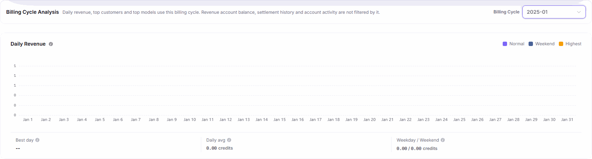
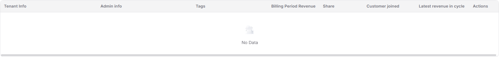
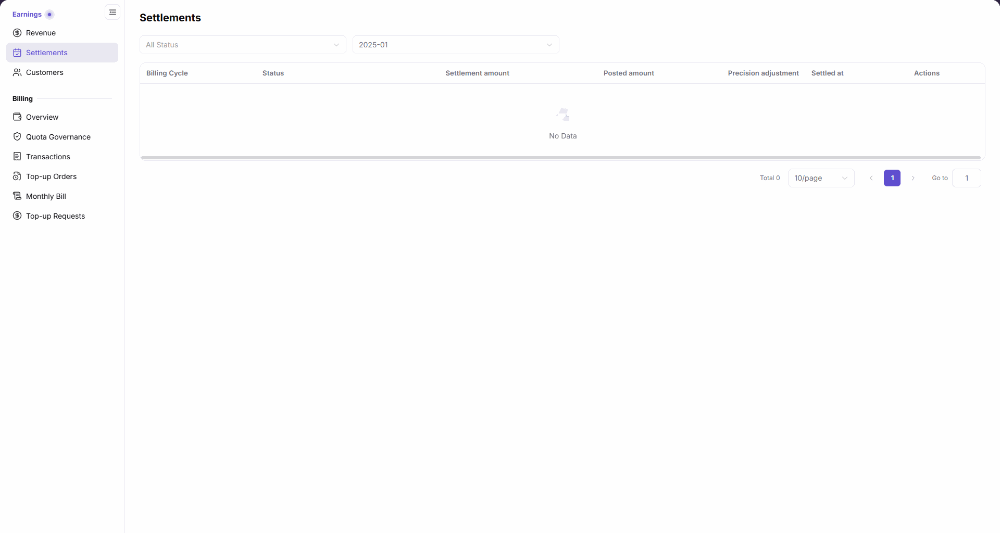

# Provider Revenue and Settlement Reconciliation

Use this task to explain provider revenue sources and confirm a monthly settlement result. Credit is the platform account's accounting unit, not the original-currency payment amount of an order.

The provider or its authorized finance viewer first reconciles its own revenue. For a discrepancy, hand the cycle, statement identifier, estimate-versus-posted scope, and discrepancy notes to platform billing staff. After receiving their findings, the provider verifies the result in its own revenue pages. Only a person with the relevant permission and authorization performs a balance transfer.

## Applicable Roles

- Model Providers, provider finance viewers, and revenue operators

## Before You Start

- Identify the target billing cycle and the customers or models to reconcile.
- Confirm permission to view Provider revenue and settlement data.
- Confirm the destination account, operator, and reviewer before transferring a balance.

## Procedure

### 1. Review Revenue Overview

Open [Revenue Overview](../../../usermanual/billing/user/earnings/revenue/) under `Billing > Earnings > Revenue`. Read the live balance, current-cycle estimate, next-settlement notice, and cycle analysis separately. Estimates are unsettled and excluded from the revenue-account balance; the next-settlement notice is only a time reminder. The analysis cycle affects daily revenue and customer/model rankings, not live balances or historical outflows.

The figure shows the analysis area for a historical billing cycle, not the live account balance; check account totals separately on the page.

### 2. Explain Revenue Sources

Select the target billing cycle and review the top customers and top models. Then open [Customers](../../../usermanual/billing/user/earnings/customers/), filter by customer or tag, and open details to reconcile the revenue contribution.

The figure shows an empty customer-results table. It does not show the query controls, customer identities, summary cards, or detail results; check the selected cycle and filters on the actual page.

### 3. Reconcile Monthly Settlements

Open [Monthly Settlements](../../../usermanual/billing/user/earnings/settlements/), filter by status and billing cycle, and compare settlement amount, posted amount, precision adjustment, settled time, and processing status. The current estimated/pending row opens a full estimate-details page: no statement has been generated or posted to the revenue account. Read historical rows by their own status; do not treat an estimate as a received amount.

### 4. Transfer the Balance

Return to [Revenue Overview](../../../usermanual/billing/user/earnings/revenue/) and click **Transfer to Available** to open its form. Check the transferable balance, required transfer amount, and optional remarks; this action is not in the Monthly Settlements list. Use the final transfer confirmation only after verifying the amount and business authorization. Cancel for read-only inspection or when a discrepancy remains; do not submit merely to test availability.

## Completion Checklist

Do not transfer a balance until its sources and settlement results reconcile.

| Check | Pass Criteria |
| --- | --- |
| Revenue totals | Balance, estimated revenue, and billing-cycle trend are confirmed. |
| Revenue sources | Major customer and model contributions can be explained. |
| Settlement status | Expected settlement, actual receipt, and status are consistent. |
| Transfer conditions | Amount, destination account, permission, and reviewer are confirmed. |

## Troubleshooting

| Symptom | Check First |
| --- | --- |
| Revenue balance differs from expectation | Billing cycle, model calls, pricing rules, and synchronization time |
| Customer revenue is empty | Customer scope, tag filter, and valid calls |
| Expected settlement differs from actual receipt | Statement status, rounding adjustment, receipt time, and outbound transactions |
| Transfer action is unavailable | Settlement status, account permission, and destination account |
