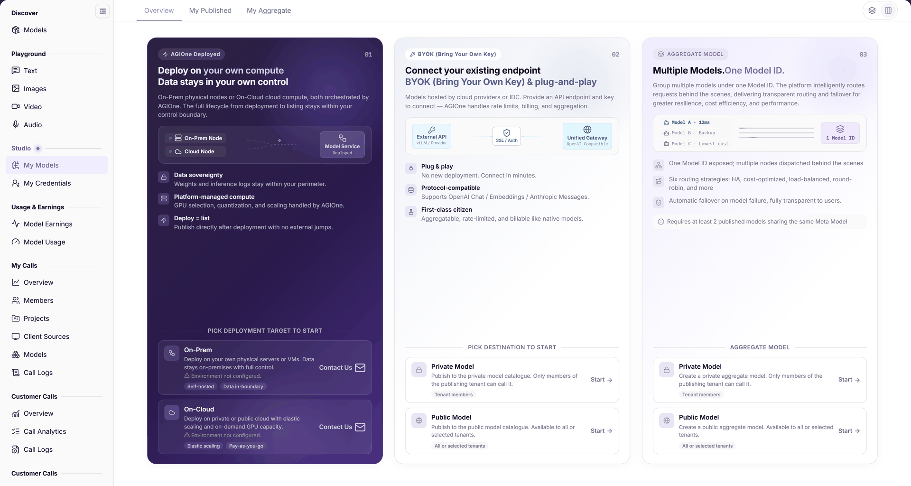

# Publish an Aggregation Model

## Applicable Roles

- Model Provider

## Before You Start

- Prepare at least two published models sharing the same Meta Model; verify availability, modalities, protocols, prices, and visibility. A Meta Model is a capability profile that may be referenced by different provider instances.
- Define the routing objective and publication scope. Aggregation does not replace member capabilities or authorization.

## Procedure

1. Open **Model Services > Studio > My Models** and switch to **My Aggregate**.
2. Click **Create Aggregate Model** and choose **Private Model** or **Public Model**.

The figure shows three publication paths on Overview. The aggregate area offers private and public entries and explicitly requires at least two published models sharing the same Meta Model.

3. Select published models, check their providers, and configure the routing strategy, billing, and rate limits offered by the page.
4. Review scope and cost impact before submission, then return to **My Aggregate** and verify the record and status.
5. Follow [Model Experience and API Calling](../model-experience-api-calling/) for a controlled request by an authorized account. The provider hands over the aggregate identifier, protocol, and scope; the caller uses their own authorized key rather than receiving real keys through shared handoff material. Do not assume that disabling a member guarantees automatic failover without verification.

## Completion Checklist

| Check | Pass Criteria |
| --- | --- |
| Members | At least two published members share the same Meta Model, with availability, providers, and authorization verified. |
| Strategy and cost | Routing, billing, and rate-limit settings have been reviewed. |
| Save result | My Aggregate contains the target record and status. |
| Call | An authorized account completes a controlled request and inspects its result. |

## Troubleshooting

| Symptom | Check First and Continue |
| --- | --- |
| Aggregate record is missing | Confirm the My Aggregate tab and filters in [My Models](../../../usermanual/model-services/user/studio/my-models/). |
| Configuration cannot complete | Confirm that at least two selected models are published and share the same Meta Model, then check availability and required fields. |
| Call fails | Verify model and authorization, then inspect [My Calls logs](../../../usermanual/model-services/user/my-calls/call-logs/). |

## User Manual

[My Models: aggregation creation and validation](../../../usermanual/model-services/user/studio/my-models/)
