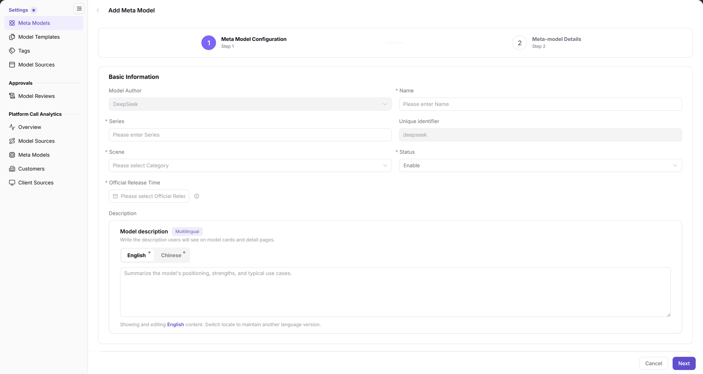

# Meta Models

## Target Outcome

Maintain a capability profile with verified identity, modalities, capabilities, token limits, and protocols for templates and publication. Modalities are input/output data types; tokens are units of text processed by the model, and protocols define request/response formats.

## Applicable Roles

- Operator Admin

## Before You Start

- Permission for **Model Services > Settings > Meta Models**, with the target model author already present.
- Confirm name, family, unique identifier, scene, release time, and capabilities against the official specification; do not copy limits from another model's example.

## Procedure

1. Open **Settings > Meta Models** and select the intended author on the left. If missing, ask the base-data owner to maintain it rather than assuming an author-creation button is available here.
2. Click **Add Meta Model** to enter the two steps **Meta Model Configuration > Meta Model Details**.
3. Check the author, complete basic information and localized descriptions, and configure the real model types, modalities, Function/Tool Support, Thinking Mode, token limits, and protocols.

The figure shows the configuration step. The author is carried in; starred fields such as Name, Family, Scene, and Official Release Time must be completed.

4. Click **Next**, complete model details, and submit through the page.
5. Search under the same author, check the identifier and status, then confirm the model is selectable in [Model Templates](../Model-Templates/).

## Completion Checklist

| Check | Pass Criteria |
| --- | --- |
| Record | The intended author's list contains the new record with correct identifier and status. |
| Capability | Modalities, capabilities, token limits, and protocols match verified specifications. |
| Reference | The template creation flow can select this meta model. |

## Troubleshooting

| Symptom | Check First and Continue |
| --- | --- |
| Record is not found | Check author context, filters, and pagination in [Meta Models FAQ](../../../../usermanual/model-services/operator/settings/meta-models/#faq). |
| Next step is unavailable | Check starred fields and protocols. |
| Service address is missing | Configure addresses on Endpoints in [Model Sources](../Model-Source/), not in Meta Models. |

## User Manual

[Meta Models: complete fields and operations](../../../../usermanual/model-services/operator/settings/meta-models/)
