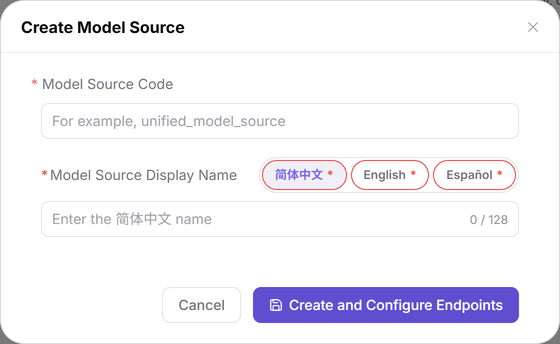

# Model Sources

## Target Outcome

Maintain an upstream source and its Endpoints (service access points) so publishers can select the correct address and protocols. The source itself does not hold a call address; the Base URL is the call root address and belongs to an Endpoint.

## Applicable Roles

- Operator Admin

## Before You Start

- Permission to maintain **Model Services > Settings > Model Sources**.
- Obtain the upstream Base URL, region tag, console/documentation URLs, and protocol list. Never put real authentication values in shared materials.

## Procedure

1. Open **Settings > Model Sources**, not **Platform Call Analytics > Model Sources**, which only displays call data.
2. Click **Create Model Source**, enter a unique **Model Source Code** (identifying the upstream source, not a specific model route), and complete display names on all three language tabs: 简体中文, English, and Español.
3. Click **Create and Configure Endpoints** to open the configuration page.

The figure shows the creation dialog with Code and multilingual display names only. Call addresses are configured on Endpoints afterwards.

4. Under **Endpoint Management**, click **Add Endpoint**. Enter the display name, region tag, and Base URL; maintain the official-endpoint flag and console/documentation URLs as needed.
5. Select the protocols actually supported by the Endpoint, then click **Save Endpoint**.
6. Review the source-level information and use **Save Model Source** in the header for source-level changes. These saves belong to different levels and do not replace each other.
7. Return to the list or open **Details** to check Code, Endpoint count, region, Base URL, and protocols; continue to [Model Templates](../Model-Templates/) to assemble presets.

## Completion Checklist

| Check | Pass Criteria |
| --- | --- |
| Source | The unique Code and three language names are correct; the record is in the list. |
| Endpoint | Details show the intended access point, Base URL, and protocols. |
| Downstream reference | The template's provider and region match the intended source. |

## Troubleshooting

| Symptom | Check First and Continue |
| --- | --- |
| No creation entry | Ensure this is not the statistics page; see [Model Sources](../../../../usermanual/model-services/operator/settings/model-source/). |
| Creation cannot complete | Check Code uniqueness and all three language names. |
| Address is missing or count is unchanged | Complete Endpoint configuration and click Save Endpoint; see [Model Sources FAQ](../../../../usermanual/model-services/operator/settings/model-source/#faq). |

## User Manual

[Model Sources: complete fields and separate save actions](../../../../usermanual/model-services/operator/settings/model-source/)
