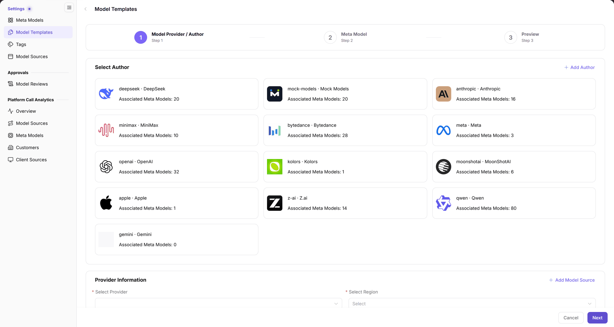

# Model Templates

## Target Outcome

Combine the prepared author, model-source provider, region, and meta model into a reusable publishing preset. A meta model is a capability profile; a template references it and a service source rather than being a published model instance.

## Applicable Roles

- Operator Admin

## Before You Start

- Permission for **Model Services > Settings > Model Templates**.
- Prepare the author, meta model, model source, and Endpoints, and verify actual capabilities and protocols (request/response format contracts).

## Procedure

1. Open **Settings > Model Templates**, select the source on the left, and click **Add**.
2. In **1 Model Provider / Author**, choose an author card and select the provider and region under **Provider Information**. Check [Model Sources](../Model-Source/) first when a source is missing.

The figure shows the first wizard step: author cards and associated meta-model counts above the provider and region selectors.

3. Click **Next** to enter **2 Meta Model**. Select the model and review the displayed modalities, capabilities, token limits (text-processing unit limits), and protocols against the actual service rather than fixed fields or values in an old screenshot.
4. Review the configuration in **3 Preview**, then submit.
5. Return to the same source and filter by Author, Meta Model, Status, or Keyword to locate the template and verify the list and Total. The operator hands its source, region, and meta model to the provider so the provider can identify the intended publishing configuration.

## Completion Checklist

| Check | Pass Criteria |
| --- | --- |
| Ownership | The left source matches the right heading; provider and region are correct. |
| Dependencies | Author, meta model, capabilities, and protocols match the service. |
| Save result | The submitted template can be found under the correct source. |

## Troubleshooting

| Symptom | Check First and Continue |
| --- | --- |
| List is empty after creation | Reset filters and verify the selected source; see [Model Templates FAQ](../../../../usermanual/model-services/operator/settings/model-templates/#faq). |
| Author, provider, or region is missing | Check prerequisite base data in Meta Models and Model Sources. |
| Wizard cannot proceed | Complete the current step; do not skip step 1 to infer fields in later steps. |

## User Manual

[Model Templates: complete operations and filters](../../../../usermanual/model-services/operator/settings/model-templates/)
