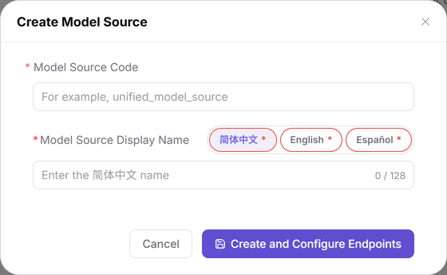

# Model Publishing: Preconfiguration Guide

This task hands operator-side base settings to model providers without duplicating complete field tables from the manuals.

## Target Outcome

Meta models (capability profiles), source Endpoints (service access points), and templates correspond correctly so the provider can start publication, with a designated operator for review when required.

## Applicable Roles

- Operator Admin; Model Providers assist with publication-option verification.

The operator hands over the meta model, source Code, Endpoint, and template ownership. The provider checks selectable settings and tests protocol connectivity. When review is required, the provider hands the target model and submitted revision back to the operator for processing.

## Before You Start

- Permission for **Model Services > Settings** and the relevant approval operations.
- Obtain official model specifications, upstream addresses, and protocols; confirm pricing basis, publication scope, and review ownership.
- Keep credentials out of names, descriptions, shared documents, and public request examples.

## Procedure

1. In **Settings > Meta Models**, select an existing author and maintain capabilities and protocols following [Meta Models](./Meta-models/).
2. In **Settings > Model Sources**, follow [Model Sources](./Model-Source/) to create a Code (the unique source identifier) and three language names, then configure Endpoints and protocols. Addresses belong to Endpoints; do not follow the old region-row and authentication-header flow.
3. In **Settings > Model Templates**, follow [Model Templates](./Model-Templates/) to choose author, provider, region, and meta model. Preview, submit, and verify the list.

The figure shows the model-source creation dialog. Endpoint configuration is still needed afterwards; name and Code alone do not establish a call address.

4. Check model classification in [Tags](../../../usermanual/model-services/operator/settings/tags/). Confirm the pricing currency with the platform settings owner; publishing one model does not require changing the platform-wide currency.
5. Have the provider open [My Models](../../../usermanual/model-services/user/studio/my-models/), verify meta-model, source, Endpoint, and credential choices, and pass protocol connectivity testing before proceeding.
6. When review is required, the operator opens **Approvals > Model Reviews**, clicks the row's **Review**, and checks the revision, capabilities, protocols, and charges in the drawer. See [Model Publishing Approval](../model-publishing-approval/).

## Completion Checklist

| Check | Pass Criteria |
| --- | --- |
| Base data | The meta model is present and source details contain the intended Endpoint and protocols. |
| Template | The template is found under the correct source with matching author, region, and meta model. |
| Provider verification | The provider can select required settings and pass connectivity testing. |
| Review handoff | Any version requiring review can be located in Model Reviews and has an assigned reviewer. |

## Troubleshooting

| Symptom | Check First and Continue |
| --- | --- |
| Meta model is missing | Check author context, state, and filters in [Meta Models](../../../usermanual/model-services/operator/settings/meta-models/). |
| Source has no address | Confirm the Endpoint was saved in [Model Sources](../../../usermanual/model-services/operator/settings/model-source/). |
| Template list is empty | Reset filters and select the correct source in [Model Templates](../../../usermanual/model-services/operator/settings/model-templates/). |
| Publication or review is blocked | Check the current revision in [My Models](../../../usermanual/model-services/user/studio/my-models/) or [Model Reviews](../../../usermanual/model-services/operator/approvals/model-reviews/). |
