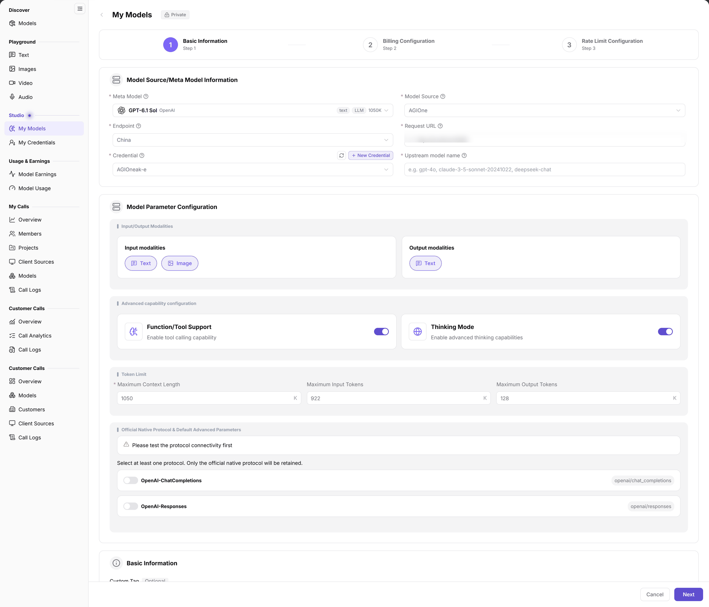

# Publish a Model (Video)

This page covers publication and verification for a video model. See [Publish Public Models](../provider-quick-guide) for the shared publishing entry.

## Target Outcome

Publish a verified video service to the intended scope, pass protocol testing, and verify its publication record and call results.

## Applicable Roles

- Model Provider

## Before You Start

- Prepare the meta model (capability profile), model source (upstream source) and Endpoint (access point under that source), upstream model name, request URL, and credential.
- Confirm the model's modalities (input/output data types), protocols (request/response format contracts), billing unit, and rate-limit policy.
- Prepare a prompt or image supported by the target model and verify the video task and final result. Do not confuse a task-query URL with a callback URL or reuse another model's status mapping.

## Procedure

1. Open **Model Services > Studio > My Models > My Published**, click **Publish Model**, and choose **Private Model** or **Public Model** to enter the wizard.
2. In **Step 1 Basic Information**, select the corresponding meta model, model source, and Endpoint. Enter the request URL, credential, and **Upstream model name**; verify modalities and advanced capabilities against the actual service.

The figure shows a private text-model example explaining shared meta-model, source, Endpoint, and protocol fields. It does not demonstrate public publication or its result and is not a dedicated video configuration screenshot. Access Mode is outside the area shown; check actual fields and parameters for the selected model.

3. Select a native protocol supported by the service and test connectivity using its configuration. After testing passes, review the custom tag, publication method, and **Access Mode**.
4. Complete **Billing Configuration** and **Rate Limit Configuration**, then submit. Check the actual service's unit and prices rather than copying examples from a different modality.
5. Return to **My Published** to check status and revision. Use [Model Publishing Approval](../../model-publishing-approval/) when required, then follow [Model Experience and API Calling](../../model-experience-api-calling/) for controlled verification.

## Completion Checklist

| Check | Pass Criteria |
| --- | --- |
| Protocol and capability | Protocol testing passes and declared modalities match verified samples. |
| Publication revision | The target record is present in My Published; status, effective version, and pending version are checked. |
| Cost and scope | Billing unit, price, limits, and access match the agreement. |
| Call result | An authorized account completes a controlled call for the intended video capability and the result can be inspected. |

## Troubleshooting

| Symptom | Check First and Continue |
| --- | --- |
| Publishing cannot proceed | Verify meta model, Endpoint, credential, and testing in [My Models](../../../../usermanual/model-services/user/studio/my-models/#faq). |
| Published model is missing or inaccessible | Check revision, review state, and authorization in [Models](../../../../usermanual/model-services/user/discover/models/). |
| Output is unexpected | Compare input modality, model name, and sample against the upstream specification and selected protocol. Do not relabel capabilities to hide a failed test. |

## User Manual

[My Models: fields, operations, and publication-result validation](../../../../usermanual/model-services/user/studio/my-models/)
