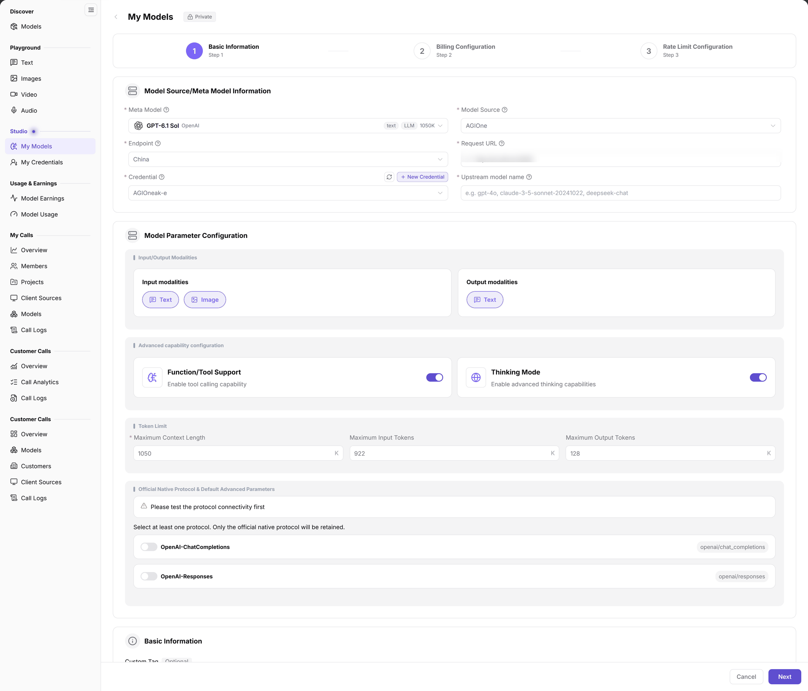

# Publish Public Models

This guide publishes an existing upstream service through BYOK (Bring Your Own Key). Compute deployment is not a deployment-method choice inside this publishing wizard; prepare deployed services through [Model Deployment and Status Check](../on-prem-model-deployment-status/) first.

## Target Outcome

Pass protocol connectivity testing, configure billing and rate limits, and verify the published revision and intended users' access.

## Applicable Roles

- Model Provider; an Operator processes review when required.

## Before You Start

- Your account can open **Model Services > Studio > My Models**.
- Confirm the meta model (capability profile), model source (upstream source), Endpoint (access point under the source), request URL, credential, and upstream model name.
- Confirm publication scope, billing, and limits, and prepare non-sensitive test input. Testing and subsequent calls can consume credits; verify price and authorization first.

## 1. Open the Publishing Entry

1. Sign in to {{DOCS_PRODUCT_NAME_EN}}, open **Studio > My Models**, and switch to **My Published**.
2. Click **Publish Model**, choose **Public Model** in **Select publish type**, then click **Publish as Public Model**.
3. Alternatively, start from the public entry under **Overview > BYOK**. A deployment card showing **Environment not configured.** does not provide a direct deployment action.

## 2. Configure Basic Information and Test Connectivity

1. In **Step 1 Basic Information**, select the meta model, model source, and Endpoint; fill the request URL, credential, and **Upstream model name**. Check input/output modalities.
2. Configure Function/Tool Support, Thinking Mode, and token limits only for verified model capabilities.
3. Select at least one protocol under **Official Native Protocol & Default Advanced Parameters**, and complete connectivity testing before proceeding.
4. Review the custom tag, model name preview, publication method, and **Access Mode**. **Global** needs no additional tenant authorization; **Authorized** requires tenant authorization even when the model is visible in the marketplace.

The figure shows a private text-model example, used only to explain shared fields such as meta model, source, Endpoint, request URL, credential, upstream model name, and protocols. It does not demonstrate the public-model publication flow or result. Access Mode is below the area shown; verify publication type and access control on the current public publishing page.

## 3. Complete Billing, Rate Limits, and Publication Checks

1. Click **Next** to complete **Step 2 Billing Configuration**. Check the billing method, unit, and price.
2. Complete **Step 3 Rate Limit Configuration**, confirm whether limits are enabled, and submit through the page.
3. Return to **My Published** and check the target record's status, **Effective version**, and **Pending version**. Hand the target model, submitted revision, and publication scope to the operator and use [Model Publishing Approval](../model-publishing-approval/) when review is required; submission alone does not establish that the model is listed.
4. With the intended user's account, open **Discover > Models**, click the model name, and check the provider card's price, route ID, and access. Use **Playground** or **Quick Start** to verify a controlled call.

## Completion Checklist

| Check | Pass Criteria |
| --- | --- |
| Protocol | Connectivity testing passes for the intended model and protocol. |
| Publication record | My Published shows the target revision and expected status. |
| Cost and access | Price, billing unit, limits, and Access Mode have been reviewed. |
| User verification | The authorized audience can find the model and complete a controlled call. |

## Troubleshooting

| Symptom | Check First and Continue |
| --- | --- |
| Basic information cannot proceed | Check required fields and protocol testing in [My Models](../../../usermanual/model-services/user/studio/my-models/#faq). |
| Publication record is missing | Confirm My Published, reset search, and check review status. |
| Visible model cannot be called | Verify Access Mode, tenant authorization, and provider selection in [Models](../../../usermanual/model-services/user/discover/models/). |

## User Manual

- [My Models](../../../usermanual/model-services/user/studio/my-models/)
- [Models](../../../usermanual/model-services/user/discover/models/)
