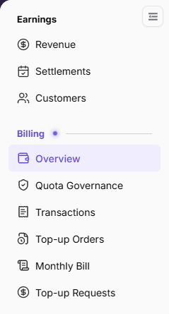
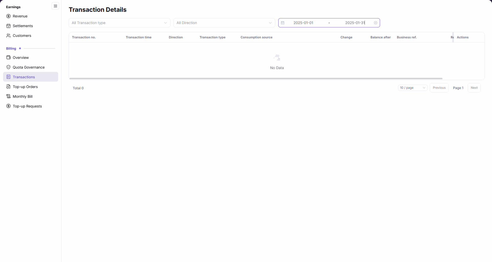
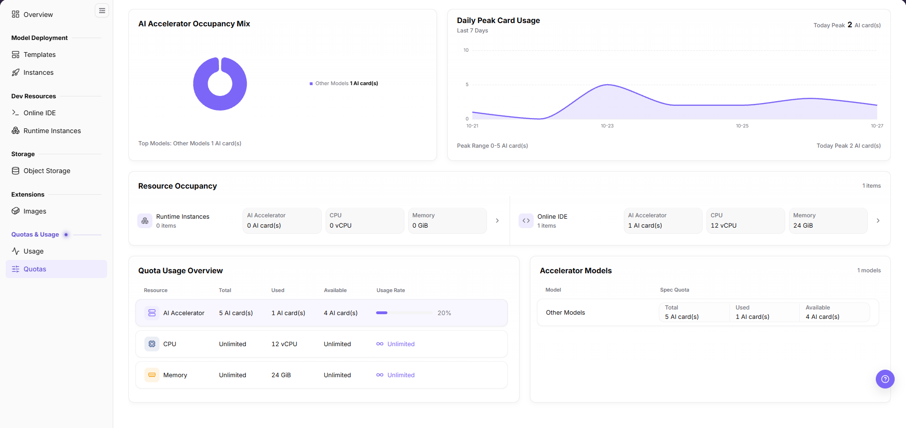
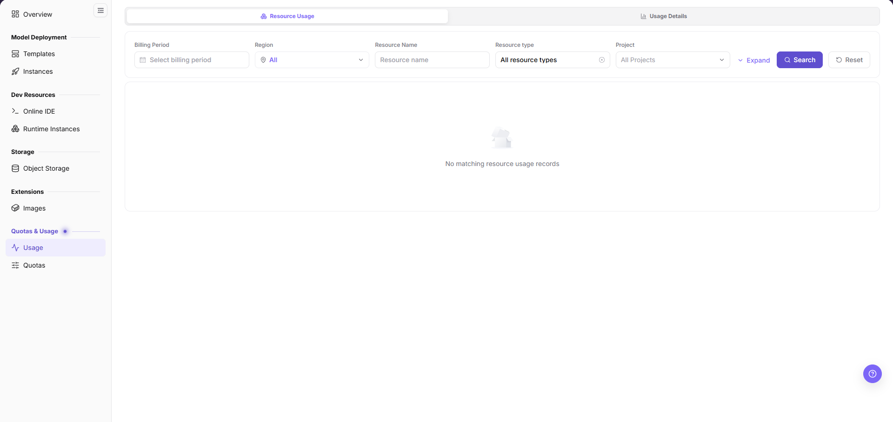

# Recharge & Billing

This scenario helps users distinguish account top-ups, resource quota, resource usage, and model billing and select the correct view for checking whether credits arrived, whether capacity is usable, and why deductions occurred. Credits are the platform account's accounting units; resource quota is a resource-usage ceiling. A model token measures processed text and is not a sign-in token.

## Applicable Roles

- End User reviewing top-ups, quota, usage, and charges
- Model Provider reviewing model usage and revenue
- Platform Operator reconciling quota, credits, metering, and billing periods

## Related Concepts

| Concept | Question | Entry |
| --- | --- | --- |
| Top-up orders | Did the account receive new spendable credits? | [Top-Up Orders](../../../usermanual/billing/user/billing/top-up-orders/) |
| Transactions | Why did the balance increase or decrease? | [Transactions](../../../usermanual/billing/user/billing/transactions/) |
| Resource quota | How much compute or storage can the tenant request? | [Resource Quotas](../../../usermanual/ai-infra-on-prem/user/quotas-usage/quotas/) |
| Resource usage | How much did an instance or job actually consume? | [Resource Usage](../../../usermanual/ai-infra-on-prem/user/quotas-usage/usage/) |
| Model usage and earnings | How many tokens, calls, duration, charges, or earnings did model calls produce? | [Model Usage](../../../usermanual/model-services/user/usage-earnings/model-usage/), [Model Earnings](../../../usermanual/model-services/user/usage-earnings/model-earnings/) |
| Monthly bill | Can summarized spending for the billing cycle be reconciled? | [Monthly Bill](../../../usermanual/billing/user/billing/monthly-bill/) |

## Target Outcome

- The user confirms top-up history and updated spendable credits.
- The user distinguishes insufficient resource quota from insufficient balance or credits.
- Resource or model consumption can be traced to an instance, job, or call.
- Operators can explain deductions with details and billing-period summaries.

## Before You Start

1. Decide whether the issue concerns model calls or On-Prem resources.
2. Confirm tenant, account, time range, billing period, and unit.
3. Prepare a redacted top-up, instance, job, or call identifier.

## Procedure

1. Open [Billing Overview](../../../usermanual/billing/user/billing/overview/) and check the update time. Use Refresh Current Cycle as needed, then read balance, month-to-date spending, top-ups, and alerts separately. In **Top-Up Orders**, query by order number, status, posting source, and date range. Original-currency amounts, credited credits, and order status have different meanings; the credited column alone is not proof of posting.

The figure shows navigation entries only; open Overview to check the actual account balance and alerts.

For an account-credit request, use [Top-Up Requests](../../../usermanual/billing/user/billing/top-up-requests/) only if this menu is enabled in the deployment. This is neither a payment order nor a member-quota request in Settings. Submitting it is not approval. Operators can use [Top-Up Approvals](../../../usermanual/billing/operator/customer-billing/top-up-approvals/) to reconcile the customer, applicant, amount, status, and approval information.

2. Open [Transactions](../../../usermanual/billing/user/billing/transactions/) and explain increases, deductions, or adjustments for the same account and time range.

3. Review **Resource Quotas** or [Quota Governance](../../../usermanual/billing/user/billing/quota-governance/) and confirm that limits and remaining values cover the target workload.

4. For On-Prem resources, compare instance state with **Resource Usage** and operator metering details.

The figure shows the Resource Usage filters and “No matching resource usage records” for the current query. It does not establish that actual consumption for an instance or job has already been reconciled.

5. For models, compare call logs, model usage, and model revenue.
6. Open [Monthly Bill](../../../usermanual/billing/user/billing/monthly-bill/) and reconcile currency, billing unit, price, transactions, and summarized deductions in the same cycle.

The figure shows the no-statistics area for a selected historical cycle. It is not a zero-value summary or a view of the full trend.

7. If operator assistance is required, the user or provider assembles the tenant, cycle, object ID, expected-versus-actual difference, and redacted evidence. Hand these to operations staff with the relevant viewing permission to continue with [Billing-Cycle Reconciliation and Settlement](../billing-cycle-reconciliation-settlement/). After receiving their findings, the user verifies the result from their own account pages, without entering operator financial pages.

Operator references: [Monthly Usage](../../../usermanual/ai-infra-on-prem/operator/quotas-metering/monthly-usage/) and its `Usage Details` tab.

## Completion Checklist

Check the results below; resolve failed items using the troubleshooting section before continuing.

| Check | Pass Criteria |
| --- | --- |
| 1 | Top-up order, transactions, account credit, and event time agree. |
| 2 | Resource quota covers the target flavor and credits cover expected consumption. |
| 3 | Deductions map to a specific instance, job, or model call. |
| 4 | Billing unit, price, currency, transactions, and monthly bill are consistent. |
| 5 | Anomaly notes include a reproducible time range and object ID. |

## Troubleshooting

| Symptom | Check First |
| --- | --- |
| Top-up exists but creation still fails | Resource quota, flavor capacity, template scope, and account credits |
| Balance is sufficient but model calls fail | Model grant, personal key, rate limit, and model state |
| Stopped instance still incurs usage | Metering end time, residual job, and state synchronization |
| Amount differs from expectation | Billing mode, unit, effective price time, currency, and period |
| User and operator views differ | Tenant, time range, aggregation level, and synchronization delay |
| Credit conversion does not match the expected amount | Current currency setting, the operator-configured default credit exchange rate, model pricing rule, token or resource usage, and effective time |
