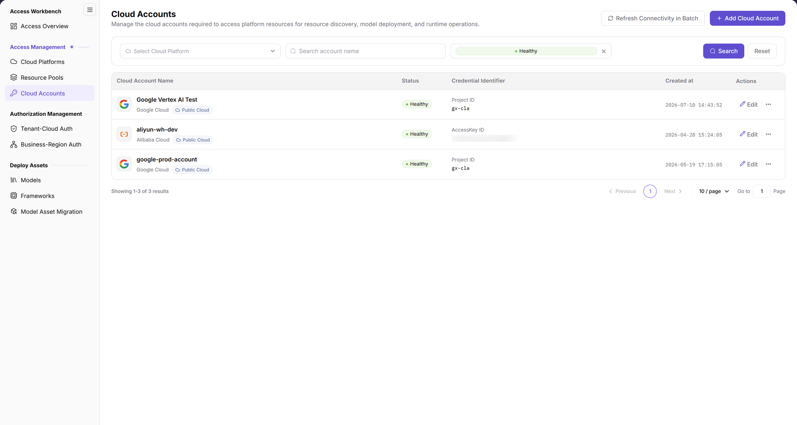
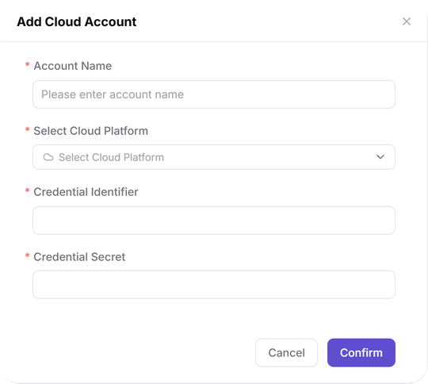

# Cloud Accounts

::: info Document Information
Version: v2.1
Updated: 2026-11-12
:::

## Feature Overview

| Item | Content |
| --- | --- |
| Applicable Roles | Operators |
| Navigation Path | AI Infra(On-Cloud) > Access Management > Cloud Accounts |
| Page Route | `/infrahub/op/access/account` |
| Managed Objects | Cloud accounts, credential identifiers, and connectivity states for accessing cloud resources |

#### Beginner Explanation

Cloud Accounts is like a register of keys to cloud resources: check the account, platform, credential identifier, and state in the table before entering the corresponding maintenance form.

#### Terms Quick Reference

| Term | Description |
| --- | --- |
| Cloud account | An account used to access cloud-platform resources. |
| Credential Identifier | The list column displaying credential type and identifier information, also a generic field name in the add form. |
| Credential Secret | The sensitive credential field in the add form. |
| Status | Account connectivity information in the table; a batch-refresh entry is available. |

## Prerequisites

1. The current account has access to the Operator Cloud Accounts page.
2. Before adding an account, confirm its platform, purpose, least privilege, and authorization scope.
3. Obtain credentials through a secure channel. Before adding, editing, or refreshing connectivity, confirm change impact and cost boundaries.

## Page Description

The current English menu entry and page heading both read **Cloud Accounts**.

| Area | Description |
| --- | --- |
| Filters | Cloud platform, account name, and status, with Search and Reset. |
| Account table | Cloud Account Name, Status, Credential Identifier, Created at, and Actions. Platform and type appear beneath the account name. |
| Page actions | Refresh Connectivity in Batch and Add Cloud Account. |
| Row actions | Edit and more actions (`...`). |
| Add form | Account Name, Select Cloud Platform, Credential Identifier, and Credential Secret. |

The figure shows the Cloud Accounts table with Healthy selected in the status filter and accounts within that scope. Platform and name filters are above the table; Refresh Connectivity in Batch and Add Cloud Account are at the top right, and Edit appears in each row.

## Main Operations

### View Cloud Accounts

1. Open Cloud Accounts under Access Management.
2. Select a platform, enter an account name, or select a status as needed, then click Search. Use Reset to reset query criteria.
3. Check the target row's account name, platform and type, status, credential identifier, and creation time.
4. To maintain an existing account, locate its row before using Edit. More actions is to the right of Edit; refer to the actual expanded menu.

### Add Cloud Account

1. Click Add Cloud Account to open the dialog of the same name.
2. Enter Account Name and specify the platform in Select Cloud Platform.
3. Enter credentials according to the actual selected-platform form. The blank form uses Credential Identifier and Credential Secret; do not assume all platforms use AK/SK.
4. Check the account name, platform, and credential purpose. Click Confirm when submission is intended. For inspection without submission, use Cancel to return to the list.

The figure shows the blank Add Cloud Account form. Account Name, Select Cloud Platform, Credential Identifier, and Credential Secret all have required markers; the bottom buttons are Cancel and Confirm.

### Locate Connectivity Refresh

1. Review the target account's currently displayed Status.
2. Refresh Connectivity in Batch at the top right is the refresh entry. Confirm business authorization and impact before using it.
3. Do not interpret an existing Healthy label as a newly executed connectivity test or describe an existing state as the result of a refresh you have not performed.

## Parameter Quick Reference

| Field Name | Required | Field Type | Example | Description |
| --- | --- | --- | --- | --- |
| Cloud platform | No | Dropdown filter | `Select Cloud Platform` | Filters by the account's platform. |
| Name | No | Input | `demo-cloud-account` | Fuzzy search by account name. |
| Status | No | Dropdown filter | `Healthy` | Corresponds to the table's Status column; Healthy is selected in the figure. |
| Cloud Account Name | — | Table field | `demo-cloud-account` | Platform and type appear beneath the name. |
| Status | — | Status label | `Healthy` / `Action required` | Examples in observed records; the figure shows only the Healthy filter, not every possible status or a new test result. |
| Credential Identifier | — | Table field | `AccessKey ID` / `Project ID` | Displays a record's credential type and identifier; not every type is AK/SK. |
| Created at | — | Time field | `YYYY-MM-DD HH:mm:ss` | Account creation time, not update time. |
| Account Name | Yes | Input | `demo-cloud-account` | Display name in the add form. |
| Select Cloud Platform | Yes | Dropdown | Select an actual option | Selects the account's platform. |
| Credential Identifier | Yes | Input | Sample credential identifier | Generic blank-form field; follow the selected platform's actual requirements. |
| Credential Secret | Yes | Input | Sample credential secret | Sensitive credential field; do not enter real values in documentation. |
| Refresh Connectivity in Batch | No | Action entry | `Refresh Connectivity in Batch` | Top-level entry; check impact before using it. |
| Edit | No | Row action | `Edit` | Maintenance entry for an existing account. |
| Search / Reset | No | Buttons | `Search` / `Reset` | Query and query-reset entries. |
| Cancel / Confirm | No | Form buttons | `Cancel` / `Confirm` | Exit and submit entries in the add form. |

## Pitfalls

- Cloud Accounts is the current menu and page name; Add Cloud Account opens the account form, not platform configuration.
- Credential Identifier can display different credential types. The blank form uses generic fields; do not describe every platform as requiring Access Key ID and Access Key Secret.
- Created at is not update time. Healthy and Action required are examples observed in account records; the figure has Healthy selected.

## Result Validation

| Check Item | Success Signal | If Abnormal |
| --- | --- | --- |
| Page location | Cloud Accounts is highlighted and the heading reads Cloud Accounts | Locate the page using its menu name and route. |
| Table information | Cloud Account Name, Status, Credential Identifier, Created at, and Actions can be reviewed | Check filters and the target name; do not search for fields using old card positions. |
| Add form | Add Cloud Account shows four required fields, Cancel, and Confirm | Confirm this is the account add form before entering credentials for any object. |
| Exit blank form | Cancel returns to the table | Check whether the dialog closed; exiting is not saving an account. |

## FAQ

#### Should I Enter an Access Key ID or a Credential Identifier?

**Symptom:**

The list shows credential types such as AccessKey ID and Project ID, while the blank add form shows Credential Identifier and Credential Secret.

**Possible Causes:**

The list displays a specific account's credential type, whereas the blank form uses generic field names.

**Resolution:**

Select the platform first, then follow the fields actually displayed. Do not treat one sample credential type as a fixed format for every platform.

#### Does Healthy Mean Connectivity Was Just Refreshed?

**Symptom:**

The list already contains a Healthy label, alongside the Refresh Connectivity in Batch entry.

**Possible Causes:**

The status label and refresh entry are separate interface elements. The label itself does not say whether a refresh was performed in the current session.

**Resolution:**

Distinguish displayed status from execution records. Viewing the list alone is not completing a connectivity test.

## Notes

- Use credentials only for authorized operations through secure channels. Do not record real credentials in documentation, tickets, screenshots, or chat.
- Before adding, editing, or batch refreshing, confirm least privilege, authorization scope, cost boundaries, and change impact, and keep necessary audit records.
- Do not assume a particular credential-masking method or use screenshots or repeated form inspection to expose real secrets.

## Next Steps

1. Go to [Resource Pools](../resource-pools/) to review pool types and states under the platform.
2. Go to [Tenant-Cloud Auth](../../auth-management/tenant-cloud-auth/) or [Business-Region Auth](../../auth-management/business-region-auth/) to review visibility scope.
3. Go to [Access Overview](../../access-workbench/access-overview/) to review the account, pool, and authorization chain. Adding an account is not completing a deployment.
