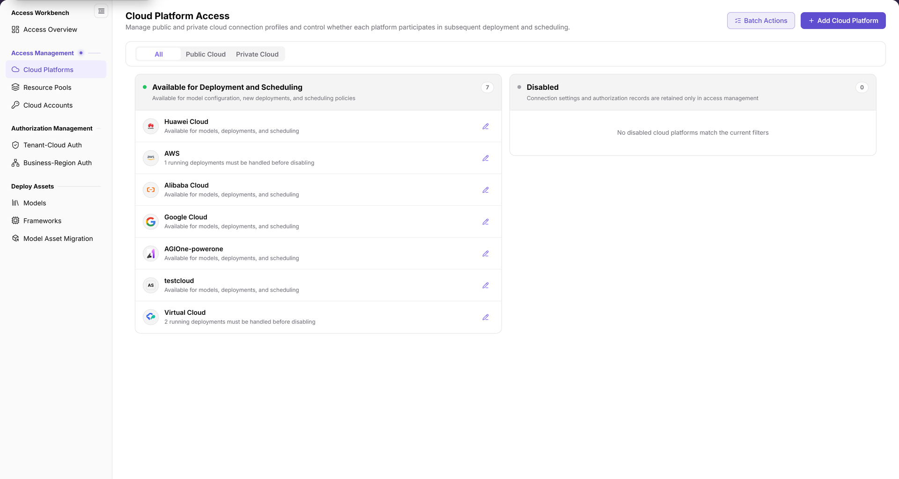
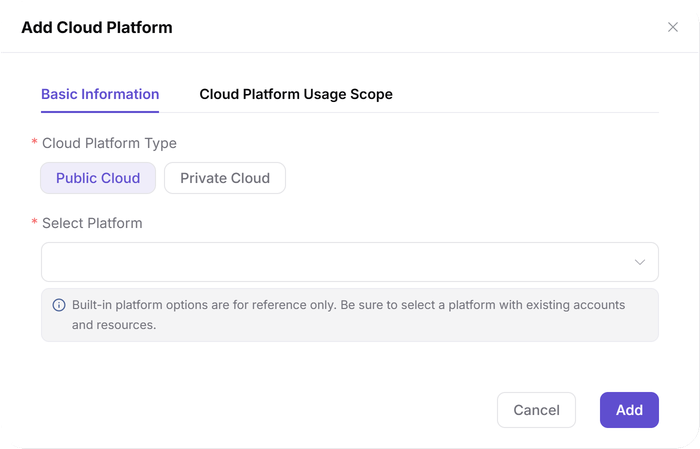
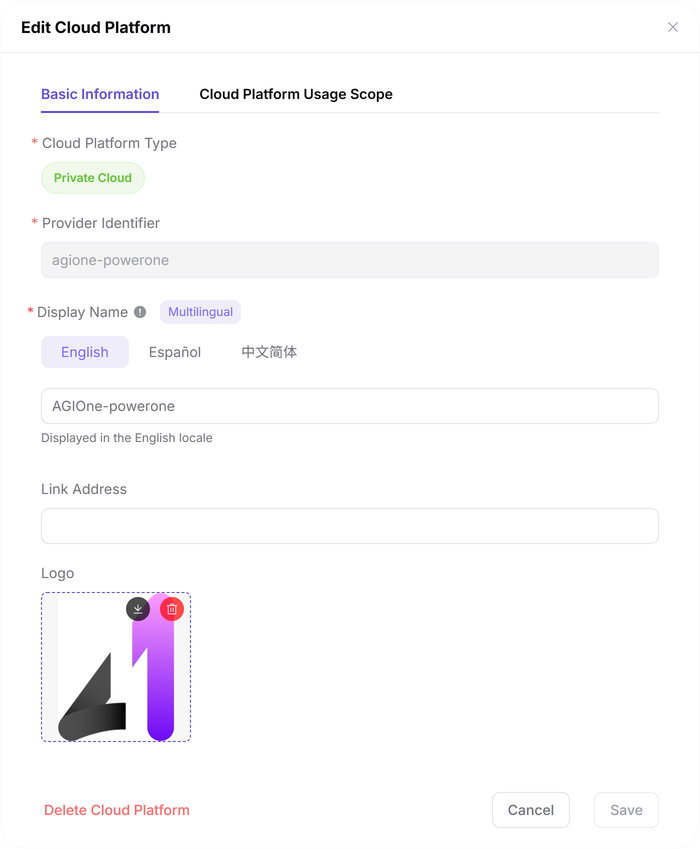

# Cloud Platforms

::: info Document Information
Version: v2.1
Updated: 2026-11-12
:::

## Feature Overview

| Item | Content |
| --- | --- |
| Applicable Roles | Operators |
| Navigation Path | AI Infra(On-Cloud) > Access Management > Cloud Platforms |
| Page Route | `/infrahub/op/access/platform` |
| Managed Objects | Public and private cloud connection profiles, usage states, and display settings |

#### Beginner Explanation

Cloud Platforms is like a provider directory: register platforms and distinguish those available for deployment and scheduling from those that are disabled.

#### Terms Quick Reference

| Term | Description |
| --- | --- |
| Public Cloud | A cloud platform provided by an external cloud provider. |
| Private Cloud | A cloud platform maintained by an organization. |
| Provider Identifier | An identifier in private-cloud display settings. |
| Cloud Platform Usage Scope | A tab in Add Cloud Platform, separate from Basic Information. |

## Prerequisites

1. The current account has access to Cloud Platforms.
2. Confirm the platform type, ownership, and purpose, then review existing records to avoid duplicates.
3. Before changing a platform or its usage state, check the impact on accounts, resource pools, authorization, and existing deployments.

## Page Description

The menu entry is **Cloud Platforms**, while the page heading is **Cloud Platform Access**. They refer to the same page.

| Area | Description |
| --- | --- |
| Type filter | All, Public Cloud, and Private Cloud. |
| Available for Deployment and Scheduling | Available platforms and their individual usage messages. |
| Disabled | Disabled-platform area; its description states that connection settings and authorization records are retained only in access management. |
| Page actions | Batch Actions and Add Cloud Platform. |
| Add dialog | Basic Information and Cloud Platform Usage Scope tabs; Basic Information contains Cloud Platform Type and Select Platform. |

The figure shows Cloud Platform Access, with Available for Deployment and Scheduling and Disabled as separate usage-state areas. Batch Actions and Add Cloud Platform are at the top right; platform-row messages identify deployment impact.

## Main Operations

### View Cloud Platforms

1. Open Cloud Platforms under Access Management.
2. Select All, Public Cloud, or Private Cloud as needed.
3. Locate the target platform in the two usage-state areas and read its row message rather than comparing counts alone.
4. For maintenance, verify the target record before using its edit entry. Batch Actions is at the top right.

### Add Cloud Platform

1. Click Add Cloud Platform to open the dialog of the same name.
2. In Basic Information, review Cloud Platform Type; Public Cloud and Private Cloud are available options.
3. Follow the actual type-specific form and use Select Platform to specify the target. The interface says built-in options are for reference and advises selecting a platform with existing accounts and resources.
4. The dialog also has a Cloud Platform Usage Scope tab. Review its actual configuration before submission; it is not a field within Basic Information.
5. Use Add at the bottom when submission is intended. To inspect without submitting, click Cancel.

The figure shows Basic Information in Add Cloud Platform, with required markers for Cloud Platform Type and Select Platform, plus the separate Cloud Platform Usage Scope tab. The bottom buttons are Cancel and Add, not Confirm.

### Maintain Private-Cloud Display Settings

1. Locate the target private cloud and enter its edit configuration.
2. Check Provider Identifier and review multilingual Display Name, Link Address, and Logo within the approved change scope.
3. Confirm the target and impact before submission. After maintenance, return to the platform list and check the display name; closing a dialog alone does not establish that a change was saved.

The figure shows Provider Identifier, Display Name, language selection, Link Address, and Logo in private-cloud edit configuration. These are platform display settings, not cloud-account credential fields.

## Parameter Quick Reference

| Field Name | Required | Field Type | Example | Description |
| --- | --- | --- | --- | --- |
| Platform type filter | No | Segmented control | `All` | Selects all, public, or private cloud platforms. |
| Available for Deployment and Scheduling | — | Usage-state area | `Available for Deployment and Scheduling` | Available-platform area on the page. |
| Disabled | — | Usage-state area | `Disabled` | Disabled-platform area on the page. |
| Cloud Platform Type | Yes | Segmented control | `Public Cloud` | Platform type under Basic Information in the add dialog. |
| Select Platform | Yes | Dropdown | Select an actual option | Selects a specific cloud platform. |
| Cloud Platform Usage Scope | No | Tab | `Cloud Platform Usage Scope` | Separate configuration tab; follow its actual displayed content. |
| Provider Identifier | Yes | Display-setting field | Sample platform identifier | Identifier in private-cloud edit configuration. |
| Display Name | Yes | Multilingual text | Sample platform name | Language-specific platform display name. |
| Link Address / Logo | No | Display settings | Follow the form | Platform link and icon. |
| Batch Actions | No | Action entry | `Batch Actions` | Top-level entry; check targets and impact first. |
| Add / Cancel | No | Buttons | `Add` / `Cancel` | Submit and exit entries in the add dialog. |

## Pitfalls

- Public Cloud and Private Cloud are type filters; Available for Deployment and Scheduling and Disabled are usage-state areas, not the same classification.
- The add dialog uses Add. Private-cloud edit configuration is a different form; do not mix its fields or button names with the add dialog.
- Platform rows can show running-deployment messages. Read them before changing usage state rather than relying on platform totals.

## Result Validation

| Check Item | Success Signal | If Abnormal |
| --- | --- | --- |
| Page location | Cloud Platforms is highlighted and the heading reads Cloud Platform Access | Locate the page using its menu name and route. |
| Platform scope | Type filters, two usage-state areas, and target-row messages can be reviewed | Check the current type filter and target platform name first. |
| Add form | Basic Information and Cloud Platform Usage Scope are visible, with Cancel and Add at the bottom | Confirm this is the add dialog rather than edit configuration. |
| Exit blank form | Cancel returns to the platform page | Check whether the dialog closed; exiting is not adding a platform. |

## FAQ

#### Are Public Cloud and Disabled the Same Kind of Filter?

**Symptom:**

Both Public Cloud and Disabled appear on the page.

**Possible Causes:**

The interface uses these names for a type filter and a usage-state area respectively.

**Resolution:**

Select the platform type, then check the target platform and its row message in the two usage-state areas.

#### Should I Click Confirm or Add to Add a Platform?

**Symptom:**

The add dialog shows Add at the bottom, while edit configuration is a different form.

**Possible Causes:**

The current Add Cloud Platform dialog uses Cancel and Add.

**Resolution:**

Follow the actual dialog buttons. Use Cancel for inspection only; review the platform and usage scope before using Add for submission.

## Notes

- Check deployment impact before batch actions or platform usage-state changes, and keep necessary audit records.
- Private-cloud display settings do not replace account-access or authorization configuration; maintain each object on its corresponding page.
- Do not record real credentials, internal addresses, or customer data in documentation, tickets, or chat.

## Next Steps

1. Go to [Cloud Accounts](../cloud-accounts/) for account and credential configuration entries.
2. Go to [Resource Pools](../resource-pools/) to review pool types and states under the platform.
3. Go to [Tenant-Cloud Auth](../../auth-management/tenant-cloud-auth/) or [Business-Region Auth](../../auth-management/business-region-auth/) to review usage scope.
